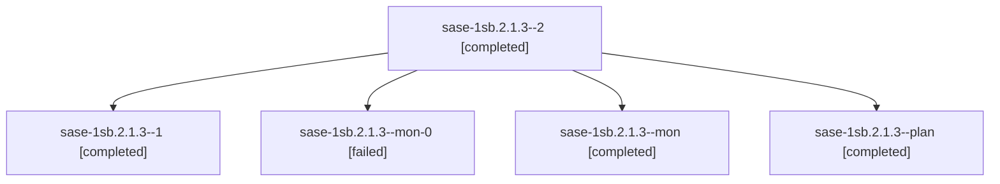

# Session: sase-1sb.2.1.3

[Agent Hoods](../README.md) / [bbugyi200](../users/bbugyi200/README.md) / [athena](../users/bbugyi200/machines/athena/README.md) / [sase-1sb](../users/bbugyi200/machines/athena/hoods/sase-1sb/README.md) / sase-1sb.2.1.3

Owner: `bbugyi200.athena` · Hood: `sase-1sb` · Members: 5 · Bead: [sase-1sb.2.1.3](https://github.com/sase-org/sase--beads/blob/main/pages/sase-1sb/sase-1sb.2.1.3.md)

## Lineage

The diagram is an optional enhancement; the ordered table below contains the same lineage in accessible text.

| Role | Agent | State | Model / provider | Timing | Commits | Prompt | Chat |
|---|---|---|---|---|---:|---|---|
| 2 | sase-1sb.2.1.3--2 | completed | muse-spark-1.3-contributor / muse | 2026-11-12T09:19:03.787355+00:00 → 2026-11-12T09:22:49.627842+00:00 | [1](../agents/bbugyi200.athena.sase-1sb.2.1.3--2/README.md#commits) | [Prompt](../agents/bbugyi200.athena.sase-1sb.2.1.3--2/prompt.md) | [Chat](../agents/bbugyi200.athena.sase-1sb.2.1.3--2/chat.md) |
| 1 | sase-1sb.2.1.3--1 | completed | muse-spark-1.3-contributor / muse | 2026-11-12T08:49:23.783788+00:00 → 2026-11-12T09:07:40.990589+00:00 | 0 | [Prompt](../agents/bbugyi200.athena.sase-1sb.2.1.3--1/prompt.md) | [Chat](../agents/bbugyi200.athena.sase-1sb.2.1.3--1/chat.md) |
| mon-0 | sase-1sb.2.1.3--mon-0 | failed | muse-spark-1.3-contributor / muse | 2026-11-12T09:05:41.384757+00:00 → 2026-11-12T09:17:12.702337+00:00 | 0 | — | [Chat](../agents/bbugyi200.athena.sase-1sb.2.1.3--mon-0/chat.md) |
| mon | sase-1sb.2.1.3--mon | completed | muse-spark-1.3-contributor / muse | 2026-11-12T08:01:41.181734+00:00 → 2026-11-12T08:47:46.064373+00:00 | 0 | — | [Chat](../agents/bbugyi200.athena.sase-1sb.2.1.3--mon/chat.md) |
| plan | sase-1sb.2.1.3--plan | completed | muse-spark-1.3-contributor / muse | 2026-11-12T06:32:50.310221+00:00 → 2026-11-12T08:26:51.332402+00:00 | 0 | [Prompt](../agents/bbugyi200.athena.sase-1sb.2.1.3--plan/prompt.md) | [Chat](../agents/bbugyi200.athena.sase-1sb.2.1.3--plan/chat.md) |

## Commits

| Role | Repo | Commit | Subject | Committed |
|---|---|---|---|---|
| 2 | sase | [`021cd73`](https://github.com/sase-org/sase/commit/021cd73021b62e9f92ccd6829c9ded59c80ed7cd) | feat(config): enforce trust for merged config and file hooks | 2026-11-12 04:21:44 EST |

## Neighbors

| Agent | Relation | State |
|---|---|---|
| [sase-1sb.2](bbugyi200.athena.sase-1sb.2.md) (session · 3) | ancestor | active 1, completed 2 |
| [sase-1sb.2.1.1](bbugyi200.athena.sase-1sb.2.1.1.md) (session · 5) | sase-1sb.2.1 hood | completed 4, failed 1 |
| [sase-1sb.2.1.2](../agents/bbugyi200.athena.sase-1sb.2.1.2/README.md) | sase-1sb.2.1 hood | completed |
| [sase-1sb.2.1.4](../agents/bbugyi200.athena.sase-1sb.2.1.4/README.md) | sase-1sb.2.1 hood | waiting |
| [sase-1sb.2.1.land](../agents/bbugyi200.athena.sase-1sb.2.1.land/README.md) | sase-1sb.2.1 hood | waiting |
| [sase-1sb.1](../agents/bbugyi200.athena.sase-1sb.1/README.md) | sase-1sb hood | completed |
| [sase-1sb.3](../agents/bbugyi200.athena.sase-1sb.3/README.md) | sase-1sb hood | completed |
| [sase-1sb.4](bbugyi200.athena.sase-1sb.4.md) (session · 3) | sase-1sb hood | completed 2, failed 1 |
| [sase-1sb.5](../agents/bbugyi200.athena.sase-1sb.5/README.md) | sase-1sb hood | completed |
| [sase-1sb.6](../agents/bbugyi200.athena.sase-1sb.6/README.md) | sase-1sb hood | completed |
| [sase-1sb.7](bbugyi200.athena.sase-1sb.7.md) (session · 3) | sase-1sb hood | completed 3 |
| [sase-1sb.land](../agents/bbugyi200.athena.sase-1sb.land/README.md) | sase-1sb hood | waiting |
