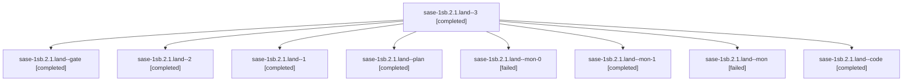

# Session: sase-1sb.2.1.land

[Agent Hoods](../README.md) / [bbugyi200](../users/bbugyi200/README.md) / [athena](../users/bbugyi200/machines/athena/README.md) / [sase-1sb](../users/bbugyi200/machines/athena/hoods/sase-1sb/README.md) / sase-1sb.2.1.land

Owner: `bbugyi200.athena` · Hood: `sase-1sb` · Members: 9 · Bead: [sase-1sb.2.1](https://github.com/sase-org/sase--beads/blob/main/pages/sase-1sb/sase-1sb.2.1.md)

## Lineage



The diagram is an optional enhancement; the ordered table below contains the same lineage in accessible text.

| Role | Agent | State | Model / provider | Timing | Commits | Prompt | Chat |
|---|---|---|---|---|---:|---|---|
| <a id="member-3"></a>3 | sase-1sb.2.1.land--3 | completed | gpt-6-luna / codex | 2026-11-12T14:36:14.586735+00:00 → 2026-11-12T16:08:32.012807+00:00 | [1](../agents/bbugyi200.athena.sase-1sb.2.1.land--3/README.md#commits) | [Prompt](../agents/bbugyi200.athena.sase-1sb.2.1.land--3/prompt.md) | [Chat](../agents/bbugyi200.athena.sase-1sb.2.1.land--3/chat.md) |
| <a id="member-gate"></a>gate | sase-1sb.2.1.land--gate | completed | gpt-6-astra / codex | 2026-11-12T10:32:30.939549+00:00 → 2026-11-12T10:33:32.629604+00:00 | 0 | — | [Chat](../agents/bbugyi200.athena.sase-1sb.2.1.land--gate/chat.md) |
| <a id="member-2"></a>2 | sase-1sb.2.1.land--2 | completed | gpt-6-luna / codex | 2026-11-12T13:51:11.328030+00:00 → 2026-11-12T13:58:37.169375+00:00 | 0 | [Prompt](../agents/bbugyi200.athena.sase-1sb.2.1.land--2/prompt.md) | [Chat](../agents/bbugyi200.athena.sase-1sb.2.1.land--2/chat.md) |
| <a id="member-1"></a>1 | sase-1sb.2.1.land--1 | completed | gpt-6-luna / codex | 2026-11-12T12:41:33.767281+00:00 → 2026-11-12T12:57:03.373882+00:00 | 0 | [Prompt](../agents/bbugyi200.athena.sase-1sb.2.1.land--1/prompt.md) | [Chat](../agents/bbugyi200.athena.sase-1sb.2.1.land--1/chat.md) |
| <a id="member-plan"></a>plan | sase-1sb.2.1.land--plan | completed | gpt-6-astra / codex | 2026-11-12T10:16:58.981858+00:00 → 2026-11-12T11:53:07.051447+00:00 | 0 | [Prompt](../agents/bbugyi200.athena.sase-1sb.2.1.land--plan/prompt.md) | [Chat](../agents/bbugyi200.athena.sase-1sb.2.1.land--plan/chat.md) |
| <a id="member-mon-0"></a>mon-0 | sase-1sb.2.1.land--mon-0 | failed | gpt-6-luna / codex | 2026-11-12T12:55:43.274937+00:00 → 2026-11-12T13:51:03.085506+00:00 | 0 | — | [Chat](../agents/bbugyi200.athena.sase-1sb.2.1.land--mon-0/chat.md) |
| <a id="member-mon-1"></a>mon-1 | sase-1sb.2.1.land--mon-1 | completed | gpt-6-luna / codex | 2026-11-12T13:57:26.744557+00:00 → 2026-11-12T14:36:09.296804+00:00 | 0 | — | [Chat](../agents/bbugyi200.athena.sase-1sb.2.1.land--mon-1/chat.md) |
| <a id="member-mon"></a>mon | sase-1sb.2.1.land--mon | failed | gpt-6-luna / codex | 2026-11-12T11:51:47.445224+00:00 → 2026-11-12T12:39:55.461107+00:00 | 0 | — | [Chat](../agents/bbugyi200.athena.sase-1sb.2.1.land--mon/chat.md) |
| <a id="member-code"></a>code | sase-1sb.2.1.land--code | completed | gpt-6-luna / codex | 2026-11-12T10:34:31.500426+00:00 → 2026-11-12T11:53:07.051447+00:00 | 0 | — | [Chat](../agents/bbugyi200.athena.sase-1sb.2.1.land--code/chat.md) |

## Commits

| Role | Repo | Commit | Subject | Committed |
|---|---|---|---|---|
| 3 | sase | [`681de35`](https://github.com/sase-org/sase/commit/681de3542bdd024f8aa3ccfe247a9f1aa4b42ef2) | fix(config): enforce local command trust provenance | 2026-11-12 11:06:29 EST |

## Variables

| Role | Variable | Value |
|---|---|---|
| plan | `artifacts` | \[{bead: sase-1sb.2.1, kind: file, label: sase-1sb.2.1 landing trust gaps and edit-lock race reproductions, path: /home/bryan/.sase/artifacts/agents/gh\_sase-org\_\_sase/20261111203826/landing-evidence-0… |

#### artifacts

**Role:** `plan`

```yaml
- bead: sase-1sb.2.1
  kind: file
  label: sase-1sb.2.1 landing trust gaps and edit-lock race reproductions
  path: /home/bryan/.sase/artifacts/agents/gh_sase-org__sase/20261111203826/landing-evidence-07a343a9cf06.txt
  ref: file:explicit:f7ff68994727a64108f4cdd2
  source_path: /home/bryan/.local/state/sase/workspaces/sase-org/sase/sase_10/.pytest_cache/land-trust/landing-evidence.txt
```

Values are truncated for display; see each member's agent meta.json for the full values.

## Neighbors

| Agent | Relation | State |
|---|---|---|
| [sase-1sb.2](bbugyi200.athena.sase-1sb.2.md) (session · 3) | ancestor | active 1, completed 2 |
| [sase-1sb.2.1.1](bbugyi200.athena.sase-1sb.2.1.1.md) (session · 5) | sase-1sb.2.1 hood | completed 4, failed 1 |
| [sase-1sb.2.1.2](../agents/bbugyi200.athena.sase-1sb.2.1.2/README.md) | sase-1sb.2.1 hood | completed |
| [sase-1sb.2.1.3](bbugyi200.athena.sase-1sb.2.1.3.md) (session · 5) | sase-1sb.2.1 hood | completed 4, failed 1 |
| [sase-1sb.2.1.4](../agents/bbugyi200.athena.sase-1sb.2.1.4/README.md) | sase-1sb.2.1 hood | completed |
| [sase-1sb.1](../agents/bbugyi200.athena.sase-1sb.1/README.md) | sase-1sb hood | completed |
| [sase-1sb.3](../agents/bbugyi200.athena.sase-1sb.3/README.md) | sase-1sb hood | completed |
| [sase-1sb.4](bbugyi200.athena.sase-1sb.4.md) (session · 3) | sase-1sb hood | completed 2, failed 1 |
| [sase-1sb.5](../agents/bbugyi200.athena.sase-1sb.5/README.md) | sase-1sb hood | completed |
| [sase-1sb.6](../agents/bbugyi200.athena.sase-1sb.6/README.md) | sase-1sb hood | completed |
| [sase-1sb.7](bbugyi200.athena.sase-1sb.7.md) (session · 3) | sase-1sb hood | completed 3 |
| [sase-1sb.land](bbugyi200.athena.sase-1sb.land.md) (session · 3) | sase-1sb hood | active 2, completed 1 |
