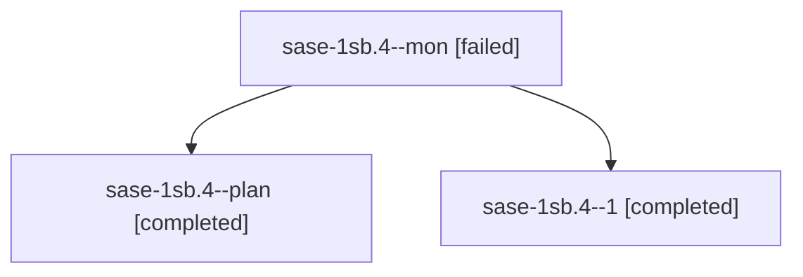

# Session: sase-1sb.4

[Agent Hoods](../README.md) / [bbugyi200](../users/bbugyi200/README.md) / [athena](../users/bbugyi200/machines/athena/README.md) / [sase-1sb](../users/bbugyi200/machines/athena/hoods/sase-1sb/README.md) / sase-1sb.4

Owner: `bbugyi200.athena` · Hood: `sase-1sb` · Members: 3 · Bead: [sase-1sb.4](https://github.com/sase-org/sase--beads/blob/main/pages/sase-1sb/sase-1sb.4.md)

## Lineage

The diagram is an optional enhancement; the ordered table below contains the same lineage in accessible text.

| Role | Agent | State | Model / provider | Timing | Commits | Prompt | Chat |
|---|---|---|---|---|---:|---|---|
| mon | sase-1sb.4--mon | failed | muse-spark-1.3-contributor / muse | 2026-11-12T02:07:45.052122+00:00 → 2026-11-12T02:23:45.274408+00:00 | 0 | — | [Chat](../agents/bbugyi200.athena.sase-1sb.4--mon/chat.md) |
| plan | sase-1sb.4--plan | completed | muse-spark-1.3-contributor / muse | 2026-11-12T00:59:36.460238+00:00 → 2026-11-12T02:09:48.006652+00:00 | 0 | [Prompt](../agents/bbugyi200.athena.sase-1sb.4--plan/prompt.md) | [Chat](../agents/bbugyi200.athena.sase-1sb.4--plan/chat.md) |
| 1 | sase-1sb.4--1 | completed | muse-spark-1.3-contributor / muse | 2026-11-12T02:26:08.342741+00:00 → 2026-11-12T02:34:49.963527+00:00 | [1](../agents/bbugyi200.athena.sase-1sb.4--1/README.md#commits) | [Prompt](../agents/bbugyi200.athena.sase-1sb.4--1/prompt.md) | [Chat](../agents/bbugyi200.athena.sase-1sb.4--1/chat.md) |

## Commits

| Role | Repo | Commit | Subject | Committed |
|---|---|---|---|---|
| 1 | sase | [`22e1ef1`](https://github.com/sase-org/sase/commit/22e1ef1249059503a29749c548564dbf01da0825) | fix(sase-1sb.4): repair shell-arg-hardening regressions found by check | 2026-11-11 21:33:39 EST |

## Neighbors

| Agent | Relation | State |
|---|---|---|
| [sase-1sb.1](../agents/bbugyi200.athena.sase-1sb.1/README.md) | sase-1sb hood | active |
| [sase-1sb.2](bbugyi200.athena.sase-1sb.2.md) (session · 3) | sase-1sb hood | active 1, completed 2 |
| [sase-1sb.2.1.1](../agents/bbugyi200.athena.sase-1sb.2.1.1/README.md) | sase-1sb hood | waiting |
| [sase-1sb.2.1.2](../agents/bbugyi200.athena.sase-1sb.2.1.2/README.md) | sase-1sb hood | waiting |
| [sase-1sb.2.1.3](../agents/bbugyi200.athena.sase-1sb.2.1.3/README.md) | sase-1sb hood | waiting |
| [sase-1sb.2.1.4](../agents/bbugyi200.athena.sase-1sb.2.1.4/README.md) | sase-1sb hood | waiting |
| [sase-1sb.2.1.land](../agents/bbugyi200.athena.sase-1sb.2.1.land/README.md) | sase-1sb hood | waiting |
| [sase-1sb.3](../agents/bbugyi200.athena.sase-1sb.3/README.md) | sase-1sb hood | active |
| [sase-1sb.5](../agents/bbugyi200.athena.sase-1sb.5/README.md) | sase-1sb hood | completed |
| [sase-1sb.6](../agents/bbugyi200.athena.sase-1sb.6/README.md) | sase-1sb hood | completed |
| [sase-1sb.7](bbugyi200.athena.sase-1sb.7.md) (session · 3) | sase-1sb hood | completed 3 |
| [sase-1sb.land](../agents/bbugyi200.athena.sase-1sb.land/README.md) | sase-1sb hood | waiting |
