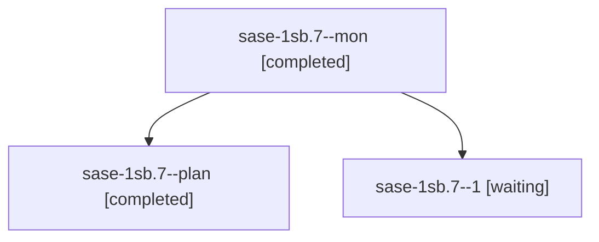

# Session: sase-1sb.7

[Agent Hoods](../README.md) / [bbugyi200](../users/bbugyi200/README.md) / [athena](../users/bbugyi200/machines/athena/README.md) / [sase-1sb](../users/bbugyi200/machines/athena/hoods/sase-1sb/README.md) / sase-1sb.7

Owner: `bbugyi200.athena` · Hood: `sase-1sb` · Members: 3 · Bead: [sase-1sb.7](https://github.com/sase-org/sase--beads/blob/main/pages/sase-1sb/sase-1sb.7.md)

## Lineage

The diagram is an optional enhancement; the ordered table below contains the same lineage in accessible text.

| Role | Agent | State | Model / provider | Timing | Commits | Prompt | Chat |
|---|---|---|---|---|---:|---|---|
| mon | sase-1sb.7--mon | completed | grok-4.6 / grok | 2026-11-12T01:01:30.447293+00:00 → 2026-11-12T01:30:23.267544+00:00 | 0 | — | [Chat](../agents/bbugyi200.athena.sase-1sb.7--mon/chat.md) |
| plan | sase-1sb.7--plan | completed | grok-4.6 / grok | 2026-11-12T00:54:23.684317+00:00 → 2026-11-12T01:03:25.521274+00:00 | 0 | [Prompt](../agents/bbugyi200.athena.sase-1sb.7--plan/prompt.md) | [Chat](../agents/bbugyi200.athena.sase-1sb.7--plan/chat.md) |
| 1 | sase-1sb.7--1 | waiting | grok-4.6 / grok | 20261111202922 | 0 | [Prompt](../agents/bbugyi200.athena.sase-1sb.7--1/prompt.md) | — |

## Neighbors

| Agent | Relation | State |
|---|---|---|
| [sase-1sb.1](../agents/bbugyi200.athena.sase-1sb.1/README.md) | sase-1sb hood | active |
| [sase-1sb.2](bbugyi200.athena.sase-1sb.2.md) (session · 3) | sase-1sb hood | active 1, completed 2 |
| [sase-1sb.2.1.1](../agents/bbugyi200.athena.sase-1sb.2.1.1/README.md) | sase-1sb hood | waiting |
| [sase-1sb.2.1.2](../agents/bbugyi200.athena.sase-1sb.2.1.2/README.md) | sase-1sb hood | waiting |
| [sase-1sb.2.1.3](../agents/bbugyi200.athena.sase-1sb.2.1.3/README.md) | sase-1sb hood | waiting |
| [sase-1sb.2.1.4](../agents/bbugyi200.athena.sase-1sb.2.1.4/README.md) | sase-1sb hood | waiting |
| [sase-1sb.2.1.land](../agents/bbugyi200.athena.sase-1sb.2.1.land/README.md) | sase-1sb hood | waiting |
| [sase-1sb.3](../agents/bbugyi200.athena.sase-1sb.3/README.md) | sase-1sb hood | active |
| [sase-1sb.4](../agents/bbugyi200.athena.sase-1sb.4/README.md) | sase-1sb hood | active |
| [sase-1sb.5](../agents/bbugyi200.athena.sase-1sb.5/README.md) | sase-1sb hood | completed |
| [sase-1sb.6](../agents/bbugyi200.athena.sase-1sb.6/README.md) | sase-1sb hood | completed |
| [sase-1sb.land](../agents/bbugyi200.athena.sase-1sb.land/README.md) | sase-1sb hood | waiting |
