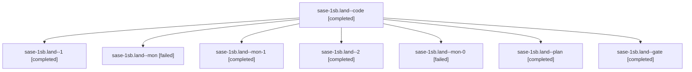

# Session: sase-1sb.land

[Agent Hoods](../README.md) / [bbugyi200](../users/bbugyi200/README.md) / [athena](../users/bbugyi200/machines/athena/README.md) / [sase-1sb](../users/bbugyi200/machines/athena/hoods/sase-1sb/README.md) / sase-1sb.land

Owner: `bbugyi200.athena` · Hood: `sase-1sb` · Members: 8 · Bead: [sase-1sb](https://github.com/sase-org/sase--beads/blob/main/pages/sase-1sb/README.md)

## Lineage

The diagram is an optional enhancement; the ordered table below contains the same lineage in accessible text.

| Role | Agent | State | Model / provider | Timing | Commits | Prompt | Chat |
|---|---|---|---|---|---:|---|---|
| code | sase-1sb.land--code | completed | muse-spark-1.3-contributor / muse | 2026-11-12T22:31:52.761498+00:00 → 2026-11-12T23:54:08.458990+00:00 | 0 | — | [Chat](../agents/bbugyi200.athena.sase-1sb.land--code/chat.md) |
| 1 | sase-1sb.land--1 | completed | muse-spark-1.3-contributor / muse | 2026-11-12T23:58:56.390193+00:00 → 2026-11-13T00:08:16.572799+00:00 | 0 | [Prompt](../agents/bbugyi200.athena.sase-1sb.land--1/prompt.md) | [Chat](../agents/bbugyi200.athena.sase-1sb.land--1/chat.md) |
| mon | sase-1sb.land--mon | failed | muse-spark-1.3-contributor / muse | 2026-11-12T23:37:21.338705+00:00 → 2026-11-12T23:37:26.441388+00:00 | 0 | — | — |
| mon-1 | sase-1sb.land--mon-1 | completed | muse-spark-1.3-contributor / muse | 2026-11-13T00:04:31.546456+00:00 → 2026-11-13T00:59:18.190556+00:00 | 0 | — | [Chat](../agents/bbugyi200.athena.sase-1sb.land--mon-1/chat.md) |
| 2 | sase-1sb.land--2 | completed | muse-spark-1.3-contributor / muse | 2026-11-13T01:02:04.399329+00:00 → 2026-11-13T01:34:04.720404+00:00 | [1](../agents/bbugyi200.athena.sase-1sb.land--2/README.md#commits) | [Prompt](../agents/bbugyi200.athena.sase-1sb.land--2/prompt.md) | [Chat](../agents/bbugyi200.athena.sase-1sb.land--2/chat.md) |
| mon-0 | sase-1sb.land--mon-0 | failed | muse-spark-1.3-contributor / muse | 2026-11-12T23:49:40.374925+00:00 → 2026-11-12T23:56:40.168784+00:00 | 0 | — | [Chat](../agents/bbugyi200.athena.sase-1sb.land--mon-0/chat.md) |
| plan | sase-1sb.land--plan | completed | opus / claude | 2026-11-12T21:59:25.149879+00:00 → 2026-11-12T23:54:08.458990+00:00 | 0 | [Prompt](../agents/bbugyi200.athena.sase-1sb.land--plan/prompt.md) | [Chat](../agents/bbugyi200.athena.sase-1sb.land--plan/chat.md) |
| gate | sase-1sb.land--gate | completed | opus / claude | 2026-11-12T22:29:37.372539+00:00 → 2026-11-12T22:30:44.765370+00:00 | 0 | — | [Chat](../agents/bbugyi200.athena.sase-1sb.land--gate/chat.md) |

## Commits

| Role | Repo | Commit | Subject | Committed |
|---|---|---|---|---|
| 2 | sase | [`4a4ee98`](https://github.com/sase-org/sase/commit/4a4ee98c651bbbb1e1c6e8417891de83dd827777) | fix(sase-1sb): atomic edit-lock publish and replace-all placeholder rendering with regression tests | 2026-11-12 20:31:39 EST |

## Neighbors

| Agent | Relation | State |
|---|---|---|
| [sase-1sb.1](../agents/bbugyi200.athena.sase-1sb.1/README.md) | sase-1sb hood | completed |
| [sase-1sb.2](bbugyi200.athena.sase-1sb.2.md) (session · 3) | sase-1sb hood | active 1, completed 2 |
| [sase-1sb.2.1.1](bbugyi200.athena.sase-1sb.2.1.1.md) (session · 5) | sase-1sb hood | completed 4, failed 1 |
| [sase-1sb.2.1.2](../agents/bbugyi200.athena.sase-1sb.2.1.2/README.md) | sase-1sb hood | completed |
| [sase-1sb.2.1.3](bbugyi200.athena.sase-1sb.2.1.3.md) (session · 5) | sase-1sb hood | completed 4, failed 1 |
| [sase-1sb.2.1.4](../agents/bbugyi200.athena.sase-1sb.2.1.4/README.md) | sase-1sb hood | completed |
| [sase-1sb.2.1.land](bbugyi200.athena.sase-1sb.2.1.land.md) (session · 9) | sase-1sb hood | completed 7, failed 2 |
| [sase-1sb.2.1.land](../agents/bbugyi200.athena.sase-1sb.2.1.land/README.md) | sase-1sb hood | completed |
| [sase-1sb.3](../agents/bbugyi200.athena.sase-1sb.3/README.md) | sase-1sb hood | completed |
| [sase-1sb.4](bbugyi200.athena.sase-1sb.4.md) (session · 3) | sase-1sb hood | completed 2, failed 1 |
| [sase-1sb.5](../agents/bbugyi200.athena.sase-1sb.5/README.md) | sase-1sb hood | completed |
| [sase-1sb.6](../agents/bbugyi200.athena.sase-1sb.6/README.md) | sase-1sb hood | completed |
| [sase-1sb.7](bbugyi200.athena.sase-1sb.7.md) (session · 3) | sase-1sb hood | completed 3 |
