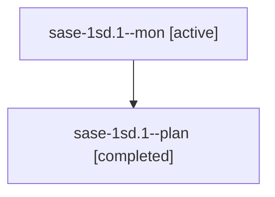

# Session: sase-1sd.1

[Agent Hoods](../README.md) / [bbugyi200](../users/bbugyi200/README.md) / [athena](../users/bbugyi200/machines/athena/README.md) / [sase-1sd](../users/bbugyi200/machines/athena/hoods/sase-1sd/README.md) / sase-1sd.1

Owner: `bbugyi200.athena` · Hood: `sase-1sd` · Members: 2 · Bead: [sase-1sd.1](https://github.com/sase-org/sase--beads/blob/main/pages/sase-1sd/sase-1sd.1.md)

## Lineage

The diagram is an optional enhancement; the ordered table below contains the same lineage in accessible text.

| Role | Agent | State | Model / provider | Timing | Commits | Prompt | Chat |
|---|---|---|---|---|---:|---|---|
| mon | sase-1sd.1--mon | active | muse-spark-1.3-contributor / muse | 2026-11-12T10:57:30.429284+00:00 | 0 | — | — |
| plan | sase-1sd.1--plan | completed | muse-spark-1.3-contributor / muse | 2026-11-12T10:32:14.143183+00:00 → 2026-11-12T11:03:33.094807+00:00 | [1](../agents/bbugyi200.athena.sase-1sd.1--plan/README.md#commits) | [Prompt](../agents/bbugyi200.athena.sase-1sd.1--plan/prompt.md) | [Chat](../agents/bbugyi200.athena.sase-1sd.1--plan/chat.md) |

## Commits

| Role | Repo | Commit | Subject | Committed |
|---|---|---|---|---|
| plan | sase | [`e072729`](https://github.com/sase-org/sase/commit/e07272959937e0a39e1b7c31254b252e657978be) | fix(repo): resolve -p project ref through registry display names and aliases | 2026-11-12 06:01:49 EST |

## Neighbors

| Agent | Relation | State |
|---|---|---|
| [sase-1sd.2](../agents/bbugyi200.athena.sase-1sd.2/README.md) | sase-1sd hood | waiting |
