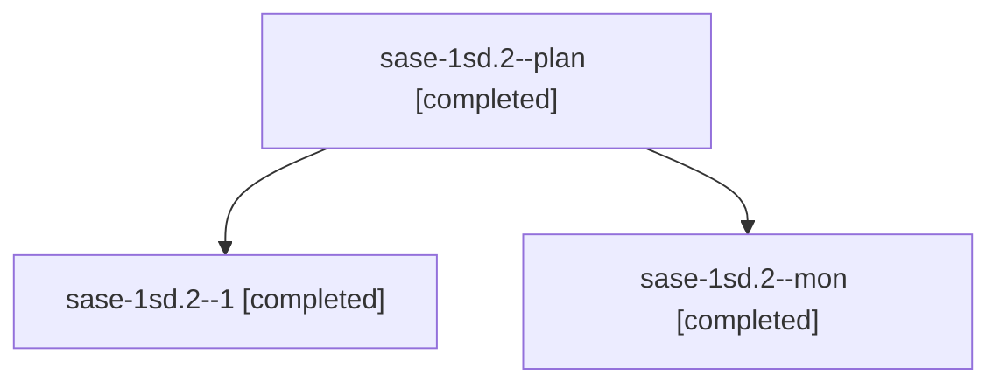

# Session: sase-1sd.2

[Agent Hoods](../README.md) / [bbugyi200](../users/bbugyi200/README.md) / [athena](../users/bbugyi200/machines/athena/README.md) / [sase-1sd](../users/bbugyi200/machines/athena/hoods/sase-1sd/README.md) / sase-1sd.2

Owner: `bbugyi200.athena` · Hood: `sase-1sd` · Members: 3 · Bead: [sase-1sd.2](https://github.com/sase-org/sase--beads/blob/main/pages/sase-1sd/sase-1sd.2.md)

## Lineage

The diagram is an optional enhancement; the ordered table below contains the same lineage in accessible text.

| Role | Agent | State | Model / provider | Timing | Commits | Prompt | Chat |
|---|---|---|---|---|---:|---|---|
| plan | sase-1sd.2--plan | completed | grok-4.6 / grok | 2026-11-12T11:25:37.087984+00:00 → 2026-11-12T11:38:07.033354+00:00 | 0 | [Prompt](../agents/bbugyi200.athena.sase-1sd.2--plan/prompt.md) | [Chat](../agents/bbugyi200.athena.sase-1sd.2--plan/chat.md) |
| 1 | sase-1sd.2--1 | completed | grok-4.6 / grok | 2026-11-12T11:54:42.549540+00:00 → 2026-11-12T12:00:48.569849+00:00 | [1](../agents/bbugyi200.athena.sase-1sd.2--1/README.md#commits) | [Prompt](../agents/bbugyi200.athena.sase-1sd.2--1/prompt.md) | [Chat](../agents/bbugyi200.athena.sase-1sd.2--1/chat.md) |
| mon | sase-1sd.2--mon | completed | grok-4.6 / grok | 2026-11-12T11:35:49.027334+00:00 → 2026-11-12T11:51:31.891375+00:00 | 0 | — | [Chat](../agents/bbugyi200.athena.sase-1sd.2--mon/chat.md) |

## Commits

| Role | Repo | Commit | Subject | Committed |
|---|---|---|---|---|
| 1 | sase | [`063c982`](https://github.com/sase-org/sase/commit/063c98293b69f23543c91d66709a2b28eaa310a1) | fix(axe): install SIGTERM handlers in runner main, not at import | 2026-11-12 06:59:06 EST |

## Neighbors

| Agent | Relation | State |
|---|---|---|
| [sase-1sd.1](bbugyi200.athena.sase-1sd.1.md) (session · 3) | sase-1sd hood | completed 2, failed 1 |
| [sase-1sd.3](../agents/bbugyi200.athena.sase-1sd.3/README.md) | sase-1sd hood | completed |
| [sase-1sd.4](bbugyi200.athena.sase-1sd.4.md) (session · 5) | sase-1sd hood | completed 5 |
| [sase-1sd.5](bbugyi200.athena.sase-1sd.5.md) (session · 17) | sase-1sd hood | completed 12, failed 5 |
| [sase-1sd.6](../agents/bbugyi200.athena.sase-1sd.6/README.md) | sase-1sd hood | waiting |
| [sase-1sd.7](../agents/bbugyi200.athena.sase-1sd.7/README.md) | sase-1sd hood | waiting |
| [sase-1sd.land](../agents/bbugyi200.athena.sase-1sd.land/README.md) | sase-1sd hood | waiting |
