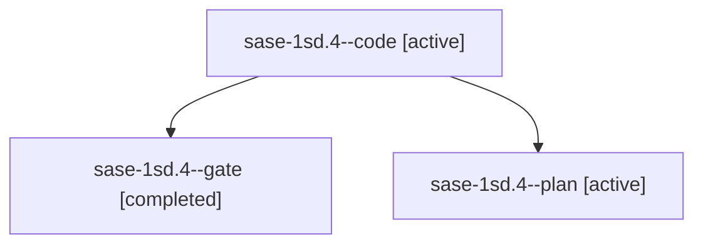

# Session: sase-1sd.4

[Agent Hoods](../README.md) / [bbugyi200](../users/bbugyi200/README.md) / [athena](../users/bbugyi200/machines/athena/README.md) / [sase-1sd](../users/bbugyi200/machines/athena/hoods/sase-1sd/README.md) / sase-1sd.4

Owner: `bbugyi200.athena` · Hood: `sase-1sd` · Members: 3 · Bead: [sase-1sd.4](https://github.com/sase-org/sase--beads/blob/main/pages/sase-1sd/sase-1sd.4.md)

## Lineage

The diagram is an optional enhancement; the ordered table below contains the same lineage in accessible text.

| Role | Agent | State | Model / provider | Timing | Commits | Prompt | Chat |
|---|---|---|---|---|---:|---|---|
| code | sase-1sd.4--code | active | gpt-6-luna / codex | 2026-11-12T14:54:49.750056+00:00 | 0 | — | — |
| gate | sase-1sd.4--gate | completed | gpt-6-astra / codex | 2026-11-12T14:52:57.633499+00:00 → 2026-11-12T14:53:51.241011+00:00 | 0 | — | [Chat](../agents/bbugyi200.athena.sase-1sd.4--gate/chat.md) |
| plan | sase-1sd.4--plan | active | gpt-6-astra / codex | 2026-11-12T14:42:31.628690+00:00 | 0 | [Prompt](../agents/bbugyi200.athena.sase-1sd.4--plan/prompt.md) | [Chat](../agents/bbugyi200.athena.sase-1sd.4--plan/chat.md) |

## Neighbors

| Agent | Relation | State |
|---|---|---|
| [sase-1sd.1](bbugyi200.athena.sase-1sd.1.md) (session · 3) | sase-1sd hood | completed 2, failed 1 |
| [sase-1sd.2](bbugyi200.athena.sase-1sd.2.md) (session · 3) | sase-1sd hood | completed 3 |
| [sase-1sd.3](../agents/bbugyi200.athena.sase-1sd.3/README.md) | sase-1sd hood | completed |
| [sase-1sd.5](../agents/bbugyi200.athena.sase-1sd.5/README.md) | sase-1sd hood | waiting |
| [sase-1sd.6](../agents/bbugyi200.athena.sase-1sd.6/README.md) | sase-1sd hood | waiting |
| [sase-1sd.7](../agents/bbugyi200.athena.sase-1sd.7/README.md) | sase-1sd hood | waiting |
| [sase-1sd.land](../agents/bbugyi200.athena.sase-1sd.land/README.md) | sase-1sd hood | waiting |
