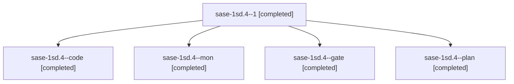

# Session: sase-1sd.4

[Agent Hoods](../README.md) / [bbugyi200](../users/bbugyi200/README.md) / [athena](../users/bbugyi200/machines/athena/README.md) / [sase-1sd](../users/bbugyi200/machines/athena/hoods/sase-1sd/README.md) / sase-1sd.4

Owner: `bbugyi200.athena` · Hood: `sase-1sd` · Members: 5 · Bead: [sase-1sd.4](https://github.com/sase-org/sase--beads/blob/main/pages/sase-1sd/sase-1sd.4.md)

## Lineage

The diagram is an optional enhancement; the ordered table below contains the same lineage in accessible text.

| Role | Agent | State | Model / provider | Timing | Commits | Prompt | Chat |
|---|---|---|---|---|---:|---|---|
| 1 | sase-1sd.4--1 | completed | gpt-6-luna / codex | 2026-11-12T15:49:52.101109+00:00 → 2026-11-12T17:12:53.379094+00:00 | [1](../agents/bbugyi200.athena.sase-1sd.4--1/README.md#commits) | [Prompt](../agents/bbugyi200.athena.sase-1sd.4--1/prompt.md) | [Chat](../agents/bbugyi200.athena.sase-1sd.4--1/chat.md) |
| code | sase-1sd.4--code | completed | gpt-6-luna / codex | 2026-11-12T14:54:49.750056+00:00 → 2026-11-12T15:24:03.747355+00:00 | 0 | — | [Chat](../agents/bbugyi200.athena.sase-1sd.4--code/chat.md) |
| mon | sase-1sd.4--mon | completed | gpt-6-luna / codex | 2026-11-12T15:22:45.378902+00:00 → 2026-11-12T15:49:35.230847+00:00 | 0 | — | [Chat](../agents/bbugyi200.athena.sase-1sd.4--mon/chat.md) |
| gate | sase-1sd.4--gate | completed | gpt-6-astra / codex | 2026-11-12T14:52:57.633499+00:00 → 2026-11-12T14:53:51.241011+00:00 | 0 | — | [Chat](../agents/bbugyi200.athena.sase-1sd.4--gate/chat.md) |
| plan | sase-1sd.4--plan | completed | gpt-6-astra / codex | 2026-11-12T14:42:31.628690+00:00 → 2026-11-12T15:24:03.747355+00:00 | 0 | [Prompt](../agents/bbugyi200.athena.sase-1sd.4--plan/prompt.md) | [Chat](../agents/bbugyi200.athena.sase-1sd.4--plan/chat.md) |

## Commits

| Role | Repo | Commit | Subject | Committed |
|---|---|---|---|---|
| 1 | sase | [`1087ccd`](https://github.com/sase-org/sase/commit/1087ccd7f15f09f9cd2267a4cef598a1219432ca) | fix(continuation): preserve local request provenance | 2026-11-12 12:11:33 EST |

## Neighbors

| Agent | Relation | State |
|---|---|---|
| [sase-1sd.1](bbugyi200.athena.sase-1sd.1.md) (session · 3) | sase-1sd hood | completed 2, failed 1 |
| [sase-1sd.2](bbugyi200.athena.sase-1sd.2.md) (session · 3) | sase-1sd hood | completed 3 |
| [sase-1sd.3](../agents/bbugyi200.athena.sase-1sd.3/README.md) | sase-1sd hood | completed |
| [sase-1sd.5](bbugyi200.athena.sase-1sd.5.md) (session · 17) | sase-1sd hood | completed 12, failed 5 |
| [sase-1sd.6](../agents/bbugyi200.athena.sase-1sd.6/README.md) | sase-1sd hood | completed |
| [sase-1sd.7](../agents/bbugyi200.athena.sase-1sd.7/README.md) | sase-1sd hood | completed |
| [sase-1sd.land](../agents/bbugyi200.athena.sase-1sd.land/README.md) | sase-1sd hood | completed |
