# Session: sase-1sd.5

[Agent Hoods](../README.md) / [bbugyi200](../users/bbugyi200/README.md) / [athena](../users/bbugyi200/machines/athena/README.md) / [sase-1sd](../users/bbugyi200/machines/athena/hoods/sase-1sd/README.md) / sase-1sd.5

Owner: `bbugyi200.athena` · Hood: `sase-1sd` · Members: 17 · Bead: [sase-1sd.5](https://github.com/sase-org/sase--beads/blob/main/pages/sase-1sd/sase-1sd.5.md)

## Lineage

```mermaid
flowchart TD
  n0["sase-1sd.5--mon-2 [completed]"]
  n1["sase-1sd.5--plan [completed]"]
  n0 --> n1
  n2["sase-1sd.5--6 [completed]"]
  n0 --> n2
  n3["sase-1sd.5--mon-1 [failed]"]
  n0 --> n3
  n4["sase-1sd.5--7 [completed]"]
  n0 --> n4
  n5["sase-1sd.5--5 [completed]"]
  n0 --> n5
  n6["sase-1sd.5--4 [completed]"]
  n0 --> n6
  n7["sase-1sd.5--mon-4 [failed]"]
  n0 --> n7
  n8["sase-1sd.5--mon-3 [failed]"]
  n0 --> n8
  n9["sase-1sd.5--gate [completed]"]
  n0 --> n9
  n10["sase-1sd.5--1 [completed]"]
  n0 --> n10
  n11["sase-1sd.5--mon-0 [failed]"]
  n0 --> n11
  n12["sase-1sd.5--code [completed]"]
  n0 --> n12
  n13["sase-1sd.5--mon [failed]"]
  n0 --> n13
  n14["sase-1sd.5--2 [completed]"]
  n0 --> n14
  n15["sase-1sd.5--3 [completed]"]
  n0 --> n15
  n16["sase-1sd.5--mon-5 [completed]"]
  n0 --> n16
```

The diagram is an optional enhancement; the ordered table below contains the same lineage in accessible text.

| Role | Agent | State | Model / provider | Timing | Commits | Prompt | Chat |
|---|---|---|---|---|---:|---|---|
| mon-2 | sase-1sd.5--mon-2 | completed | gpt-6-luna / codex | 2026-11-12T19:05:24.224866+00:00 → 2026-11-12T19:32:17.537304+00:00 | 0 | — | [Chat](../agents/bbugyi200.athena.sase-1sd.5--mon-2/chat.md) |
| plan | sase-1sd.5--plan | completed | gpt-6-astra / codex | 2026-11-12T17:14:36.400458+00:00 → 2026-11-12T18:34:57.767950+00:00 | 0 | [Prompt](../agents/bbugyi200.athena.sase-1sd.5--plan/prompt.md) | [Chat](../agents/bbugyi200.athena.sase-1sd.5--plan/chat.md) |
| 6 | sase-1sd.5--6 | completed | gpt-6-luna / codex | 2026-11-12T19:52:37.746695+00:00 → 2026-11-12T19:55:16.263750+00:00 | 0 | [Prompt](../agents/bbugyi200.athena.sase-1sd.5--6/prompt.md) | [Chat](../agents/bbugyi200.athena.sase-1sd.5--6/chat.md) |
| mon-1 | sase-1sd.5--mon-1 | failed | gpt-6-luna / codex | 2026-11-12T18:56:44.933716+00:00 → 2026-11-12T19:01:07.023249+00:00 | 0 | — | [Chat](../agents/bbugyi200.athena.sase-1sd.5--mon-1/chat.md) |
| 7 | sase-1sd.5--7 | completed | gpt-6-luna / codex | 2026-11-12T20:12:01.826720+00:00 → 2026-11-12T20:18:45.441482+00:00 | [1](../agents/bbugyi200.athena.sase-1sd.5--7/README.md#commits) | [Prompt](../agents/bbugyi200.athena.sase-1sd.5--7/prompt.md) | [Chat](../agents/bbugyi200.athena.sase-1sd.5--7/chat.md) |
| 5 | sase-1sd.5--5 | completed | gpt-6-luna / codex | 2026-11-12T19:43:27.150118+00:00 → 2026-11-12T19:45:38.262750+00:00 | 0 | [Prompt](../agents/bbugyi200.athena.sase-1sd.5--5/prompt.md) | [Chat](../agents/bbugyi200.athena.sase-1sd.5--5/chat.md) |
| 4 | sase-1sd.5--4 | completed | gpt-6-luna / codex | 2026-11-12T19:34:18.565451+00:00 → 2026-11-12T19:36:20.958208+00:00 | 0 | [Prompt](../agents/bbugyi200.athena.sase-1sd.5--4/prompt.md) | [Chat](../agents/bbugyi200.athena.sase-1sd.5--4/chat.md) |
| mon-4 | sase-1sd.5--mon-4 | failed | gpt-6-luna / codex | 2026-11-12T19:44:47.220604+00:00 → 2026-11-12T19:50:45.293673+00:00 | 0 | — | [Chat](../agents/bbugyi200.athena.sase-1sd.5--mon-4/chat.md) |
| mon-3 | sase-1sd.5--mon-3 | failed | gpt-6-luna / codex | 2026-11-12T19:35:38.826769+00:00 → 2026-11-12T19:41:36.621138+00:00 | 0 | — | [Chat](../agents/bbugyi200.athena.sase-1sd.5--mon-3/chat.md) |
| gate | sase-1sd.5--gate | completed | gpt-6-astra / codex | 2026-11-12T17:25:48.960345+00:00 → 2026-11-12T17:26:34.659039+00:00 | 0 | — | [Chat](../agents/bbugyi200.athena.sase-1sd.5--gate/chat.md) |
| 1 | sase-1sd.5--1 | completed | gpt-6-luna / codex | 2026-11-12T18:43:02.321331+00:00 → 2026-11-12T18:47:53.435350+00:00 | 0 | [Prompt](../agents/bbugyi200.athena.sase-1sd.5--1/prompt.md) | [Chat](../agents/bbugyi200.athena.sase-1sd.5--1/chat.md) |
| mon-0 | sase-1sd.5--mon-0 | failed | gpt-6-luna / codex | 2026-11-12T18:46:43.822216+00:00 → 2026-11-12T18:51:50.430518+00:00 | 0 | — | [Chat](../agents/bbugyi200.athena.sase-1sd.5--mon-0/chat.md) |
| code | sase-1sd.5--code | completed | gpt-6-luna / codex | 2026-11-12T17:27:30.307731+00:00 → 2026-11-12T18:34:57.767950+00:00 | 0 | — | [Chat](../agents/bbugyi200.athena.sase-1sd.5--code/chat.md) |
| mon | sase-1sd.5--mon | failed | gpt-6-luna / codex | 2026-11-12T18:33:38.086336+00:00 → 2026-11-12T18:40:48.148452+00:00 | 0 | — | [Chat](../agents/bbugyi200.athena.sase-1sd.5--mon/chat.md) |
| 2 | sase-1sd.5--2 | completed | gpt-6-luna / codex | 2026-11-12T18:53:43.822281+00:00 → 2026-11-12T18:57:47.976538+00:00 | 0 | [Prompt](../agents/bbugyi200.athena.sase-1sd.5--2/prompt.md) | [Chat](../agents/bbugyi200.athena.sase-1sd.5--2/chat.md) |
| 3 | sase-1sd.5--3 | completed | gpt-6-luna / codex | 2026-11-12T19:02:55.900150+00:00 → 2026-11-12T19:06:19.653939+00:00 | 0 | [Prompt](../agents/bbugyi200.athena.sase-1sd.5--3/prompt.md) | [Chat](../agents/bbugyi200.athena.sase-1sd.5--3/chat.md) |
| mon-5 | sase-1sd.5--mon-5 | completed | gpt-6-luna / codex | 2026-11-12T19:54:26.926371+00:00 → 2026-11-12T20:10:03.791925+00:00 | 0 | — | [Chat](../agents/bbugyi200.athena.sase-1sd.5--mon-5/chat.md) |

## Commits

| Role | Repo | Commit | Subject | Committed |
|---|---|---|---|---|
| 7 | sase | [`a49dac1`](https://github.com/sase-org/sase/commit/a49dac15cafc3e6b667734f6b1e5f4b8eb7df33a) | fix(monitor): preserve completion fingerprints and diagnostics | 2026-11-12 15:17:38 EST |

## Neighbors

| Agent | Relation | State |
|---|---|---|
| [sase-1sd.1](bbugyi200.athena.sase-1sd.1.md) (session · 3) | sase-1sd hood | completed 2, failed 1 |
| [sase-1sd.2](bbugyi200.athena.sase-1sd.2.md) (session · 3) | sase-1sd hood | completed 3 |
| [sase-1sd.3](../agents/bbugyi200.athena.sase-1sd.3/README.md) | sase-1sd hood | completed |
| [sase-1sd.4](bbugyi200.athena.sase-1sd.4.md) (session · 5) | sase-1sd hood | completed 5 |
| [sase-1sd.6](../agents/bbugyi200.athena.sase-1sd.6/README.md) | sase-1sd hood | completed |
| [sase-1sd.7](../agents/bbugyi200.athena.sase-1sd.7/README.md) | sase-1sd hood | completed |
| [sase-1sd.land](../agents/bbugyi200.athena.sase-1sd.land/README.md) | sase-1sd hood | waiting |
