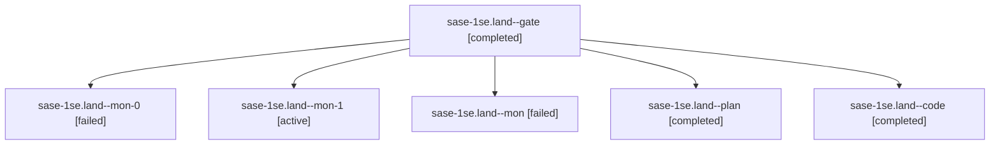

# Session: sase-1se.land

[Agent Hoods](../README.md) / [bbugyi200](../users/bbugyi200/README.md) / [athena](../users/bbugyi200/machines/athena/README.md) / [sase-1se](../users/bbugyi200/machines/athena/hoods/sase-1se/README.md) / sase-1se.land

Owner: `bbugyi200.athena` · Hood: `sase-1se` · Members: 6 · Bead: [sase-1se](https://github.com/sase-org/sase--beads/blob/main/pages/sase-1se/README.md)

## Lineage



The diagram is an optional enhancement; the ordered table below contains the same lineage in accessible text.

| Role | Agent | State | Model / provider | Timing | Commits | Prompt | Chat |
|---|---|---|---|---|---:|---|---|
| <a id="member-gate"></a>gate | sase-1se.land--gate | completed | gpt-6-astra / codex | 2026-11-12T14:35:54.588271+00:00 → 2026-11-12T14:37:05.956482+00:00 | 0 | — | [Chat](../agents/bbugyi200.athena.sase-1se.land--gate/chat.md) |
| <a id="member-mon-0"></a>mon-0 | sase-1se.land--mon-0 | failed | muse-spark-1.3-contributor / muse | 2026-11-12T15:26:51.591021+00:00 → 2026-11-12T15:26:53.783735+00:00 | 0 | — | — |
| <a id="member-mon-1"></a>mon-1 | sase-1se.land--mon-1 | active | muse-spark-1.3-contributor / muse | 2026-11-12T15:47:27.103321+00:00 | 0 | — | — |
| <a id="member-mon"></a>mon | sase-1se.land--mon | failed | muse-spark-1.3-contributor / muse | 2026-11-12T14:56:53.980733+00:00 → 2026-11-12T14:56:59.288475+00:00 | 0 | — | — |
| <a id="member-plan"></a>plan | sase-1se.land--plan | completed | gpt-6-astra / codex | 2026-11-12T14:12:46.638660+00:00 → 2026-11-12T15:52:55.129238+00:00 | 0 | [Prompt](../agents/bbugyi200.athena.sase-1se.land--plan/prompt.md) | [Chat](../agents/bbugyi200.athena.sase-1se.land--plan/chat.md) |
| <a id="member-code"></a>code | sase-1se.land--code | completed | muse-spark-1.3-contributor / muse | 2026-11-12T14:38:00.408377+00:00 → 2026-11-12T15:52:55.129238+00:00 | [1](../agents/bbugyi200.athena.sase-1se.land--code/README.md#commits) | — | [Chat](../agents/bbugyi200.athena.sase-1se.land--code/chat.md) |

## Commits

| Role | Repo | Commit | Subject | Committed |
|---|---|---|---|---|
| code | sase | [`d237c84`](https://github.com/sase-org/sase/commit/d237c842040a7bd9449359ee9c0aa8e6d3d566c7) | fix(auto-restart): hand off owned planned names in launcher resubmission; stop parser-error project guesses | 2026-11-12 10:50:54 EST |

## Variables

| Role | Variable | Value |
|---|---|---|
| plan | `artifacts` | \[{bead: sase-1se, kind: markdown, label: sase-1se landing audit and reservation blocker reproduction, path: /home/bryan/.sase/artifacts/agents/gh\_sase-org\_\_sase/20261112061820/sase-1se-landing-audit-… |

#### artifacts

**Role:** `plan`

```yaml
- bead: sase-1se
  kind: markdown
  label: sase-1se landing audit and reservation blocker reproduction
  path: /home/bryan/.sase/artifacts/agents/gh_sase-org__sase/20261112061820/sase-1se-landing-audit-5d8081847175.md
  ref: file:explicit:9023ae26f2429704cab3f420
  source_path: /home/bryan/.local/state/sase/workspaces/sase-org/sase/sase_16/.pytest_cache/sase-1se-landing-audit.md
```

Values are truncated for display; see each member's agent meta.json for the full values.

## Neighbors

| Agent | Relation | State |
|---|---|---|
| [sase-1se.1](../agents/bbugyi200.athena.sase-1se.1/README.md) | sase-1se hood | completed |
| [sase-1se.2](../agents/bbugyi200.athena.sase-1se.2/README.md) | sase-1se hood | completed |
| [sase-1se.3](../agents/bbugyi200.athena.sase-1se.3/README.md) | sase-1se hood | completed |
| [sase-1se.4](../agents/bbugyi200.athena.sase-1se.4/README.md) | sase-1se hood | completed |
