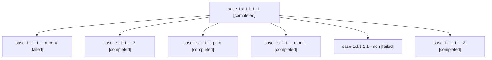

# Session: sase-1sl.1.1.1

[Agent Hoods](../README.md) / [bbugyi200](../users/bbugyi200/README.md) / [athena](../users/bbugyi200/machines/athena/README.md) / [sase-1sl](../users/bbugyi200/machines/athena/hoods/sase-1sl/README.md) / sase-1sl.1.1.1

Owner: `bbugyi200.athena` · Hood: `sase-1sl` · Members: 7 · Bead: [sase-1sl.1.1.1](https://github.com/sase-org/sase--beads/blob/main/pages/sase-1sl/sase-1sl.1.1.1.md)

## Lineage

The diagram is an optional enhancement; the ordered table below contains the same lineage in accessible text.

| Role | Agent | State | Model / provider | Timing | Commits | Prompt | Chat |
|---|---|---|---|---|---:|---|---|
| 1 | sase-1sl.1.1.1--1 | completed | gpt-6-luna / codex | 2026-11-12T23:06:55.601500+00:00 → 2026-11-12T23:12:13.128155+00:00 | 0 | [Prompt](../agents/bbugyi200.athena.sase-1sl.1.1.1--1/prompt.md) | [Chat](../agents/bbugyi200.athena.sase-1sl.1.1.1--1/chat.md) |
| mon-0 | sase-1sl.1.1.1--mon-0 | failed | gpt-6-luna / codex | 2026-11-12T23:10:34.899572+00:00 → 2026-11-13T00:00:54.813804+00:00 | 0 | — | [Chat](../agents/bbugyi200.athena.sase-1sl.1.1.1--mon-0/chat.md) |
| 3 | sase-1sl.1.1.1--3 | completed | gpt-6-luna / codex | 2026-11-13T00:25:21.040615+00:00 → 2026-11-13T00:31:55.756231+00:00 | 0 | [Prompt](../agents/bbugyi200.athena.sase-1sl.1.1.1--3/prompt.md) | [Chat](../agents/bbugyi200.athena.sase-1sl.1.1.1--3/chat.md) |
| plan | sase-1sl.1.1.1--plan | completed | gpt-6-luna / codex | 2026-11-12T22:06:30.672820+00:00 → 2026-11-12T23:02:08.837304+00:00 | 0 | [Prompt](../agents/bbugyi200.athena.sase-1sl.1.1.1--plan/prompt.md) | [Chat](../agents/bbugyi200.athena.sase-1sl.1.1.1--plan/chat.md) |
| mon-1 | sase-1sl.1.1.1--mon-1 | completed | gpt-6-luna / codex | 2026-11-13T00:06:37.421241+00:00 → 2026-11-13T00:22:31.953613+00:00 | 0 | — | [Chat](../agents/bbugyi200.athena.sase-1sl.1.1.1--mon-1/chat.md) |
| mon | sase-1sl.1.1.1--mon | failed | gpt-6-luna / codex | 2026-11-12T23:00:46.105868+00:00 → 2026-11-12T23:04:39.704024+00:00 | 0 | — | [Chat](../agents/bbugyi200.athena.sase-1sl.1.1.1--mon/chat.md) |
| 2 | sase-1sl.1.1.1--2 | completed | gpt-6-luna / codex | 2026-11-13T00:01:28.987054+00:00 → 2026-11-13T00:09:01.859602+00:00 | 0 | [Prompt](../agents/bbugyi200.athena.sase-1sl.1.1.1--2/prompt.md) | [Chat](../agents/bbugyi200.athena.sase-1sl.1.1.1--2/chat.md) |

## Neighbors

| Agent | Relation | State |
|---|---|---|
| [sase-1sl.1](bbugyi200.athena.sase-1sl.1.md) (session · 3) | ancestor | active 1, completed 2 |
| [sase-1sl.1.1.2](../agents/bbugyi200.athena.sase-1sl.1.1.2/README.md) | sase-1sl.1.1 hood | completed |
| [sase-1sl.1.1.3](bbugyi200.athena.sase-1sl.1.1.3.md) (session · 9) | sase-1sl.1.1 hood | completed 7, failed 2 |
| [sase-1sl.1.1.land](bbugyi200.athena.sase-1sl.1.1.land.md) (session · 3) | sase-1sl.1.1 hood | completed 3 |
| [sase-1sl.2](../agents/bbugyi200.athena.sase-1sl.2/README.md) | sase-1sl hood | completed |
| [sase-1sl.3](bbugyi200.athena.sase-1sl.3.md) (session · 3) | sase-1sl hood | completed 3 |
| [sase-1sl.4](../agents/bbugyi200.athena.sase-1sl.4/README.md) | sase-1sl hood | waiting |
| [sase-1sl.land](../agents/bbugyi200.athena.sase-1sl.land/README.md) | sase-1sl hood | waiting |
