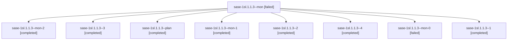

# Session: sase-1sl.1.1.3

[Agent Hoods](../README.md) / [bbugyi200](../users/bbugyi200/README.md) / [athena](../users/bbugyi200/machines/athena/README.md) / [sase-1sl](../users/bbugyi200/machines/athena/hoods/sase-1sl/README.md) / sase-1sl.1.1.3

Owner: `bbugyi200.athena` · Hood: `sase-1sl` · Members: 9 · Bead: [sase-1sl.1.1.3](https://github.com/sase-org/sase--beads/blob/main/pages/sase-1sl/sase-1sl.1.1.3.md)

## Lineage

The diagram is an optional enhancement; the ordered table below contains the same lineage in accessible text.

| Role | Agent | State | Model / provider | Timing | Commits | Prompt | Chat |
|---|---|---|---|---|---:|---|---|
| mon | sase-1sl.1.1.3--mon | failed | gpt-6-luna / codex | 2026-11-13T02:08:15.886892+00:00 → 2026-11-13T02:31:24.300892+00:00 | 0 | — | [Chat](../agents/bbugyi200.athena.sase-1sl.1.1.3--mon/chat.md) |
| mon-2 | sase-1sl.1.1.3--mon-2 | completed | muse-spark-1.3-contributor / muse | 2026-11-13T04:15:55.623322+00:00 → 2026-11-13T04:26:37.945306+00:00 | 0 | — | [Chat](../agents/bbugyi200.athena.sase-1sl.1.1.3--mon-2/chat.md) |
| 3 | sase-1sl.1.1.3--3 | completed | muse-spark-1.3-contributor / muse | 2026-11-13T03:57:29.587484+00:00 → 2026-11-13T04:24:32.137332+00:00 | 0 | [Prompt](../agents/bbugyi200.athena.sase-1sl.1.1.3--3/prompt.md) | [Chat](../agents/bbugyi200.athena.sase-1sl.1.1.3--3/chat.md) |
| plan | sase-1sl.1.1.3--plan | completed | gpt-6-luna / codex | 2026-11-13T01:28:32.876678+00:00 → 2026-11-13T02:10:11.270348+00:00 | 0 | [Prompt](../agents/bbugyi200.athena.sase-1sl.1.1.3--plan/prompt.md) | [Chat](../agents/bbugyi200.athena.sase-1sl.1.1.3--plan/chat.md) |
| mon-1 | sase-1sl.1.1.3--mon-1 | completed | muse-spark-1.3-contributor / muse | 2026-11-13T03:29:11.456690+00:00 → 2026-11-13T03:55:03.970107+00:00 | 0 | — | [Chat](../agents/bbugyi200.athena.sase-1sl.1.1.3--mon-1/chat.md) |
| 2 | sase-1sl.1.1.3--2 | completed | muse-spark-1.3-contributor / muse | 2026-11-13T03:04:24.739658+00:00 → 2026-11-13T03:31:54.564046+00:00 | 0 | [Prompt](../agents/bbugyi200.athena.sase-1sl.1.1.3--2/prompt.md) | [Chat](../agents/bbugyi200.athena.sase-1sl.1.1.3--2/chat.md) |
| 4 | sase-1sl.1.1.3--4 | completed | muse-spark-1.3-contributor / muse | 2026-11-13T04:28:55.792847+00:00 → 2026-11-13T04:33:39.672265+00:00 | 0 | [Prompt](../agents/bbugyi200.athena.sase-1sl.1.1.3--4/prompt.md) | [Chat](../agents/bbugyi200.athena.sase-1sl.1.1.3--4/chat.md) |
| mon-0 | sase-1sl.1.1.3--mon-0 | failed | gpt-6-luna / codex | 2026-11-13T02:38:58.157855+00:00 → 2026-11-13T03:02:07.444451+00:00 | 0 | — | [Chat](../agents/bbugyi200.athena.sase-1sl.1.1.3--mon-0/chat.md) |
| 1 | sase-1sl.1.1.3--1 | completed | gpt-6-luna / codex | 2026-11-13T02:33:48.820919+00:00 → 2026-11-13T02:40:13.615408+00:00 | 0 | [Prompt](../agents/bbugyi200.athena.sase-1sl.1.1.3--1/prompt.md) | [Chat](../agents/bbugyi200.athena.sase-1sl.1.1.3--1/chat.md) |

## Neighbors

| Agent | Relation | State |
|---|---|---|
| [sase-1sl.1](bbugyi200.athena.sase-1sl.1.md) (session · 3) | ancestor | active 1, completed 2 |
| [sase-1sl.1.1.1](bbugyi200.athena.sase-1sl.1.1.1.md) (session · 7) | sase-1sl.1.1 hood | completed 5, failed 2 |
| [sase-1sl.1.1.2](../agents/bbugyi200.athena.sase-1sl.1.1.2/README.md) | sase-1sl.1.1 hood | completed |
| [sase-1sl.1.1.land](../agents/bbugyi200.athena.sase-1sl.1.1.land/README.md) | sase-1sl.1.1 hood | waiting |
| [sase-1sl.2](../agents/bbugyi200.athena.sase-1sl.2/README.md) | sase-1sl hood | waiting |
| [sase-1sl.3](bbugyi200.athena.sase-1sl.3.md) (session · 3) | sase-1sl hood | completed 3 |
| [sase-1sl.4](../agents/bbugyi200.athena.sase-1sl.4/README.md) | sase-1sl hood | waiting |
| [sase-1sl.land](../agents/bbugyi200.athena.sase-1sl.land/README.md) | sase-1sl hood | waiting |
