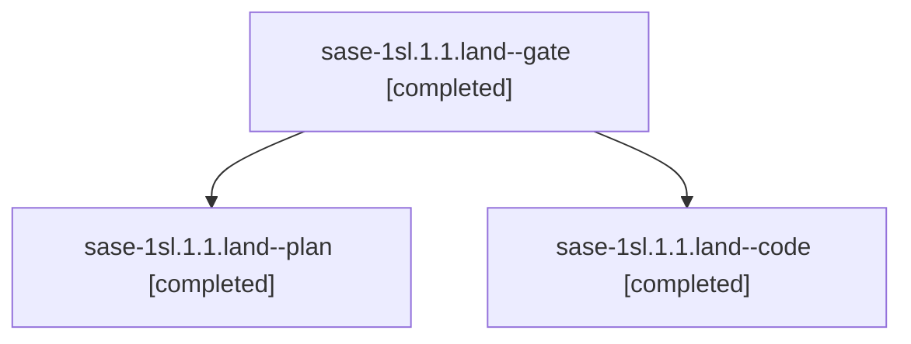

# Session: sase-1sl.1.1.land

[Agent Hoods](../README.md) / [bbugyi200](../users/bbugyi200/README.md) / [athena](../users/bbugyi200/machines/athena/README.md) / [sase-1sl](../users/bbugyi200/machines/athena/hoods/sase-1sl/README.md) / sase-1sl.1.1.land

Owner: `bbugyi200.athena` · Hood: `sase-1sl` · Members: 3 · Bead: [sase-1sl.1.1](https://github.com/sase-org/sase--beads/blob/main/pages/sase-1sl/sase-1sl.1.1.md)

## Lineage



The diagram is an optional enhancement; the ordered table below contains the same lineage in accessible text.

| Role | Agent | State | Model / provider | Timing | Commits | Prompt | Chat |
|---|---|---|---|---|---:|---|---|
| <a id="member-gate"></a>gate | sase-1sl.1.1.land--gate | completed | gpt-6-astra / codex | 2026-11-13T04:52:50.826560+00:00 → 2026-11-13T04:53:59.261019+00:00 | 0 | — | [Chat](../agents/bbugyi200.athena.sase-1sl.1.1.land--gate/chat.md) |
| <a id="member-plan"></a>plan | sase-1sl.1.1.land--plan | completed | gpt-6-astra / codex | 2026-11-13T04:34:43.761230+00:00 → 2026-11-13T05:49:25.434469+00:00 | 0 | [Prompt](../agents/bbugyi200.athena.sase-1sl.1.1.land--plan/prompt.md) | [Chat](../agents/bbugyi200.athena.sase-1sl.1.1.land--plan/chat.md) |
| <a id="member-code"></a>code | sase-1sl.1.1.land--code | completed | gpt-6-luna / codex | 2026-11-13T04:55:16.686719+00:00 → 2026-11-13T05:49:25.434469+00:00 | 0 | — | [Chat](../agents/bbugyi200.athena.sase-1sl.1.1.land--code/chat.md) |

## Variables

| Role | Variable | Value |
|---|---|---|
| plan | `artifacts` | \[{bead: sase-1sl.1.1, kind: file, label: sccache wrapper transport failure reproduction from capacity epic landing, path: /home/bryan/.sase/artifacts/agents/gh\_sase-org\_\_sase/20261112170430/sase-1sl-… |

#### artifacts

**Role:** `plan`

```yaml
- bead: sase-1sl.1.1
  kind: file
  label: sccache wrapper transport failure reproduction from capacity epic landing
  path: /home/bryan/.sase/artifacts/agents/gh_sase-org__sase/20261112170430/sase-1sl-sccache-repro-37f9aee9510f.txt
  ref: file:explicit:1182493b8b8ec8ca08782193
  source_path: /tmp/sase-1sl-sccache-repro.txt
```

Values are truncated for display; see each member's agent meta.json for the full values.

## Neighbors

| Agent | Relation | State |
|---|---|---|
| [sase-1sl.1](bbugyi200.athena.sase-1sl.1.md) (session · 3) | ancestor | active 1, completed 2 |
| [sase-1sl.1.1.1](bbugyi200.athena.sase-1sl.1.1.1.md) (session · 7) | sase-1sl.1.1 hood | completed 5, failed 2 |
| [sase-1sl.1.1.2](../agents/bbugyi200.athena.sase-1sl.1.1.2/README.md) | sase-1sl.1.1 hood | completed |
| [sase-1sl.1.1.3](bbugyi200.athena.sase-1sl.1.1.3.md) (session · 9) | sase-1sl.1.1 hood | completed 7, failed 2 |
| [sase-1sl.2](../agents/bbugyi200.athena.sase-1sl.2/README.md) | sase-1sl hood | completed |
| [sase-1sl.3](bbugyi200.athena.sase-1sl.3.md) (session · 3) | sase-1sl hood | completed 3 |
| [sase-1sl.4](../agents/bbugyi200.athena.sase-1sl.4/README.md) | sase-1sl hood | waiting |
| [sase-1sl.land](../agents/bbugyi200.athena.sase-1sl.land/README.md) | sase-1sl hood | waiting |
