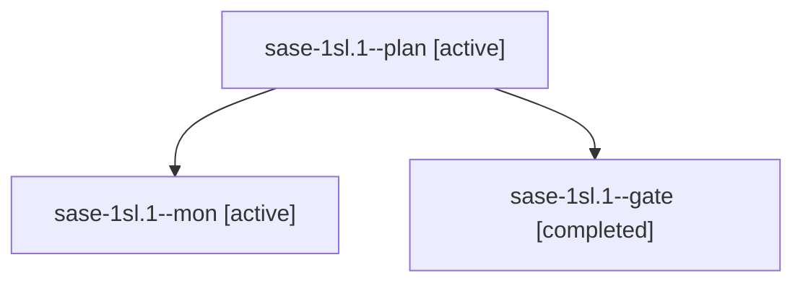

# Session: sase-1sl.1

[Agent Hoods](../README.md) / [bbugyi200](../users/bbugyi200/README.md) / [athena](../users/bbugyi200/machines/athena/README.md) / [sase-1sl](../users/bbugyi200/machines/athena/hoods/sase-1sl/README.md) / sase-1sl.1

Owner: `bbugyi200.athena` · Hood: `sase-1sl` · Members: 3 · Bead: [sase-1sl.1](https://github.com/sase-org/sase--beads/blob/main/pages/sase-1sl/sase-1sl.1.md)

## Lineage

The diagram is an optional enhancement; the ordered table below contains the same lineage in accessible text.

| Role | Agent | State | Model / provider | Timing | Commits | Prompt | Chat |
|---|---|---|---|---|---:|---|---|
| plan | sase-1sl.1--plan | active | gpt-6-astra / codex | 2026-11-12T21:51:31.053202+00:00 → 2026-11-12T22:02:09.321845+00:00 | 0 | [Prompt](../agents/bbugyi200.athena.sase-1sl.1--plan/prompt.md) | [Chat](../agents/bbugyi200.athena.sase-1sl.1--plan/chat.md) |
| mon | sase-1sl.1--mon | active | gpt-6-astra / codex | 2026-11-12T22:01:58.235241+00:00 | 0 | — | — |
| gate | sase-1sl.1--gate | completed | gpt-6-astra / codex | 2026-11-12T22:00:08.070701+00:00 → 2026-11-12T22:02:01.351903+00:00 | 0 | — | [Chat](../agents/bbugyi200.athena.sase-1sl.1--gate/chat.md) |

## Neighbors

| Agent | Relation | State |
|---|---|---|
| [sase-1sl.2](../agents/bbugyi200.athena.sase-1sl.2/README.md) | sase-1sl hood | waiting |
| [sase-1sl.3](../agents/bbugyi200.athena.sase-1sl.3/README.md) | sase-1sl hood | active |
| [sase-1sl.4](../agents/bbugyi200.athena.sase-1sl.4/README.md) | sase-1sl hood | waiting |
| [sase-1sl.land](../agents/bbugyi200.athena.sase-1sl.land/README.md) | sase-1sl hood | waiting |
