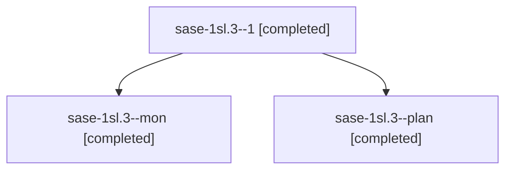

# Session: sase-1sl.3

[Agent Hoods](../README.md) / [bbugyi200](../users/bbugyi200/README.md) / [athena](../users/bbugyi200/machines/athena/README.md) / [sase-1sl](../users/bbugyi200/machines/athena/hoods/sase-1sl/README.md) / sase-1sl.3

Owner: `bbugyi200.athena` · Hood: `sase-1sl` · Members: 3 · Bead: [sase-1sl.3](https://github.com/sase-org/sase--beads/blob/main/pages/sase-1sl/sase-1sl.3.md)

## Lineage

The diagram is an optional enhancement; the ordered table below contains the same lineage in accessible text.

| Role | Agent | State | Model / provider | Timing | Commits | Prompt | Chat |
|---|---|---|---|---|---:|---|---|
| 1 | sase-1sl.3--1 | completed | muse-spark-1.3-contributor / muse | 2026-11-12T23:07:51.170048+00:00 → 2026-11-12T23:12:54.527829+00:00 | 0 | [Prompt](../agents/bbugyi200.athena.sase-1sl.3--1/prompt.md) | [Chat](../agents/bbugyi200.athena.sase-1sl.3--1/chat.md) |
| mon | sase-1sl.3--mon | completed | muse-spark-1.3-contributor / muse | 2026-11-12T22:39:21.794549+00:00 → 2026-11-12T23:05:31.067037+00:00 | 0 | — | [Chat](../agents/bbugyi200.athena.sase-1sl.3--mon/chat.md) |
| plan | sase-1sl.3--plan | completed | muse-spark-1.3-contributor / muse | 2026-11-12T21:52:14.692846+00:00 → 2026-11-12T22:44:38.846013+00:00 | [1](../agents/bbugyi200.athena.sase-1sl.3--plan/README.md#commits) | [Prompt](../agents/bbugyi200.athena.sase-1sl.3--plan/prompt.md) | [Chat](../agents/bbugyi200.athena.sase-1sl.3--plan/chat.md) |

## Commits

| Role | Repo | Commit | Subject | Committed |
|---|---|---|---|---|
| plan | sase | [`bdf8ae1`](https://github.com/sase-org/sase/commit/bdf8ae15909f3fb61d8cb63af463183ae7a8f985) | feat(tui): bound full GC collections by duty cycle in gc\_policy | 2026-11-12 17:43:20 EST |

## Neighbors

| Agent | Relation | State |
|---|---|---|
| [sase-1sl.1](bbugyi200.athena.sase-1sl.1.md) (session · 3) | sase-1sl hood | active 1, completed 2 |
| [sase-1sl.1.1.1](bbugyi200.athena.sase-1sl.1.1.1.md) (session · 7) | sase-1sl hood | completed 5, failed 2 |
| [sase-1sl.1.1.2](../agents/bbugyi200.athena.sase-1sl.1.1.2/README.md) | sase-1sl hood | completed |
| [sase-1sl.1.1.3](bbugyi200.athena.sase-1sl.1.1.3.md) (session · 9) | sase-1sl hood | completed 7, failed 2 |
| [sase-1sl.1.1.land](bbugyi200.athena.sase-1sl.1.1.land.md) (session · 3) | sase-1sl hood | active 2, completed 1 |
| [sase-1sl.2](../agents/bbugyi200.athena.sase-1sl.2/README.md) | sase-1sl hood | waiting |
| [sase-1sl.4](../agents/bbugyi200.athena.sase-1sl.4/README.md) | sase-1sl hood | waiting |
| [sase-1sl.land](../agents/bbugyi200.athena.sase-1sl.land/README.md) | sase-1sl hood | waiting |
