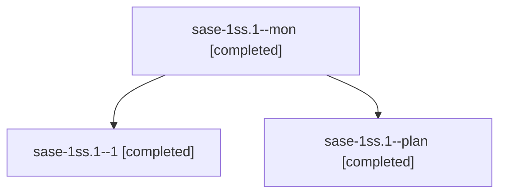

# Session: sase-1ss.1

[Agent Hoods](../README.md) / [bbugyi200](../users/bbugyi200/README.md) / [athena](../users/bbugyi200/machines/athena/README.md) / [sase-1ss](../users/bbugyi200/machines/athena/hoods/sase-1ss/README.md) / sase-1ss.1

Owner: `bbugyi200.athena` · Hood: `sase-1ss` · Members: 3 · Bead: [sase-1ss.1](https://github.com/sase-org/sase--beads/blob/main/pages/sase-1ss/sase-1ss.1.md)

## Lineage

The diagram is an optional enhancement; the ordered table below contains the same lineage in accessible text.

| Role | Agent | State | Model / provider | Timing | Commits | Prompt | Chat |
|---|---|---|---|---|---:|---|---|
| mon | sase-1ss.1--mon | completed | muse-spark-1.3-contributor / muse | 2026-11-14T00:40:00.743270+00:00 → 2026-11-14T00:49:16.721094+00:00 | 0 | — | [Chat](../agents/bbugyi200.athena.sase-1ss.1--mon/chat.md) |
| 1 | sase-1ss.1--1 | completed | muse-spark-1.3-contributor / muse | 2026-11-14T00:49:42.097071+00:00 → 2026-11-14T00:52:56.836137+00:00 | [1](../agents/bbugyi200.athena.sase-1ss.1--1/README.md#commits) | [Prompt](../agents/bbugyi200.athena.sase-1ss.1--1/prompt.md) | [Chat](../agents/bbugyi200.athena.sase-1ss.1--1/chat.md) |
| plan | sase-1ss.1--plan | completed | muse-spark-1.3-contributor / muse | 2026-11-13T23:48:39.027054+00:00 → 2026-11-14T00:47:24.432224+00:00 | 0 | [Prompt](../agents/bbugyi200.athena.sase-1ss.1--plan/prompt.md) | [Chat](../agents/bbugyi200.athena.sase-1ss.1--plan/chat.md) |

## Commits

| Role | Repo | Commit | Subject | Committed |
|---|---|---|---|---|
| 1 | sase | [`cf7a09f`](https://github.com/sase-org/sase/commit/cf7a09f15b485b8e1f0b9216b4707aab93f16a5b) | feat(sase-1ss.1): catalog Gemini 4 Hydrogen on Antigravity | 2026-11-13 19:52:07 EST |

## Neighbors

| Agent | Relation | State |
|---|---|---|
| [sase-1ss.2](../agents/bbugyi200.athena.sase-1ss.2/README.md) | sase-1ss hood | completed |
| [sase-1ss.land](../agents/bbugyi200.athena.sase-1ss.land/README.md) | sase-1ss hood | waiting |
