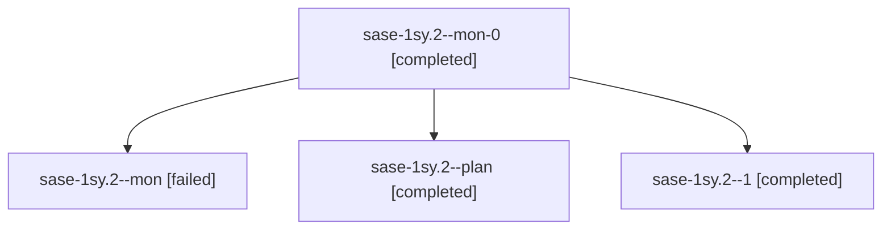

# Session: sase-1sy.2

[Agent Hoods](../README.md) / [bbugyi200](../users/bbugyi200/README.md) / [athena](../users/bbugyi200/machines/athena/README.md) / [sase-1sy](../users/bbugyi200/machines/athena/hoods/sase-1sy/README.md) / sase-1sy.2

Owner: `bbugyi200.athena` · Hood: `sase-1sy` · Members: 4 · Bead: [sase-1sy.2](https://github.com/sase-org/sase--beads/blob/main/pages/sase-1sy/sase-1sy.2.md)

## Lineage

The diagram is an optional enhancement; the ordered table below contains the same lineage in accessible text.

| Role | Agent | State | Model / provider | Timing | Commits | Prompt | Chat |
|---|---|---|---|---|---:|---|---|
| mon-0 | sase-1sy.2--mon-0 | completed | grok-4.6 / grok | 2026-11-15T16:08:06.889771+00:00 → 2026-11-15T16:44:39.165143+00:00 | [1](../agents/bbugyi200.athena.sase-1sy.2--mon-0/README.md#commits) | — | [Chat](../agents/bbugyi200.athena.sase-1sy.2--mon-0/chat.md) |
| mon | sase-1sy.2--mon | failed | grok-4.6 / grok | 2026-11-15T15:56:38.976441+00:00 → 2026-11-15T16:03:29.331205+00:00 | 0 | — | [Chat](../agents/bbugyi200.athena.sase-1sy.2--mon/chat.md) |
| plan | sase-1sy.2--plan | completed | grok-4.6 / grok | 2026-11-15T15:28:53.308808+00:00 → 2026-11-15T15:58:28.747052+00:00 | 0 | [Prompt](../agents/bbugyi200.athena.sase-1sy.2--plan/prompt.md) | [Chat](../agents/bbugyi200.athena.sase-1sy.2--plan/chat.md) |
| 1 | sase-1sy.2--1 | completed | grok-4.6 / grok | 2026-11-15T16:04:03.680045+00:00 → 2026-11-15T16:10:09.662701+00:00 | 0 | [Prompt](../agents/bbugyi200.athena.sase-1sy.2--1/prompt.md) | [Chat](../agents/bbugyi200.athena.sase-1sy.2--1/chat.md) |

## Commits

| Role | Repo | Commit | Subject | Committed |
|---|---|---|---|---|
| mon-0 | sase | [`baf2309`](https://github.com/sase-org/sase/commit/baf23097d646611b6530c1a2970404e76f0f231e) | feat(tui): add related beads, navigation, and full detail to the K card | 2026-11-15 11:43:44 EST |

## Neighbors

| Agent | Relation | State |
|---|---|---|
| [sase-1sy.1](../agents/bbugyi200.athena.sase-1sy.1/README.md) | sase-1sy hood | completed |
| [sase-1sy.3](../agents/bbugyi200.athena.sase-1sy.3/README.md) | sase-1sy hood | active |
| [sase-1sy.land](../agents/bbugyi200.athena.sase-1sy.land/README.md) | sase-1sy hood | waiting |
