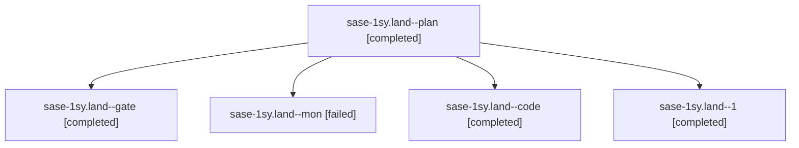

# Session: sase-1sy.land

[Agent Hoods](../README.md) / [bbugyi200](../users/bbugyi200/README.md) / [athena](../users/bbugyi200/machines/athena/README.md) / [sase-1sy](../users/bbugyi200/machines/athena/hoods/sase-1sy/README.md) / sase-1sy.land

Owner: `bbugyi200.athena` · Hood: `sase-1sy` · Members: 5 · Bead: [sase-1sy](https://github.com/sase-org/sase--beads/blob/main/pages/sase-1sy/README.md)

## Lineage

The diagram is an optional enhancement; the ordered table below contains the same lineage in accessible text.

| Role | Agent | State | Model / provider | Timing | Commits | Prompt | Chat |
|---|---|---|---|---|---:|---|---|
| plan | sase-1sy.land--plan | completed | gpt-6-astra / codex | 2026-11-15T18:37:28.965148+00:00 → 2026-11-15T19:27:15.178096+00:00 | 0 | [Prompt](../agents/bbugyi200.athena.sase-1sy.land--plan/prompt.md) | [Chat](../agents/bbugyi200.athena.sase-1sy.land--plan/chat.md) |
| gate | sase-1sy.land--gate | completed | gpt-6-astra / codex | 2026-11-15T18:50:07.590862+00:00 → 2026-11-15T18:50:26.814948+00:00 | 0 | — | [Chat](../agents/bbugyi200.athena.sase-1sy.land--gate/chat.md) |
| mon | sase-1sy.land--mon | failed | gpt-6-luna / codex | 2026-11-15T19:26:14.831623+00:00 → 2026-11-15T19:33:00.986242+00:00 | 0 | — | [Chat](../agents/bbugyi200.athena.sase-1sy.land--mon/chat.md) |
| code | sase-1sy.land--code | completed | gpt-6-luna / codex | 2026-11-15T18:50:55.568434+00:00 → 2026-11-15T19:27:15.178096+00:00 | 0 | — | [Chat](../agents/bbugyi200.athena.sase-1sy.land--code/chat.md) |
| 1 | sase-1sy.land--1 | completed | gpt-6-luna / codex | 2026-11-15T19:33:44.864813+00:00 → 2026-11-15T21:05:07.773128+00:00 | [1](../agents/bbugyi200.athena.sase-1sy.land--1/README.md#commits) | [Prompt](../agents/bbugyi200.athena.sase-1sy.land--1/prompt.md) | [Chat](../agents/bbugyi200.athena.sase-1sy.land--1/chat.md) |

## Commits

| Role | Repo | Commit | Subject | Committed |
|---|---|---|---|---|
| 1 | sase | [`082f2bc`](https://github.com/sase-org/sase/commit/082f2bc7054de7d71a86646105c863b4dd85849d) | fix(ace): complete bead preview routing and mentions | 2026-11-15 16:03:27 EST |

## Neighbors

| Agent | Relation | State |
|---|---|---|
| [sase-1sy.1](../agents/bbugyi200.athena.sase-1sy.1/README.md) | sase-1sy hood | completed |
| [sase-1sy.2](bbugyi200.athena.sase-1sy.2.md) (session · 4) | sase-1sy hood | completed 3, failed 1 |
| [sase-1sy.2](../agents/bbugyi200.athena.sase-1sy.2/README.md) | sase-1sy hood | active |
| [sase-1sy.3](../agents/bbugyi200.athena.sase-1sy.3/README.md) | sase-1sy hood | completed |
