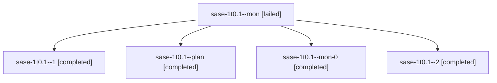

# Session: sase-1t0.1

[Agent Hoods](../README.md) / [bbugyi200](../users/bbugyi200/README.md) / [athena](../users/bbugyi200/machines/athena/README.md) / [sase-1t0](../users/bbugyi200/machines/athena/hoods/sase-1t0/README.md) / sase-1t0.1

Owner: `bbugyi200.athena` · Hood: `sase-1t0` · Members: 5 · Bead: [sase-1t0.1](https://github.com/sase-org/sase--beads/blob/main/pages/sase-1t0/sase-1t0.1.md)

## Lineage

The diagram is an optional enhancement; the ordered table below contains the same lineage in accessible text.

| Role | Agent | State | Model / provider | Timing | Commits | Prompt | Chat |
|---|---|---|---|---|---:|---|---|
| mon | sase-1t0.1--mon | failed | gpt-6-luna / codex | 2026-11-15T17:58:37.940376+00:00 → 2026-11-15T18:01:48.367488+00:00 | 0 | — | [Chat](../agents/bbugyi200.athena.sase-1t0.1--mon/chat.md) |
| 1 | sase-1t0.1--1 | completed | gpt-6-luna / codex | 2026-11-15T18:02:36.196463+00:00 → 2026-11-15T19:20:48.846130+00:00 | 0 | [Prompt](../agents/bbugyi200.athena.sase-1t0.1--1/prompt.md) | [Chat](../agents/bbugyi200.athena.sase-1t0.1--1/chat.md) |
| plan | sase-1t0.1--plan | completed | gpt-6-luna / codex | 2026-11-15T17:31:54.068581+00:00 → 2026-11-15T17:59:44.028647+00:00 | 0 | [Prompt](../agents/bbugyi200.athena.sase-1t0.1--plan/prompt.md) | [Chat](../agents/bbugyi200.athena.sase-1t0.1--plan/chat.md) |
| mon-0 | sase-1t0.1--mon-0 | completed | gpt-6-luna / codex | 2026-11-15T19:16:41.898993+00:00 → 2026-11-15T19:22:30.541408+00:00 | 0 | — | [Chat](../agents/bbugyi200.athena.sase-1t0.1--mon-0/chat.md) |
| 2 | sase-1t0.1--2 | completed | gpt-6-luna / codex | 2026-11-15T19:23:15.181763+00:00 → 2026-11-15T19:43:18.221178+00:00 | [1](../agents/bbugyi200.athena.sase-1t0.1--2/README.md#commits) | [Prompt](../agents/bbugyi200.athena.sase-1t0.1--2/prompt.md) | [Chat](../agents/bbugyi200.athena.sase-1t0.1--2/chat.md) |

## Commits

| Role | Repo | Commit | Subject | Committed |
|---|---|---|---|---|
| 2 | sase | [`9793a95`](https://github.com/sase-org/sase/commit/9793a95a5c507b75d97139b084797488329f9aab) | fix(artifact-retention): tolerate dangling payloads | 2026-11-15 14:42:24 EST |

## Neighbors

| Agent | Relation | State |
|---|---|---|
| [sase-1t0.2](bbugyi200.athena.sase-1t0.2.md) (session · 2) | sase-1t0 hood | completed 2 |
| [sase-1t0.land](../agents/bbugyi200.athena.sase-1t0.land/README.md) | sase-1t0 hood | waiting |
