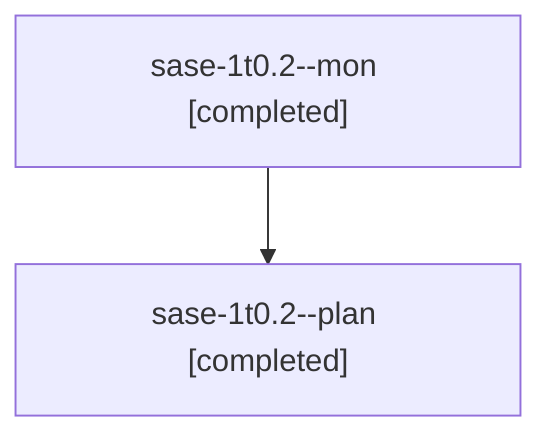

# Session: sase-1t0.2

[Agent Hoods](../README.md) / [bbugyi200](../users/bbugyi200/README.md) / [athena](../users/bbugyi200/machines/athena/README.md) / [sase-1t0](../users/bbugyi200/machines/athena/hoods/sase-1t0/README.md) / sase-1t0.2

Owner: `bbugyi200.athena` · Hood: `sase-1t0` · Members: 2 · Bead: [sase-1t0.2](https://github.com/sase-org/sase--beads/blob/main/pages/sase-1t0/sase-1t0.2.md)

## Lineage

The diagram is an optional enhancement; the ordered table below contains the same lineage in accessible text.

| Role | Agent | State | Model / provider | Timing | Commits | Prompt | Chat |
|---|---|---|---|---|---:|---|---|
| mon | sase-1t0.2--mon | completed | grok-4.6 / grok | 2026-11-15T18:14:58.641680+00:00 → 2026-11-15T18:29:29.518259+00:00 | [1](../agents/bbugyi200.athena.sase-1t0.2--mon/README.md#commits) | — | [Chat](../agents/bbugyi200.athena.sase-1t0.2--mon/chat.md) |
| plan | sase-1t0.2--plan | completed | grok-4.6 / grok | 2026-11-15T17:31:57.788125+00:00 → 2026-11-15T18:16:38.705529+00:00 | 0 | [Prompt](../agents/bbugyi200.athena.sase-1t0.2--plan/prompt.md) | [Chat](../agents/bbugyi200.athena.sase-1t0.2--plan/chat.md) |

## Commits

| Role | Repo | Commit | Subject | Committed |
|---|---|---|---|---|
| mon | sase | [`974c600`](https://github.com/sase-org/sase/commit/974c600c6a29cf25b123ab3ae3aa381bdfcbf522) | feat(agents-sync): grace unresolved deferred prompt archives | 2026-11-15 13:28:13 EST |

## Neighbors

| Agent | Relation | State |
|---|---|---|
| [sase-1t0.1](bbugyi200.athena.sase-1t0.1.md) (session · 5) | sase-1t0 hood | completed 4, failed 1 |
| [sase-1t0.land](../agents/bbugyi200.athena.sase-1t0.land/README.md) | sase-1t0 hood | waiting |
