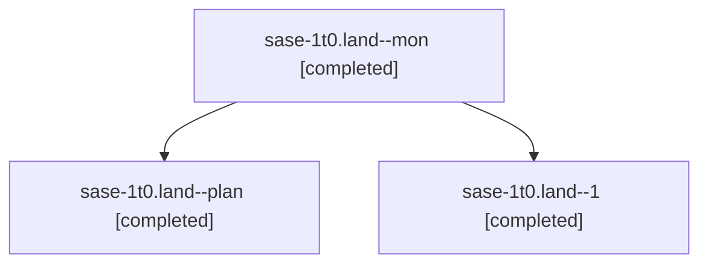

# Session: sase-1t0.land

[Agent Hoods](../README.md) / [bbugyi200](../users/bbugyi200/README.md) / [athena](../users/bbugyi200/machines/athena/README.md) / [sase-1t0](../users/bbugyi200/machines/athena/hoods/sase-1t0/README.md) / sase-1t0.land

Owner: `bbugyi200.athena` · Hood: `sase-1t0` · Members: 3 · Bead: [sase-1t0](https://github.com/sase-org/sase--beads/blob/main/pages/sase-1t0/README.md)

## Lineage



The diagram is an optional enhancement; the ordered table below contains the same lineage in accessible text.

| Role | Agent | State | Model / provider | Timing | Commits | Prompt | Chat |
|---|---|---|---|---|---:|---|---|
| <a id="member-mon"></a>mon | sase-1t0.land--mon | completed | gpt-6-astra / codex | 2026-11-15T19:54:18.641121+00:00 → 2026-11-15T20:34:07.822261+00:00 | 0 | — | [Chat](../agents/bbugyi200.athena.sase-1t0.land--mon/chat.md) |
| <a id="member-plan"></a>plan | sase-1t0.land--plan | completed | gpt-6-astra / codex | 2026-11-15T19:44:21.551612+00:00 → 2026-11-15T19:57:51.924815+00:00 | 0 | [Prompt](../agents/bbugyi200.athena.sase-1t0.land--plan/prompt.md) | [Chat](../agents/bbugyi200.athena.sase-1t0.land--plan/chat.md) |
| <a id="member-1"></a>1 | sase-1t0.land--1 | completed | gpt-6-astra / codex | 2026-11-15T20:35:08.739385+00:00 → 2026-11-15T20:40:21.632442+00:00 | 0 | [Prompt](../agents/bbugyi200.athena.sase-1t0.land--1/prompt.md) | [Chat](../agents/bbugyi200.athena.sase-1t0.land--1/chat.md) |

## Variables

| Role | Variable | Value |
|---|---|---|
| plan | `artifacts` | \[{kind: file, label: Rust 1.100 clean-base needless\_bool failures proposed by sase-1t0.1, path: /home/bryan/.sase/artifacts/agents/gh\_sase-org\_\_sase/20261115123047/sase-1t0-clean-base-clippy-e3b0c442… |

#### artifacts

**Role:** `plan`

```yaml
- kind: file
  label: Rust 1.100 clean-base needless_bool failures proposed by sase-1t0.1
  path: /home/bryan/.sase/artifacts/agents/gh_sase-org__sase/20261115123047/sase-1t0-clean-base-clippy-e3b0c44298fc.log
  ref: file:explicit:577cacd11486b9dc34ec644d
  source_path: /tmp/sase-1t0-clean-base-clippy.log
- kind: file
  label: Nonempty clean-base Rust 1.100 needless_bool evidence from sase-1t0.1
  path: /home/bryan/.sase/artifacts/agents/gh_sase-org__sase/20261115123047/sase-1t0-clean-base-clippy-evidence-80da8bae3877.log
  ref: file:explicit:b4045c72067f344a59543fd3
  source_path: /tmp/sase-1t0-clean-base-clippy-evidence.log
```

Values are truncated for display; see each member's agent meta.json for the full values.

## Neighbors

| Agent | Relation | State |
|---|---|---|
| [sase-1t0.1](bbugyi200.athena.sase-1t0.1.md) (session · 5) | sase-1t0 hood | completed 4, failed 1 |
| [sase-1t0.2](bbugyi200.athena.sase-1t0.2.md) (session · 2) | sase-1t0 hood | completed 2 |
