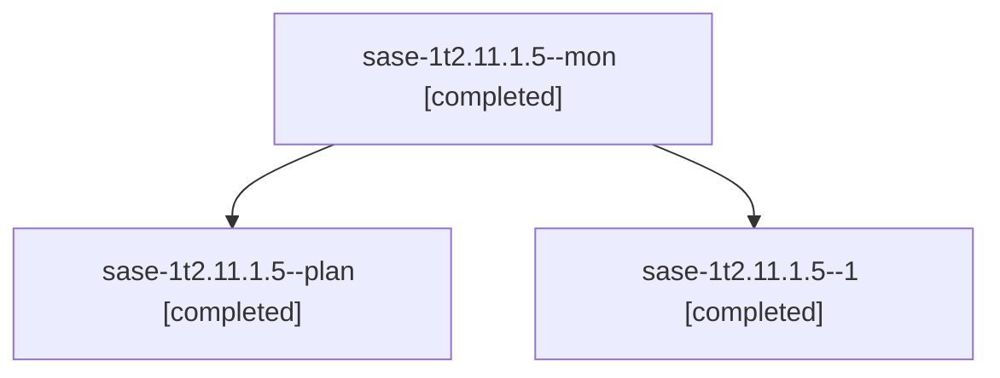

# Session: sase-1t2.11.1.5

[Agent Hoods](../README.md) / [bbugyi200](../users/bbugyi200/README.md) / [athena](../users/bbugyi200/machines/athena/README.md) / [sase-1t2](../users/bbugyi200/machines/athena/hoods/sase-1t2/README.md) / sase-1t2.11.1.5

Owner: `bbugyi200.athena` · Hood: `sase-1t2` · Members: 3 · Bead: [sase-1t2.11.1.5](https://github.com/sase-org/sase--beads/blob/main/pages/sase-1t2/sase-1t2.11.1.5.md)

## Lineage

The diagram is an optional enhancement; the ordered table below contains the same lineage in accessible text.

| Role | Agent | State | Model / provider | Timing | Commits | Prompt | Chat |
|---|---|---|---|---|---:|---|---|
| mon | sase-1t2.11.1.5--mon | completed | muse-spark-1.3-contributor / muse | 2026-11-17T02:50:38.884277+00:00 → 2026-11-17T02:55:03.942072+00:00 | 0 | — | [Chat](../agents/bbugyi200.athena.sase-1t2.11.1.5--mon/chat.md) |
| plan | sase-1t2.11.1.5--plan | completed | muse-spark-1.3-contributor / muse | 2026-11-17T02:27:07.951779+00:00 → 2026-11-17T02:53:28.934129+00:00 | 0 | [Prompt](../agents/bbugyi200.athena.sase-1t2.11.1.5--plan/prompt.md) | [Chat](../agents/bbugyi200.athena.sase-1t2.11.1.5--plan/chat.md) |
| 1 | sase-1t2.11.1.5--1 | completed | muse-spark-1.3-contributor / muse | 2026-11-17T02:56:42.153291+00:00 → 2026-11-17T03:00:41.828402+00:00 | [1](../agents/bbugyi200.athena.sase-1t2.11.1.5--1/README.md#commits) | [Prompt](../agents/bbugyi200.athena.sase-1t2.11.1.5--1/prompt.md) | [Chat](../agents/bbugyi200.athena.sase-1t2.11.1.5--1/chat.md) |

## Commits

| Role | Repo | Commit | Subject | Committed |
|---|---|---|---|---|
| 1 | sase | [`c52a24a`](https://github.com/sase-org/sase/commit/c52a24ade967836e4abac3ec93f7b0a40df07888) | feat(ace-tui): present monitor recovery in hijack panel | 2026-11-16 21:59:24 EST |

## Neighbors

| Agent | Relation | State |
|---|---|---|
| [sase-1t2.11](bbugyi200.athena.sase-1t2.11.md) (session · 3) | ancestor | active 1, completed 2 |
| [sase-1t2.11.1.1](../agents/bbugyi200.athena.sase-1t2.11.1.1/README.md) | sase-1t2.11.1 hood | completed |
| [sase-1t2.11.1.2](../agents/bbugyi200.athena.sase-1t2.11.1.2/README.md) | sase-1t2.11.1 hood | completed |
| [sase-1t2.11.1.3](bbugyi200.athena.sase-1t2.11.1.3.md) (session · 3) | sase-1t2.11.1 hood | completed 3 |
| [sase-1t2.11.1.4](../agents/bbugyi200.athena.sase-1t2.11.1.4/README.md) | sase-1t2.11.1 hood | completed |
| [sase-1t2.11.1.6](bbugyi200.athena.sase-1t2.11.1.6.md) (session · 5) | sase-1t2.11.1 hood | completed 3, failed 2 |
| [sase-1t2.11.1.7](../agents/bbugyi200.athena.sase-1t2.11.1.7/README.md) | sase-1t2.11.1 hood | completed |
| [sase-1t2.11.1.land](../agents/bbugyi200.athena.sase-1t2.11.1.land/README.md) | sase-1t2.11.1 hood | waiting |
| [sase-1t2.1](../agents/bbugyi200.athena.sase-1t2.1/README.md) | sase-1t2 hood | completed |
| [sase-1t2.10](../agents/bbugyi200.athena.sase-1t2.10/README.md) | sase-1t2 hood | completed |
| [sase-1t2.12](../agents/bbugyi200.athena.sase-1t2.12/README.md) | sase-1t2 hood | completed |
| [sase-1t2.13](../agents/bbugyi200.athena.sase-1t2.13/README.md) | sase-1t2 hood | waiting |
| [sase-1t2.14](../agents/bbugyi200.athena.sase-1t2.14/README.md) | sase-1t2 hood | waiting |
| [sase-1t2.2](../agents/bbugyi200.athena.sase-1t2.2/README.md) | sase-1t2 hood | completed |
| [sase-1t2.3](bbugyi200.athena.sase-1t2.3.md) (session · 3) | sase-1t2 hood | completed 3 |
| [sase-1t2.4](bbugyi200.athena.sase-1t2.4.md) (session · 5) | sase-1t2 hood | completed 4, failed 1 |
| [sase-1t2.5](../agents/bbugyi200.athena.sase-1t2.5/README.md) | sase-1t2 hood | completed |
| [sase-1t2.6](bbugyi200.athena.sase-1t2.6.md) (session · 3) | sase-1t2 hood | completed 2, failed 1 |
| [sase-1t2.7](bbugyi200.athena.sase-1t2.7.md) (session · 5) | sase-1t2 hood | completed 4, failed 1 |
| [sase-1t2.8](bbugyi200.athena.sase-1t2.8.md) (session · 3) | sase-1t2 hood | active 1, completed 2 |
| [sase-1t2.8.1.1](../agents/bbugyi200.athena.sase-1t2.8.1.1/README.md) | sase-1t2 hood | completed |
| [sase-1t2.8.1.2](bbugyi200.athena.sase-1t2.8.1.2.md) (session · 4) | sase-1t2 hood | completed 3, failed 1 |
| [sase-1t2.8.1.3](../agents/bbugyi200.athena.sase-1t2.8.1.3/README.md) | sase-1t2 hood | completed |
| [sase-1t2.8.1.4](../agents/bbugyi200.athena.sase-1t2.8.1.4/README.md) | sase-1t2 hood | completed |
| [sase-1t2.8.1.5](../agents/bbugyi200.athena.sase-1t2.8.1.5/README.md) | sase-1t2 hood | completed |
| [sase-1t2.8.1.6](bbugyi200.athena.sase-1t2.8.1.6.md) (session · 3) | sase-1t2 hood | completed 2, failed 1 |
| [sase-1t2.8.1.7](../agents/bbugyi200.athena.sase-1t2.8.1.7/README.md) | sase-1t2 hood | completed |
| [sase-1t2.8.1.land](../agents/bbugyi200.athena.sase-1t2.8.1.land/README.md) | sase-1t2 hood | completed |
| [sase-1t2.9](../agents/bbugyi200.athena.sase-1t2.9/README.md) | sase-1t2 hood | completed |
| [sase-1t2.land](../agents/bbugyi200.athena.sase-1t2.land/README.md) | sase-1t2 hood | waiting |
