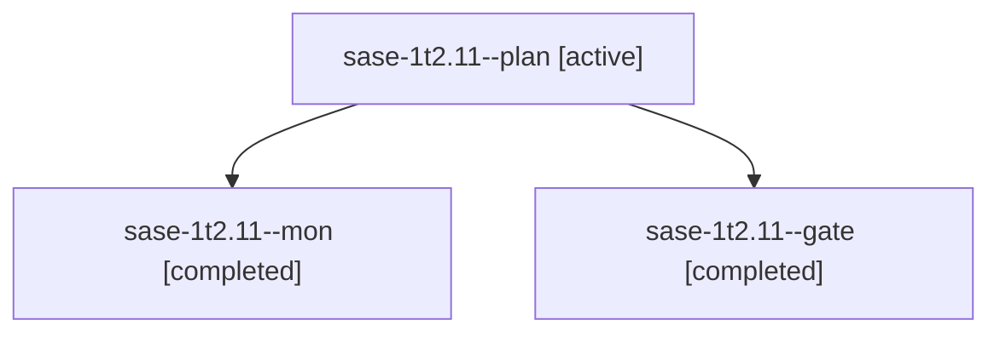

# Session: sase-1t2.11

[Agent Hoods](../README.md) / [bbugyi200](../users/bbugyi200/README.md) / [athena](../users/bbugyi200/machines/athena/README.md) / [sase-1t2](../users/bbugyi200/machines/athena/hoods/sase-1t2/README.md) / sase-1t2.11

Owner: `bbugyi200.athena` · Hood: `sase-1t2` · Members: 3 · Bead: [sase-1t2.11](https://github.com/sase-org/sase--beads/blob/main/pages/sase-1t2/sase-1t2.11.md)

## Lineage

The diagram is an optional enhancement; the ordered table below contains the same lineage in accessible text.

| Role | Agent | State | Model / provider | Timing | Commits | Prompt | Chat |
|---|---|---|---|---|---:|---|---|
| plan | sase-1t2.11--plan | active | gpt-6-astra / codex | 2026-11-16T20:17:36.773827+00:00 → 2026-11-16T20:27:13.776445+00:00 | 0 | [Prompt](../agents/bbugyi200.athena.sase-1t2.11--plan/prompt.md) | [Chat](../agents/bbugyi200.athena.sase-1t2.11--plan/chat.md) |
| mon | sase-1t2.11--mon | completed | gpt-6-astra / codex | 2026-11-16T20:27:05.960252+00:00 → 2026-11-16T20:30:40.782883+00:00 | 0 | — | [Chat](../agents/bbugyi200.athena.sase-1t2.11--mon/chat.md) |
| gate | sase-1t2.11--gate | completed | gpt-6-astra / codex | 2026-11-16T20:26:38.894203+00:00 → 2026-11-16T20:27:07.260028+00:00 | 0 | — | [Chat](../agents/bbugyi200.athena.sase-1t2.11--gate/chat.md) |

## Neighbors

| Agent | Relation | State |
|---|---|---|
| [sase-1t2.11.1.1](../agents/bbugyi200.athena.sase-1t2.11.1.1/README.md) | descendant | completed |
| [sase-1t2.11.1.2](../agents/bbugyi200.athena.sase-1t2.11.1.2/README.md) | descendant | completed |
| [sase-1t2.11.1.3](bbugyi200.athena.sase-1t2.11.1.3.md) (session · 3) | descendant | completed 3 |
| [sase-1t2.11.1.4](../agents/bbugyi200.athena.sase-1t2.11.1.4/README.md) | descendant | waiting |
| [sase-1t2.11.1.5](bbugyi200.athena.sase-1t2.11.1.5.md) (session · 3) | descendant | completed 3 |
| [sase-1t2.11.1.6](../agents/bbugyi200.athena.sase-1t2.11.1.6/README.md) | descendant | waiting |
| [sase-1t2.11.1.7](../agents/bbugyi200.athena.sase-1t2.11.1.7/README.md) | descendant | waiting |
| [sase-1t2.11.1.land](../agents/bbugyi200.athena.sase-1t2.11.1.land/README.md) | descendant | waiting |
| [sase-1t2.1](../agents/bbugyi200.athena.sase-1t2.1/README.md) | sase-1t2 hood | completed |
| [sase-1t2.10](../agents/bbugyi200.athena.sase-1t2.10/README.md) | sase-1t2 hood | completed |
| [sase-1t2.12](../agents/bbugyi200.athena.sase-1t2.12/README.md) | sase-1t2 hood | completed |
| [sase-1t2.13](../agents/bbugyi200.athena.sase-1t2.13/README.md) | sase-1t2 hood | waiting |
| [sase-1t2.14](../agents/bbugyi200.athena.sase-1t2.14/README.md) | sase-1t2 hood | waiting |
| [sase-1t2.2](../agents/bbugyi200.athena.sase-1t2.2/README.md) | sase-1t2 hood | completed |
| [sase-1t2.3](bbugyi200.athena.sase-1t2.3.md) (session · 3) | sase-1t2 hood | completed 3 |
| [sase-1t2.4](bbugyi200.athena.sase-1t2.4.md) (session · 5) | sase-1t2 hood | completed 4, failed 1 |
| [sase-1t2.5](../agents/bbugyi200.athena.sase-1t2.5/README.md) | sase-1t2 hood | completed |
| [sase-1t2.6](bbugyi200.athena.sase-1t2.6.md) (session · 3) | sase-1t2 hood | completed 2, failed 1 |
| [sase-1t2.7](bbugyi200.athena.sase-1t2.7.md) (session · 5) | sase-1t2 hood | completed 4, failed 1 |
| [sase-1t2.8](bbugyi200.athena.sase-1t2.8.md) (session · 3) | sase-1t2 hood | active 1, completed 2 |
| [sase-1t2.8.1.1](../agents/bbugyi200.athena.sase-1t2.8.1.1/README.md) | sase-1t2 hood | completed |
| [sase-1t2.8.1.2](bbugyi200.athena.sase-1t2.8.1.2.md) (session · 4) | sase-1t2 hood | completed 3, failed 1 |
| [sase-1t2.8.1.3](../agents/bbugyi200.athena.sase-1t2.8.1.3/README.md) | sase-1t2 hood | completed |
| [sase-1t2.8.1.4](../agents/bbugyi200.athena.sase-1t2.8.1.4/README.md) | sase-1t2 hood | completed |
| [sase-1t2.8.1.5](../agents/bbugyi200.athena.sase-1t2.8.1.5/README.md) | sase-1t2 hood | completed |
| [sase-1t2.8.1.6](bbugyi200.athena.sase-1t2.8.1.6.md) (session · 3) | sase-1t2 hood | completed 2, failed 1 |
| [sase-1t2.8.1.7](../agents/bbugyi200.athena.sase-1t2.8.1.7/README.md) | sase-1t2 hood | completed |
| [sase-1t2.8.1.land](../agents/bbugyi200.athena.sase-1t2.8.1.land/README.md) | sase-1t2 hood | completed |
| [sase-1t2.9](../agents/bbugyi200.athena.sase-1t2.9/README.md) | sase-1t2 hood | completed |
| [sase-1t2.land](../agents/bbugyi200.athena.sase-1t2.land/README.md) | sase-1t2 hood | waiting |
