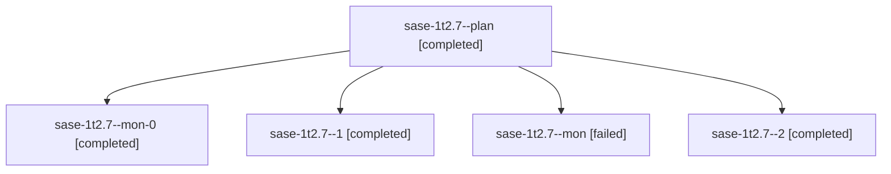

# Session: sase-1t2.7

[Agent Hoods](../README.md) / [bbugyi200](../users/bbugyi200/README.md) / [athena](../users/bbugyi200/machines/athena/README.md) / [sase-1t2](../users/bbugyi200/machines/athena/hoods/sase-1t2/README.md) / sase-1t2.7

Owner: `bbugyi200.athena` · Hood: `sase-1t2` · Members: 5 · Bead: [sase-1t2.7](https://github.com/sase-org/sase--beads/blob/main/pages/sase-1t2/sase-1t2.7.md)

## Lineage

The diagram is an optional enhancement; the ordered table below contains the same lineage in accessible text.

| Role | Agent | State | Model / provider | Timing | Commits | Prompt | Chat |
|---|---|---|---|---|---:|---|---|
| plan | sase-1t2.7--plan | completed | grok-4.6 / grok | 2026-11-16T06:29:08.905509+00:00 → 2026-11-16T07:23:04.023203+00:00 | 0 | [Prompt](../agents/bbugyi200.athena.sase-1t2.7--plan/prompt.md) | [Chat](../agents/bbugyi200.athena.sase-1t2.7--plan/chat.md) |
| mon-0 | sase-1t2.7--mon-0 | completed | grok-4.6 / grok | 2026-11-16T07:32:41.768553+00:00 → 2026-11-16T07:49:52.359374+00:00 | 0 | — | [Chat](../agents/bbugyi200.athena.sase-1t2.7--mon-0/chat.md) |
| 1 | sase-1t2.7--1 | completed | grok-4.6 / grok | 2026-11-16T07:28:42.026432+00:00 → 2026-11-16T07:34:12.683153+00:00 | 0 | [Prompt](../agents/bbugyi200.athena.sase-1t2.7--1/prompt.md) | [Chat](../agents/bbugyi200.athena.sase-1t2.7--1/chat.md) |
| mon | sase-1t2.7--mon | failed | grok-4.6 / grok | 2026-11-16T07:21:18.462679+00:00 → 2026-11-16T07:27:48.105140+00:00 | 0 | — | [Chat](../agents/bbugyi200.athena.sase-1t2.7--mon/chat.md) |
| 2 | sase-1t2.7--2 | completed | grok-4.6 / grok | 2026-11-16T07:50:32.856652+00:00 → 2026-11-16T08:56:47.540959+00:00 | [1](../agents/bbugyi200.athena.sase-1t2.7--2/README.md#commits) | [Prompt](../agents/bbugyi200.athena.sase-1t2.7--2/prompt.md) | [Chat](../agents/bbugyi200.athena.sase-1t2.7--2/chat.md) |

## Commits

| Role | Repo | Commit | Subject | Committed |
|---|---|---|---|---|
| 2 | sase | [`8254254`](https://github.com/sase-org/sase/commit/8254254e2f61726db20f2313ce4f8afb9b7e4300) | feat(agent-hijack): add real-pipeline hijack canary | 2026-11-16 03:55:28 EST |

## Neighbors

| Agent | Relation | State |
|---|---|---|
| [sase-1t2.1](../agents/bbugyi200.athena.sase-1t2.1/README.md) | sase-1t2 hood | completed |
| [sase-1t2.10](../agents/bbugyi200.athena.sase-1t2.10/README.md) | sase-1t2 hood | waiting |
| [sase-1t2.11](../agents/bbugyi200.athena.sase-1t2.11/README.md) | sase-1t2 hood | waiting |
| [sase-1t2.12](../agents/bbugyi200.athena.sase-1t2.12/README.md) | sase-1t2 hood | completed |
| [sase-1t2.13](../agents/bbugyi200.athena.sase-1t2.13/README.md) | sase-1t2 hood | waiting |
| [sase-1t2.14](../agents/bbugyi200.athena.sase-1t2.14/README.md) | sase-1t2 hood | waiting |
| [sase-1t2.2](../agents/bbugyi200.athena.sase-1t2.2/README.md) | sase-1t2 hood | completed |
| [sase-1t2.3](bbugyi200.athena.sase-1t2.3.md) (session · 3) | sase-1t2 hood | completed 3 |
| [sase-1t2.4](bbugyi200.athena.sase-1t2.4.md) (session · 5) | sase-1t2 hood | completed 4, failed 1 |
| [sase-1t2.5](../agents/bbugyi200.athena.sase-1t2.5/README.md) | sase-1t2 hood | completed |
| [sase-1t2.6](bbugyi200.athena.sase-1t2.6.md) (session · 3) | sase-1t2 hood | completed 2, failed 1 |
| [sase-1t2.8](bbugyi200.athena.sase-1t2.8.md) (session · 3) | sase-1t2 hood | active 1, completed 2 |
| [sase-1t2.8.1.1](../agents/bbugyi200.athena.sase-1t2.8.1.1/README.md) | sase-1t2 hood | completed |
| [sase-1t2.8.1.2](bbugyi200.athena.sase-1t2.8.1.2.md) (session · 4) | sase-1t2 hood | completed 3, failed 1 |
| [sase-1t2.8.1.3](../agents/bbugyi200.athena.sase-1t2.8.1.3/README.md) | sase-1t2 hood | completed |
| [sase-1t2.8.1.4](../agents/bbugyi200.athena.sase-1t2.8.1.4/README.md) | sase-1t2 hood | completed |
| [sase-1t2.8.1.5](../agents/bbugyi200.athena.sase-1t2.8.1.5/README.md) | sase-1t2 hood | completed |
| [sase-1t2.8.1.6](bbugyi200.athena.sase-1t2.8.1.6.md) (session · 3) | sase-1t2 hood | completed 2, failed 1 |
| [sase-1t2.8.1.7](../agents/bbugyi200.athena.sase-1t2.8.1.7/README.md) | sase-1t2 hood | waiting |
| [sase-1t2.8.1.land](../agents/bbugyi200.athena.sase-1t2.8.1.land/README.md) | sase-1t2 hood | waiting |
| [sase-1t2.9](../agents/bbugyi200.athena.sase-1t2.9/README.md) | sase-1t2 hood | completed |
| [sase-1t2.land](../agents/bbugyi200.athena.sase-1t2.land/README.md) | sase-1t2 hood | waiting |
