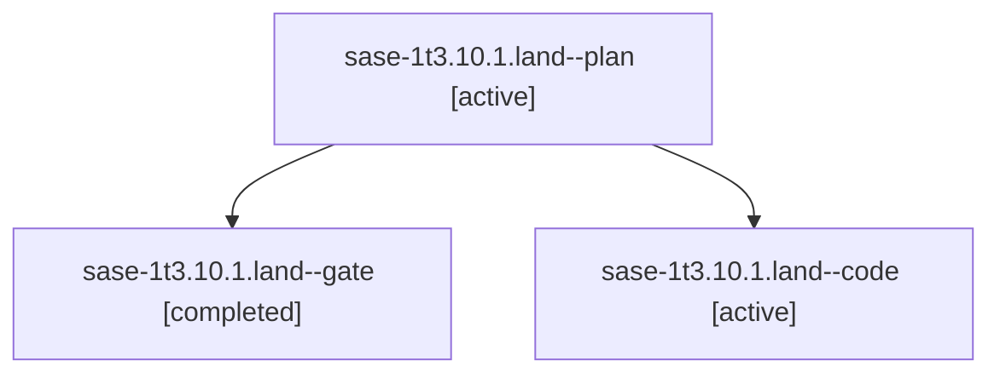

# Session: sase-1t3.10.1.land

[Agent Hoods](../README.md) / [bbugyi200](../users/bbugyi200/README.md) / [athena](../users/bbugyi200/machines/athena/README.md) / [sase-1t3](../users/bbugyi200/machines/athena/hoods/sase-1t3/README.md) / sase-1t3.10.1.land

Owner: `bbugyi200.athena` · Hood: `sase-1t3` · Members: 3 · Bead: [sase-1t3.10.1](https://github.com/sase-org/sase--beads/blob/main/pages/sase-1t3/sase-1t3.10.1.md)

## Lineage



The diagram is an optional enhancement; the ordered table below contains the same lineage in accessible text.

| Role | Agent | State | Model / provider | Timing | Commits | Prompt | Chat |
|---|---|---|---|---|---:|---|---|
| <a id="member-plan"></a>plan | sase-1t3.10.1.land--plan | active | gpt-6-astra / codex | 2026-11-18T16:11:40.547869+00:00 | [1](../agents/bbugyi200.athena.sase-1t3.10.1.land--plan/README.md#commits) | [Prompt](../agents/bbugyi200.athena.sase-1t3.10.1.land--plan/prompt.md) | [Chat](../agents/bbugyi200.athena.sase-1t3.10.1.land--plan/chat.md) |
| <a id="member-gate"></a>gate | sase-1t3.10.1.land--gate | completed | gpt-6-astra / codex | 2026-11-18T17:58:51.045171+00:00 → 2026-11-18T17:59:01.565117+00:00 | 0 | — | [Chat](../agents/bbugyi200.athena.sase-1t3.10.1.land--gate/chat.md) |
| <a id="member-code"></a>code | sase-1t3.10.1.land--code | active | gpt-6-luna / codex | 2026-11-18T17:59:43.194313+00:00 | 0 | — | — |

## Commits

| Role | Repo | Commit | Subject | Committed |
|---|---|---|---|---|
| plan | sase | [`fbfaf07`](https://github.com/sase-org/sase/commit/fbfaf07123b790738caf0bf203b3f3d3711aa374) | refactor(agent-scan): retire unused compact-list landing APIs | 2026-11-18 12:57:07 EST |

## Variables

| Role | Variable | Value |
|---|---|---|
| plan | `artifacts` | \[{bead: sase-1t3.10.1, kind: file, label: Slim list landing reproduction script, path: /home/bryan/.sase/artifacts/agents/gh\_sase-org\_\_sase/20261118094001/sase\_slim\_landing\_evidence-18015c01fdaa.py,… |

#### artifacts

**Role:** `plan`

```yaml
- bead: sase-1t3.10.1
  kind: file
  label: Slim list landing reproduction script
  path: /home/bryan/.sase/artifacts/agents/gh_sase-org__sase/20261118094001/sase_slim_landing_evidence-18015c01fdaa.py
  ref: file:explicit:390183b0f5d7c729aaa2f505
  source_path: /tmp/sase_slim_landing_evidence.py
- bead: sase-1t3.10.1
  kind: file
  label: Slim list landing reproduction results
  path: /home/bryan/.sase/artifacts/agents/gh_sase-org__sase/20261118094001/sase_slim_landing_evidence-44f38beb7f49.txt
  ref: file:explicit:b20e7bc07e4622a2fb08abb5
  source_path: /tmp/sase_slim_landing_evidence.txt
- kind: file
  label: slim-list-landing-cancellation-rerun
  path: /home/bryan/.sase/artifacts/agents/gh_sase-org__sase/20261118094001/sase-slim-cancellation-rerun-26412626c711.log
  ref: file:explicit:5a1946d926ef97e2b7ce4d60
  source_path: /tmp/sase-slim-cancellation-rerun.log
```

Values are truncated for display; see each member's agent meta.json for the full values.

## Neighbors

| Agent | Relation | State |
|---|---|---|
| [sase-1t3.10](bbugyi200.athena.sase-1t3.10.md) (session · 3) | ancestor | active 1, completed 2 |
| [sase-1t3.10.1.1](../agents/bbugyi200.athena.sase-1t3.10.1.1/README.md) | sase-1t3.10.1 hood | completed |
| [sase-1t3.10.1.2](../agents/bbugyi200.athena.sase-1t3.10.1.2/README.md) | sase-1t3.10.1 hood | completed |
| [sase-1t3.10.1.3](bbugyi200.athena.sase-1t3.10.1.3.md) (session · 3) | sase-1t3.10.1 hood | completed 2, failed 1 |
| [sase-1t3.10.1.3](../agents/bbugyi200.athena.sase-1t3.10.1.3/README.md) | sase-1t3.10.1 hood | completed |
| [sase-1t3.10.1.4](bbugyi200.athena.sase-1t3.10.1.4.md) (session · 3) | sase-1t3.10.1 hood | completed 3 |
| [sase-1t3.10.1.4](../agents/bbugyi200.athena.sase-1t3.10.1.4/README.md) | sase-1t3.10.1 hood | waiting |
| [sase-1t3.1](bbugyi200.athena.sase-1t3.1.md) (session · 2) | sase-1t3 hood | completed 2 |
| [sase-1t3.1](../agents/bbugyi200.athena.sase-1t3.1/README.md) | sase-1t3 hood | completed |
| [sase-1t3.11](bbugyi200.athena.sase-1t3.11.md) (session · 3) | sase-1t3 hood | active 1, completed 2 |
| [sase-1t3.11.1.1](../agents/bbugyi200.athena.sase-1t3.11.1.1/README.md) | sase-1t3 hood | completed |
| [sase-1t3.11.1.2](bbugyi200.athena.sase-1t3.11.1.2.md) (session · 5) | sase-1t3 hood | completed 3, failed 2 |
| [sase-1t3.11.1.3](../agents/bbugyi200.athena.sase-1t3.11.1.3/README.md) | sase-1t3 hood | completed |
| [sase-1t3.11.1.4](../agents/bbugyi200.athena.sase-1t3.11.1.4/README.md) | sase-1t3 hood | completed |
| [sase-1t3.11.1.5](../agents/bbugyi200.athena.sase-1t3.11.1.5/README.md) | sase-1t3 hood | completed |
| [sase-1t3.11.1.6](bbugyi200.athena.sase-1t3.11.1.6.md) (session · 8) | sase-1t3 hood | completed 7, failed 1 |
| [sase-1t3.11.1.land](bbugyi200.athena.sase-1t3.11.1.land.md) (session · 3) | sase-1t3 hood | completed 3 |
| [sase-1t3.12](bbugyi200.athena.sase-1t3.12.md) (session · 11) | sase-1t3 hood | completed 8, failed 3 |
| [sase-1t3.13](../agents/bbugyi200.athena.sase-1t3.13/README.md) | sase-1t3 hood | waiting |
| [sase-1t3.14](../agents/bbugyi200.athena.sase-1t3.14/README.md) | sase-1t3 hood | waiting |
| [sase-1t3.2](bbugyi200.athena.sase-1t3.2.md) (session · 5) | sase-1t3 hood | completed 5 |
| [sase-1t3.3](../agents/bbugyi200.athena.sase-1t3.3/README.md) | sase-1t3 hood | completed |
| [sase-1t3.4](bbugyi200.athena.sase-1t3.4.md) (session · 4) | sase-1t3 hood | completed 3, failed 1 |
| [sase-1t3.5](bbugyi200.athena.sase-1t3.5.md) (session · 6) | sase-1t3 hood | completed 4, failed 2 |
| [sase-1t3.6](bbugyi200.athena.sase-1t3.6.md) (session · 3) | sase-1t3 hood | active 1, completed 2 |
| [sase-1t3.6.1.1](../agents/bbugyi200.athena.sase-1t3.6.1.1/README.md) | sase-1t3 hood | completed |
| [sase-1t3.6.1.2](../agents/bbugyi200.athena.sase-1t3.6.1.2/README.md) | sase-1t3 hood | completed |
| [sase-1t3.6.1.3](bbugyi200.athena.sase-1t3.6.1.3.md) (session · 15) | sase-1t3 hood | completed 11, failed 4 |
| [sase-1t3.6.1.land](bbugyi200.athena.sase-1t3.6.1.land.md) (session · 5) | sase-1t3 hood | completed 4, failed 1 |
| [sase-1t3.6.1.land](../agents/bbugyi200.athena.sase-1t3.6.1.land/README.md) | sase-1t3 hood | completed |
| [sase-1t3.7](bbugyi200.athena.sase-1t3.7.md) (session · 3) | sase-1t3 hood | active 1, completed 2 |
| [sase-1t3.7.1.1](bbugyi200.athena.sase-1t3.7.1.1.md) (session · 15) | sase-1t3 hood | completed 8, failed 7 |
| [sase-1t3.7.1.2](bbugyi200.athena.sase-1t3.7.1.2.md) (session · 3) | sase-1t3 hood | completed 2, failed 1 |
| [sase-1t3.7.1.land](bbugyi200.athena.sase-1t3.7.1.land.md) (session · 3) | sase-1t3 hood | completed 3 |
| [sase-1t3.8](bbugyi200.athena.sase-1t3.8.md) (session · 9) | sase-1t3 hood | completed 7, failed 2 |
| [sase-1t3.8](../agents/bbugyi200.athena.sase-1t3.8/README.md) | sase-1t3 hood | waiting |
| [sase-1t3.9](bbugyi200.athena.sase-1t3.9.md) (session · 5) | sase-1t3 hood | completed 5 |
| [sase-1t3.land](../agents/bbugyi200.athena.sase-1t3.land/README.md) | sase-1t3 hood | waiting |
