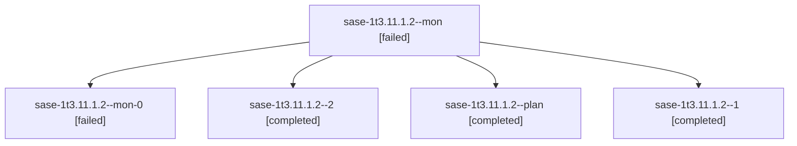

# Session: sase-1t3.11.1.2

[Agent Hoods](../README.md) / [bbugyi200](../users/bbugyi200/README.md) / [athena](../users/bbugyi200/machines/athena/README.md) / [sase-1t3](../users/bbugyi200/machines/athena/hoods/sase-1t3/README.md) / sase-1t3.11.1.2

Owner: `bbugyi200.athena` · Hood: `sase-1t3` · Members: 5 · Bead: [sase-1t3.11.1.2](https://github.com/sase-org/sase--beads/blob/main/pages/sase-1t3/sase-1t3.11.1.2.md)

## Lineage

The diagram is an optional enhancement; the ordered table below contains the same lineage in accessible text.

| Role | Agent | State | Model / provider | Timing | Commits | Prompt | Chat |
|---|---|---|---|---|---:|---|---|
| mon | sase-1t3.11.1.2--mon | failed | muse-spark-1.3-contributor / muse | 2026-11-17T20:34:44.337145+00:00 → 2026-11-17T20:41:38.196106+00:00 | 0 | — | [Chat](../agents/bbugyi200.athena.sase-1t3.11.1.2--mon/chat.md) |
| mon-0 | sase-1t3.11.1.2--mon-0 | failed | muse-spark-1.3-contributor / muse | 2026-11-17T20:52:28.377417+00:00 → 2026-11-17T22:18:35.414157+00:00 | 0 | — | [Chat](../agents/bbugyi200.athena.sase-1t3.11.1.2--mon-0/chat.md) |
| 2 | sase-1t3.11.1.2--2 | completed | muse-spark-1.3-contributor / muse | 2026-11-17T22:18:35.001910+00:00 → 2026-11-17T22:25:37.976648+00:00 | [1](../agents/bbugyi200.athena.sase-1t3.11.1.2--2/README.md#commits) | [Prompt](../agents/bbugyi200.athena.sase-1t3.11.1.2--2/prompt.md) | [Chat](../agents/bbugyi200.athena.sase-1t3.11.1.2--2/chat.md) |
| plan | sase-1t3.11.1.2--plan | completed | muse-spark-1.3-contributor / muse | 2026-11-17T19:39:37.464618+00:00 → 2026-11-17T20:40:31.566890+00:00 | [1](../agents/bbugyi200.athena.sase-1t3.11.1.2--plan/README.md#commits) | [Prompt](../agents/bbugyi200.athena.sase-1t3.11.1.2--plan/prompt.md) | [Chat](../agents/bbugyi200.athena.sase-1t3.11.1.2--plan/chat.md) |
| 1 | sase-1t3.11.1.2--1 | completed | muse-spark-1.3-contributor / muse | 2026-11-17T20:41:37.940322+00:00 → 2026-11-17T22:16:44.186917+00:00 | 0 | [Prompt](../agents/bbugyi200.athena.sase-1t3.11.1.2--1/prompt.md) | [Chat](../agents/bbugyi200.athena.sase-1t3.11.1.2--1/chat.md) |

## Commits

| Role | Repo | Commit | Subject | Committed |
|---|---|---|---|---|
| plan | sase | [`1c626f3`](https://github.com/sase-org/sase/commit/1c626f39e5a40ede6de4c7d60082f1e46d193ecd) | feat(memory-reads): query memory audit log with targeted Rust backend | 2026-11-17 15:39:07 EST |
| 2 | sase | [`cd0b9c5`](https://github.com/sase-org/sase/commit/cd0b9c52733af177af29cadf61c6cde474b6340c) | fix(memory-reads): privatize audit row per symvision unused-public hierarchy | 2026-11-17 17:23:59 EST |

## Neighbors

| Agent | Relation | State |
|---|---|---|
| [sase-1t3.11](bbugyi200.athena.sase-1t3.11.md) (session · 3) | ancestor | active 1, completed 2 |
| [sase-1t3.11.1.1](../agents/bbugyi200.athena.sase-1t3.11.1.1/README.md) | sase-1t3.11.1 hood | completed |
| [sase-1t3.11.1.3](../agents/bbugyi200.athena.sase-1t3.11.1.3/README.md) | sase-1t3.11.1 hood | completed |
| [sase-1t3.11.1.4](../agents/bbugyi200.athena.sase-1t3.11.1.4/README.md) | sase-1t3.11.1 hood | completed |
| [sase-1t3.11.1.5](../agents/bbugyi200.athena.sase-1t3.11.1.5/README.md) | sase-1t3.11.1 hood | completed |
| [sase-1t3.11.1.6](bbugyi200.athena.sase-1t3.11.1.6.md) (session · 8) | sase-1t3.11.1 hood | completed 7, failed 1 |
| [sase-1t3.11.1.land](bbugyi200.athena.sase-1t3.11.1.land.md) (session · 3) | sase-1t3.11.1 hood | completed 3 |
| [sase-1t3.1](bbugyi200.athena.sase-1t3.1.md) (session · 2) | sase-1t3 hood | completed 2 |
| [sase-1t3.1](../agents/bbugyi200.athena.sase-1t3.1/README.md) | sase-1t3 hood | completed |
| [sase-1t3.10](bbugyi200.athena.sase-1t3.10.md) (session · 3) | sase-1t3 hood | active 1, completed 2 |
| [sase-1t3.10.1.1](../agents/bbugyi200.athena.sase-1t3.10.1.1/README.md) | sase-1t3 hood | completed |
| [sase-1t3.10.1.2](../agents/bbugyi200.athena.sase-1t3.10.1.2/README.md) | sase-1t3 hood | completed |
| [sase-1t3.10.1.3](bbugyi200.athena.sase-1t3.10.1.3.md) (session · 3) | sase-1t3 hood | completed 2, failed 1 |
| [sase-1t3.10.1.3](../agents/bbugyi200.athena.sase-1t3.10.1.3/README.md) | sase-1t3 hood | completed |
| [sase-1t3.10.1.4](bbugyi200.athena.sase-1t3.10.1.4.md) (session · 3) | sase-1t3 hood | active 1, completed 2 |
| [sase-1t3.10.1.4](../agents/bbugyi200.athena.sase-1t3.10.1.4/README.md) | sase-1t3 hood | waiting |
| [sase-1t3.10.1.land](../agents/bbugyi200.athena.sase-1t3.10.1.land/README.md) | sase-1t3 hood | waiting |
| [sase-1t3.12](bbugyi200.athena.sase-1t3.12.md) (session · 11) | sase-1t3 hood | completed 8, failed 3 |
| [sase-1t3.13](../agents/bbugyi200.athena.sase-1t3.13/README.md) | sase-1t3 hood | waiting |
| [sase-1t3.14](../agents/bbugyi200.athena.sase-1t3.14/README.md) | sase-1t3 hood | waiting |
| [sase-1t3.2](bbugyi200.athena.sase-1t3.2.md) (session · 5) | sase-1t3 hood | completed 5 |
| [sase-1t3.3](../agents/bbugyi200.athena.sase-1t3.3/README.md) | sase-1t3 hood | completed |
| [sase-1t3.4](bbugyi200.athena.sase-1t3.4.md) (session · 4) | sase-1t3 hood | completed 3, failed 1 |
| [sase-1t3.5](bbugyi200.athena.sase-1t3.5.md) (session · 6) | sase-1t3 hood | completed 4, failed 2 |
| [sase-1t3.6](bbugyi200.athena.sase-1t3.6.md) (session · 3) | sase-1t3 hood | active 1, completed 2 |
| [sase-1t3.6.1.1](../agents/bbugyi200.athena.sase-1t3.6.1.1/README.md) | sase-1t3 hood | completed |
| [sase-1t3.6.1.2](../agents/bbugyi200.athena.sase-1t3.6.1.2/README.md) | sase-1t3 hood | completed |
| [sase-1t3.6.1.3](bbugyi200.athena.sase-1t3.6.1.3.md) (session · 15) | sase-1t3 hood | completed 11, failed 4 |
| [sase-1t3.6.1.land](bbugyi200.athena.sase-1t3.6.1.land.md) (session · 5) | sase-1t3 hood | completed 4, failed 1 |
| [sase-1t3.6.1.land](../agents/bbugyi200.athena.sase-1t3.6.1.land/README.md) | sase-1t3 hood | completed |
| [sase-1t3.7](bbugyi200.athena.sase-1t3.7.md) (session · 3) | sase-1t3 hood | active 1, completed 2 |
| [sase-1t3.7.1.1](bbugyi200.athena.sase-1t3.7.1.1.md) (session · 15) | sase-1t3 hood | completed 8, failed 7 |
| [sase-1t3.7.1.2](bbugyi200.athena.sase-1t3.7.1.2.md) (session · 3) | sase-1t3 hood | completed 2, failed 1 |
| [sase-1t3.7.1.land](bbugyi200.athena.sase-1t3.7.1.land.md) (session · 3) | sase-1t3 hood | completed 3 |
| [sase-1t3.8](bbugyi200.athena.sase-1t3.8.md) (session · 9) | sase-1t3 hood | completed 7, failed 2 |
| [sase-1t3.8](../agents/bbugyi200.athena.sase-1t3.8/README.md) | sase-1t3 hood | waiting |
| [sase-1t3.9](bbugyi200.athena.sase-1t3.9.md) (session · 5) | sase-1t3 hood | completed 5 |
| [sase-1t3.land](../agents/bbugyi200.athena.sase-1t3.land/README.md) | sase-1t3 hood | waiting |
