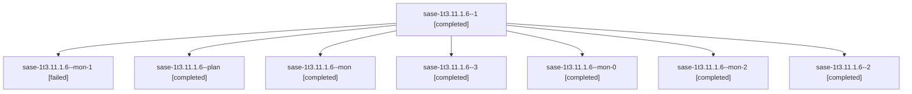

# Session: sase-1t3.11.1.6

[Agent Hoods](../README.md) / [bbugyi200](../users/bbugyi200/README.md) / [athena](../users/bbugyi200/machines/athena/README.md) / [sase-1t3](../users/bbugyi200/machines/athena/hoods/sase-1t3/README.md) / sase-1t3.11.1.6

Owner: `bbugyi200.athena` · Hood: `sase-1t3` · Members: 8 · Bead: [sase-1t3.11.1.6](https://github.com/sase-org/sase--beads/blob/main/pages/sase-1t3/sase-1t3.11.1.6.md)

## Lineage

The diagram is an optional enhancement; the ordered table below contains the same lineage in accessible text.

| Role | Agent | State | Model / provider | Timing | Commits | Prompt | Chat |
|---|---|---|---|---|---:|---|---|
| 1 | sase-1t3.11.1.6--1 | completed | gpt-6-luna / codex | 2026-11-18T05:43:44.726236+00:00 → 2026-11-18T05:57:21.239621+00:00 | 0 | [Prompt](../agents/bbugyi200.athena.sase-1t3.11.1.6--1/prompt.md) | [Chat](../agents/bbugyi200.athena.sase-1t3.11.1.6--1/chat.md) |
| mon-1 | sase-1t3.11.1.6--mon-1 | failed | gpt-6-luna / codex | 2026-11-18T06:28:59.025346+00:00 → 2026-11-18T06:54:12.153109+00:00 | 0 | — | [Chat](../agents/bbugyi200.athena.sase-1t3.11.1.6--mon-1/chat.md) |
| plan | sase-1t3.11.1.6--plan | completed | gpt-6-luna / codex | 2026-11-18T05:23:14.903248+00:00 → 2026-11-18T05:35:10.791466+00:00 | 0 | [Prompt](../agents/bbugyi200.athena.sase-1t3.11.1.6--plan/prompt.md) | [Chat](../agents/bbugyi200.athena.sase-1t3.11.1.6--plan/chat.md) |
| mon | sase-1t3.11.1.6--mon | completed | gpt-6-luna / codex | 2026-11-18T05:34:18.721820+00:00 → 2026-11-18T05:43:44.843342+00:00 | 0 | — | [Chat](../agents/bbugyi200.athena.sase-1t3.11.1.6--mon/chat.md) |
| 3 | sase-1t3.11.1.6--3 | completed | gpt-6-luna / codex | 2026-11-18T06:54:12.043998+00:00 → 2026-11-18T07:03:42.119995+00:00 | 0 | [Prompt](../agents/bbugyi200.athena.sase-1t3.11.1.6--3/prompt.md) | [Chat](../agents/bbugyi200.athena.sase-1t3.11.1.6--3/chat.md) |
| mon-0 | sase-1t3.11.1.6--mon-0 | completed | gpt-6-luna / codex | 2026-11-18T05:55:49.251197+00:00 → 2026-11-18T06:11:32.942126+00:00 | 0 | — | [Chat](../agents/bbugyi200.athena.sase-1t3.11.1.6--mon-0/chat.md) |
| mon-2 | sase-1t3.11.1.6--mon-2 | completed | gpt-6-luna / codex | 2026-11-18T07:02:20.340726+00:00 → 2026-11-18T07:32:06.757541+00:00 | [1](../agents/bbugyi200.athena.sase-1t3.11.1.6--mon-2/README.md#commits) | — | [Chat](../agents/bbugyi200.athena.sase-1t3.11.1.6--mon-2/chat.md) |
| 2 | sase-1t3.11.1.6--2 | completed | gpt-6-luna / codex | 2026-11-18T06:12:42.842368+00:00 → 2026-11-18T06:31:27.659175+00:00 | 0 | [Prompt](../agents/bbugyi200.athena.sase-1t3.11.1.6--2/prompt.md) | [Chat](../agents/bbugyi200.athena.sase-1t3.11.1.6--2/chat.md) |

## Commits

| Role | Repo | Commit | Subject | Committed |
|---|---|---|---|---|
| mon-2 | sase | [`81e124e`](https://github.com/sase-org/sase/commit/81e124eca85a9f0a369fb3fb3382c18406e676bd) | perf(tui): verify bounded log retention | 2026-11-18 02:30:41 EST |

## Neighbors

| Agent | Relation | State |
|---|---|---|
| [sase-1t3.11](bbugyi200.athena.sase-1t3.11.md) (session · 3) | ancestor | active 1, completed 2 |
| [sase-1t3.11.1.1](../agents/bbugyi200.athena.sase-1t3.11.1.1/README.md) | sase-1t3.11.1 hood | completed |
| [sase-1t3.11.1.2](bbugyi200.athena.sase-1t3.11.1.2.md) (session · 5) | sase-1t3.11.1 hood | completed 3, failed 2 |
| [sase-1t3.11.1.3](../agents/bbugyi200.athena.sase-1t3.11.1.3/README.md) | sase-1t3.11.1 hood | completed |
| [sase-1t3.11.1.4](../agents/bbugyi200.athena.sase-1t3.11.1.4/README.md) | sase-1t3.11.1 hood | completed |
| [sase-1t3.11.1.5](../agents/bbugyi200.athena.sase-1t3.11.1.5/README.md) | sase-1t3.11.1 hood | completed |
| [sase-1t3.11.1.land](bbugyi200.athena.sase-1t3.11.1.land.md) (session · 3) | sase-1t3.11.1 hood | completed 3 |
| [sase-1t3.1](bbugyi200.athena.sase-1t3.1.md) (session · 2) | sase-1t3 hood | completed 2 |
| [sase-1t3.1](../agents/bbugyi200.athena.sase-1t3.1/README.md) | sase-1t3 hood | completed |
| [sase-1t3.10](bbugyi200.athena.sase-1t3.10.md) (session · 3) | sase-1t3 hood | active 1, completed 2 |
| [sase-1t3.10.1.1](../agents/bbugyi200.athena.sase-1t3.10.1.1/README.md) | sase-1t3 hood | completed |
| [sase-1t3.10.1.2](../agents/bbugyi200.athena.sase-1t3.10.1.2/README.md) | sase-1t3 hood | completed |
| [sase-1t3.10.1.3](bbugyi200.athena.sase-1t3.10.1.3.md) (session · 3) | sase-1t3 hood | completed 2, failed 1 |
| [sase-1t3.10.1.3](../agents/bbugyi200.athena.sase-1t3.10.1.3/README.md) | sase-1t3 hood | completed |
| [sase-1t3.10.1.4](bbugyi200.athena.sase-1t3.10.1.4.md) (session · 3) | sase-1t3 hood | completed 3 |
| [sase-1t3.10.1.4](../agents/bbugyi200.athena.sase-1t3.10.1.4/README.md) | sase-1t3 hood | waiting |
| [sase-1t3.10.1.land](bbugyi200.athena.sase-1t3.10.1.land.md) (session · 5) | sase-1t3 hood | completed 5 |
| [sase-1t3.10.1.land](../agents/bbugyi200.athena.sase-1t3.10.1.land/README.md) | sase-1t3 hood | completed |
| [sase-1t3.12](bbugyi200.athena.sase-1t3.12.md) (session · 11) | sase-1t3 hood | completed 8, failed 3 |
| [sase-1t3.13](bbugyi200.athena.sase-1t3.13.md) (session · 3) | sase-1t3 hood | active 1, completed 2 |
| [sase-1t3.13.1.1](../agents/bbugyi200.athena.sase-1t3.13.1.1/README.md) | sase-1t3 hood | completed |
| [sase-1t3.13.1.2](../agents/bbugyi200.athena.sase-1t3.13.1.2/README.md) | sase-1t3 hood | completed |
| [sase-1t3.13.1.3](bbugyi200.athena.sase-1t3.13.1.3.md) (session · 3) | sase-1t3 hood | completed 3 |
| [sase-1t3.13.1.4](bbugyi200.athena.sase-1t3.13.1.4.md) (session · 3) | sase-1t3 hood | completed 3 |
| [sase-1t3.13.1.5](bbugyi200.athena.sase-1t3.13.1.5.md) (session · 3) | sase-1t3 hood | completed 3 |
| [sase-1t3.13.1.land](bbugyi200.athena.sase-1t3.13.1.land.md) (session · 3) | sase-1t3 hood | completed 3 |
| [sase-1t3.14](../agents/bbugyi200.athena.sase-1t3.14/README.md) | sase-1t3 hood | waiting |
| [sase-1t3.2](bbugyi200.athena.sase-1t3.2.md) (session · 5) | sase-1t3 hood | completed 5 |
| [sase-1t3.3](../agents/bbugyi200.athena.sase-1t3.3/README.md) | sase-1t3 hood | completed |
| [sase-1t3.4](bbugyi200.athena.sase-1t3.4.md) (session · 4) | sase-1t3 hood | completed 3, failed 1 |
| [sase-1t3.5](bbugyi200.athena.sase-1t3.5.md) (session · 6) | sase-1t3 hood | completed 4, failed 2 |
| [sase-1t3.6](bbugyi200.athena.sase-1t3.6.md) (session · 3) | sase-1t3 hood | active 1, completed 2 |
| [sase-1t3.6.1.1](../agents/bbugyi200.athena.sase-1t3.6.1.1/README.md) | sase-1t3 hood | completed |
| [sase-1t3.6.1.2](../agents/bbugyi200.athena.sase-1t3.6.1.2/README.md) | sase-1t3 hood | completed |
| [sase-1t3.6.1.3](bbugyi200.athena.sase-1t3.6.1.3.md) (session · 15) | sase-1t3 hood | completed 11, failed 4 |
| [sase-1t3.6.1.land](bbugyi200.athena.sase-1t3.6.1.land.md) (session · 5) | sase-1t3 hood | completed 4, failed 1 |
| [sase-1t3.6.1.land](../agents/bbugyi200.athena.sase-1t3.6.1.land/README.md) | sase-1t3 hood | completed |
| [sase-1t3.7](bbugyi200.athena.sase-1t3.7.md) (session · 3) | sase-1t3 hood | active 1, completed 2 |
| [sase-1t3.7.1.1](bbugyi200.athena.sase-1t3.7.1.1.md) (session · 15) | sase-1t3 hood | completed 8, failed 7 |
| [sase-1t3.7.1.2](bbugyi200.athena.sase-1t3.7.1.2.md) (session · 3) | sase-1t3 hood | completed 2, failed 1 |
| [sase-1t3.7.1.land](bbugyi200.athena.sase-1t3.7.1.land.md) (session · 3) | sase-1t3 hood | completed 3 |
| [sase-1t3.8](bbugyi200.athena.sase-1t3.8.md) (session · 9) | sase-1t3 hood | completed 7, failed 2 |
| [sase-1t3.8](../agents/bbugyi200.athena.sase-1t3.8/README.md) | sase-1t3 hood | waiting |
| [sase-1t3.9](bbugyi200.athena.sase-1t3.9.md) (session · 5) | sase-1t3 hood | completed 5 |
| [sase-1t3.land](../agents/bbugyi200.athena.sase-1t3.land/README.md) | sase-1t3 hood | waiting |
