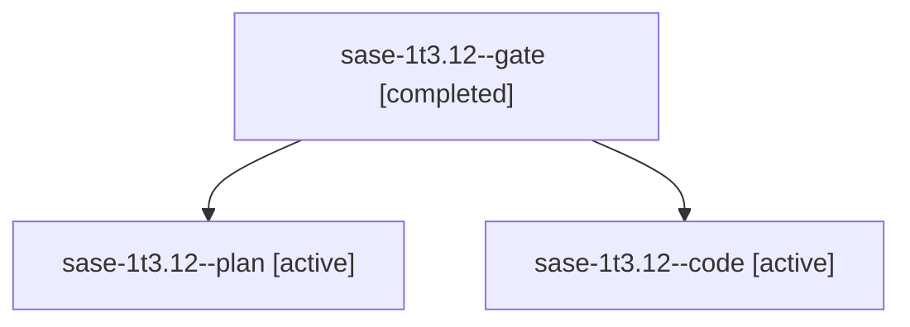

# Session: sase-1t3.12

[Agent Hoods](../README.md) / [bbugyi200](../users/bbugyi200/README.md) / [athena](../users/bbugyi200/machines/athena/README.md) / [sase-1t3](../users/bbugyi200/machines/athena/hoods/sase-1t3/README.md) / sase-1t3.12

Owner: `bbugyi200.athena` · Hood: `sase-1t3` · Members: 3 · Bead: [sase-1t3.12](https://github.com/sase-org/sase--beads/blob/main/pages/sase-1t3/sase-1t3.12.md)

## Lineage

The diagram is an optional enhancement; the ordered table below contains the same lineage in accessible text.

| Role | Agent | State | Model / provider | Timing | Commits | Prompt | Chat |
|---|---|---|---|---|---:|---|---|
| gate | sase-1t3.12--gate | completed | gpt-6-astra / codex | 2026-11-16T13:20:45.274139+00:00 → 2026-11-16T13:21:06.360047+00:00 | 0 | — | [Chat](../agents/bbugyi200.athena.sase-1t3.12--gate/chat.md) |
| plan | sase-1t3.12--plan | active | gpt-6-astra / codex | 2026-11-16T13:11:05.579493+00:00 | 0 | [Prompt](../agents/bbugyi200.athena.sase-1t3.12--plan/prompt.md) | [Chat](../agents/bbugyi200.athena.sase-1t3.12--plan/chat.md) |
| code | sase-1t3.12--code | active | grok-4.6 / grok | 2026-11-16T13:22:21.661309+00:00 | 0 | — | — |

## Neighbors

| Agent | Relation | State |
|---|---|---|
| [sase-1t3.1](../agents/bbugyi200.athena.sase-1t3.1/README.md) | sase-1t3 hood | active |
| [sase-1t3.10](../agents/bbugyi200.athena.sase-1t3.10/README.md) | sase-1t3 hood | waiting |
| [sase-1t3.11](../agents/bbugyi200.athena.sase-1t3.11/README.md) | sase-1t3 hood | waiting |
| [sase-1t3.13](../agents/bbugyi200.athena.sase-1t3.13/README.md) | sase-1t3 hood | waiting |
| [sase-1t3.14](../agents/bbugyi200.athena.sase-1t3.14/README.md) | sase-1t3 hood | waiting |
| [sase-1t3.2](bbugyi200.athena.sase-1t3.2.md) (session · 4) | sase-1t3 hood | active 1, completed 3 |
| [sase-1t3.3](../agents/bbugyi200.athena.sase-1t3.3/README.md) | sase-1t3 hood | active |
| [sase-1t3.4](../agents/bbugyi200.athena.sase-1t3.4/README.md) | sase-1t3 hood | waiting |
| [sase-1t3.5](bbugyi200.athena.sase-1t3.5.md) (session · 3) | sase-1t3 hood | active 1, completed 2 |
| [sase-1t3.6](bbugyi200.athena.sase-1t3.6.md) (session · 3) | sase-1t3 hood | active 1, completed 2 |
| [sase-1t3.6.1.1](../agents/bbugyi200.athena.sase-1t3.6.1.1/README.md) | sase-1t3 hood | active |
| [sase-1t3.6.1.2](../agents/bbugyi200.athena.sase-1t3.6.1.2/README.md) | sase-1t3 hood | waiting |
| [sase-1t3.6.1.3](../agents/bbugyi200.athena.sase-1t3.6.1.3/README.md) | sase-1t3 hood | waiting |
| [sase-1t3.6.1.land](../agents/bbugyi200.athena.sase-1t3.6.1.land/README.md) | sase-1t3 hood | waiting |
| [sase-1t3.7](../agents/bbugyi200.athena.sase-1t3.7/README.md) | sase-1t3 hood | waiting |
| [sase-1t3.8](../agents/bbugyi200.athena.sase-1t3.8/README.md) | sase-1t3 hood | waiting |
| [sase-1t3.9](../agents/bbugyi200.athena.sase-1t3.9/README.md) | sase-1t3 hood | waiting |
| [sase-1t3.land](../agents/bbugyi200.athena.sase-1t3.land/README.md) | sase-1t3 hood | waiting |
