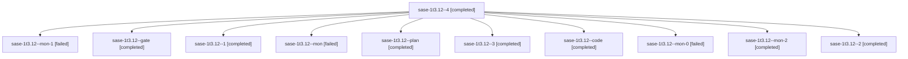

# Session: sase-1t3.12

[Agent Hoods](../README.md) / [bbugyi200](../users/bbugyi200/README.md) / [athena](../users/bbugyi200/machines/athena/README.md) / [sase-1t3](../users/bbugyi200/machines/athena/hoods/sase-1t3/README.md) / sase-1t3.12

Owner: `bbugyi200.athena` · Hood: `sase-1t3` · Members: 11 · Bead: [sase-1t3.12](https://github.com/sase-org/sase--beads/blob/main/pages/sase-1t3/sase-1t3.12.md)

## Lineage

The diagram is an optional enhancement; the ordered table below contains the same lineage in accessible text.

| Role | Agent | State | Model / provider | Timing | Commits | Prompt | Chat |
|---|---|---|---|---|---:|---|---|
| 4 | sase-1t3.12--4 | completed | grok-4.6 / grok | 2026-11-16T18:20:29.948697+00:00 → 2026-11-16T18:25:45.780710+00:00 | [1](../agents/bbugyi200.athena.sase-1t3.12--4/README.md#commits) | [Prompt](../agents/bbugyi200.athena.sase-1t3.12--4/prompt.md) | [Chat](../agents/bbugyi200.athena.sase-1t3.12--4/chat.md) |
| mon-1 | sase-1t3.12--mon-1 | failed | grok-4.6 / grok | 2026-11-16T16:58:49.226120+00:00 → 2026-11-16T17:37:03.595992+00:00 | 0 | — | [Chat](../agents/bbugyi200.athena.sase-1t3.12--mon-1/chat.md) |
| gate | sase-1t3.12--gate | completed | gpt-6-astra / codex | 2026-11-16T13:20:45.274139+00:00 → 2026-11-16T13:21:06.360047+00:00 | 0 | — | [Chat](../agents/bbugyi200.athena.sase-1t3.12--gate/chat.md) |
| 1 | sase-1t3.12--1 | completed | grok-4.6 / grok | 2026-11-16T16:00:38.033255+00:00 → 2026-11-16T16:11:05.252307+00:00 | 0 | [Prompt](../agents/bbugyi200.athena.sase-1t3.12--1/prompt.md) | [Chat](../agents/bbugyi200.athena.sase-1t3.12--1/chat.md) |
| mon | sase-1t3.12--mon | failed | grok-4.6 / grok | 2026-11-16T15:21:42.101702+00:00 → 2026-11-16T16:00:21.695634+00:00 | 0 | — | [Chat](../agents/bbugyi200.athena.sase-1t3.12--mon/chat.md) |
| plan | sase-1t3.12--plan | completed | gpt-6-astra / codex | 2026-11-16T13:11:05.579493+00:00 → 2026-11-16T15:23:29.140756+00:00 | 0 | [Prompt](../agents/bbugyi200.athena.sase-1t3.12--plan/prompt.md) | [Chat](../agents/bbugyi200.athena.sase-1t3.12--plan/chat.md) |
| 3 | sase-1t3.12--3 | completed | grok-4.6 / grok | 2026-11-16T17:37:50.785265+00:00 → 2026-11-16T17:45:33.886061+00:00 | 0 | [Prompt](../agents/bbugyi200.athena.sase-1t3.12--3/prompt.md) | [Chat](../agents/bbugyi200.athena.sase-1t3.12--3/chat.md) |
| code | sase-1t3.12--code | completed | grok-4.6 / grok | 2026-11-16T13:22:21.661309+00:00 → 2026-11-16T15:23:29.140756+00:00 | 0 | — | [Chat](../agents/bbugyi200.athena.sase-1t3.12--code/chat.md) |
| mon-0 | sase-1t3.12--mon-0 | failed | grok-4.6 / grok | 2026-11-16T16:09:46.411239+00:00 → 2026-11-16T16:45:09.102480+00:00 | 0 | — | [Chat](../agents/bbugyi200.athena.sase-1t3.12--mon-0/chat.md) |
| mon-2 | sase-1t3.12--mon-2 | completed | grok-4.6 / grok | 2026-11-16T17:44:32.095911+00:00 → 2026-11-16T18:19:35.167521+00:00 | 0 | — | [Chat](../agents/bbugyi200.athena.sase-1t3.12--mon-2/chat.md) |
| 2 | sase-1t3.12--2 | completed | grok-4.6 / grok | 2026-11-16T16:45:16.613924+00:00 → 2026-11-16T17:00:28.061606+00:00 | 0 | [Prompt](../agents/bbugyi200.athena.sase-1t3.12--2/prompt.md) | [Chat](../agents/bbugyi200.athena.sase-1t3.12--2/chat.md) |

## Commits

| Role | Repo | Commit | Subject | Committed |
|---|---|---|---|---|
| 4 | sase | [`f8c2763`](https://github.com/sase-org/sase/commit/f8c2763ae38fc3bb67afed60d8356b346563b5ec) | feat(agent-scan): surface terminalization diagnostics on the index update wire | 2026-11-16 13:24:31 EST |

## Neighbors

| Agent | Relation | State |
|---|---|---|
| [sase-1t3.1](bbugyi200.athena.sase-1t3.1.md) (session · 2) | sase-1t3 hood | completed 2 |
| [sase-1t3.1](../agents/bbugyi200.athena.sase-1t3.1/README.md) | sase-1t3 hood | completed |
| [sase-1t3.10](../agents/bbugyi200.athena.sase-1t3.10/README.md) | sase-1t3 hood | waiting |
| [sase-1t3.11](../agents/bbugyi200.athena.sase-1t3.11/README.md) | sase-1t3 hood | waiting |
| [sase-1t3.13](../agents/bbugyi200.athena.sase-1t3.13/README.md) | sase-1t3 hood | waiting |
| [sase-1t3.14](../agents/bbugyi200.athena.sase-1t3.14/README.md) | sase-1t3 hood | waiting |
| [sase-1t3.2](bbugyi200.athena.sase-1t3.2.md) (session · 5) | sase-1t3 hood | completed 5 |
| [sase-1t3.3](../agents/bbugyi200.athena.sase-1t3.3/README.md) | sase-1t3 hood | completed |
| [sase-1t3.4](bbugyi200.athena.sase-1t3.4.md) (session · 4) | sase-1t3 hood | completed 3, failed 1 |
| [sase-1t3.5](bbugyi200.athena.sase-1t3.5.md) (session · 6) | sase-1t3 hood | completed 4, failed 2 |
| [sase-1t3.6](bbugyi200.athena.sase-1t3.6.md) (session · 3) | sase-1t3 hood | active 1, completed 2 |
| [sase-1t3.6.1.1](../agents/bbugyi200.athena.sase-1t3.6.1.1/README.md) | sase-1t3 hood | completed |
| [sase-1t3.6.1.2](../agents/bbugyi200.athena.sase-1t3.6.1.2/README.md) | sase-1t3 hood | completed |
| [sase-1t3.6.1.3](bbugyi200.athena.sase-1t3.6.1.3.md) (session · 5) | sase-1t3 hood | active 1, completed 4 |
| [sase-1t3.6.1.land](../agents/bbugyi200.athena.sase-1t3.6.1.land/README.md) | sase-1t3 hood | waiting |
| [sase-1t3.7](bbugyi200.athena.sase-1t3.7.md) (session · 3) | sase-1t3 hood | active 1, completed 2 |
| [sase-1t3.7.1.1](bbugyi200.athena.sase-1t3.7.1.1.md) (session · 14) | sase-1t3 hood | active 1, completed 7, failed 6 |
| [sase-1t3.7.1.2](../agents/bbugyi200.athena.sase-1t3.7.1.2/README.md) | sase-1t3 hood | waiting |
| [sase-1t3.7.1.land](../agents/bbugyi200.athena.sase-1t3.7.1.land/README.md) | sase-1t3 hood | waiting |
| [sase-1t3.8](../agents/bbugyi200.athena.sase-1t3.8/README.md) | sase-1t3 hood | waiting |
| [sase-1t3.9](../agents/bbugyi200.athena.sase-1t3.9/README.md) | sase-1t3 hood | waiting |
| [sase-1t3.land](../agents/bbugyi200.athena.sase-1t3.land/README.md) | sase-1t3 hood | waiting |
