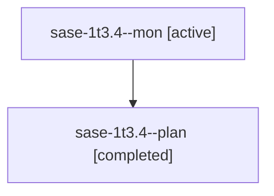

# Session: sase-1t3.4

[Agent Hoods](../README.md) / [bbugyi200](../users/bbugyi200/README.md) / [athena](../users/bbugyi200/machines/athena/README.md) / [sase-1t3](../users/bbugyi200/machines/athena/hoods/sase-1t3/README.md) / sase-1t3.4

Owner: `bbugyi200.athena` · Hood: `sase-1t3` · Members: 2 · Bead: [sase-1t3.4](https://github.com/sase-org/sase--beads/blob/main/pages/sase-1t3/sase-1t3.4.md)

## Lineage

The diagram is an optional enhancement; the ordered table below contains the same lineage in accessible text.

| Role | Agent | State | Model / provider | Timing | Commits | Prompt | Chat |
|---|---|---|---|---|---:|---|---|
| mon | sase-1t3.4--mon | active | grok-4.6 / grok | 2026-11-16T13:52:07.071824+00:00 | 0 | — | — |
| plan | sase-1t3.4--plan | completed | grok-4.6 / grok | 2026-11-16T13:35:04.145469+00:00 → 2026-11-16T13:53:59.854213+00:00 | 0 | [Prompt](../agents/bbugyi200.athena.sase-1t3.4--plan/prompt.md) | [Chat](../agents/bbugyi200.athena.sase-1t3.4--plan/chat.md) |

## Neighbors

| Agent | Relation | State |
|---|---|---|
| [sase-1t3.1](../agents/bbugyi200.athena.sase-1t3.1/README.md) | sase-1t3 hood | active |
| [sase-1t3.10](../agents/bbugyi200.athena.sase-1t3.10/README.md) | sase-1t3 hood | waiting |
| [sase-1t3.11](../agents/bbugyi200.athena.sase-1t3.11/README.md) | sase-1t3 hood | waiting |
| [sase-1t3.12](bbugyi200.athena.sase-1t3.12.md) (session · 3) | sase-1t3 hood | active 2, completed 1 |
| [sase-1t3.13](../agents/bbugyi200.athena.sase-1t3.13/README.md) | sase-1t3 hood | waiting |
| [sase-1t3.14](../agents/bbugyi200.athena.sase-1t3.14/README.md) | sase-1t3 hood | waiting |
| [sase-1t3.2](bbugyi200.athena.sase-1t3.2.md) (session · 5) | sase-1t3 hood | completed 5 |
| [sase-1t3.3](../agents/bbugyi200.athena.sase-1t3.3/README.md) | sase-1t3 hood | completed |
| [sase-1t3.5](bbugyi200.athena.sase-1t3.5.md) (session · 3) | sase-1t3 hood | active 1, completed 2 |
| [sase-1t3.6](bbugyi200.athena.sase-1t3.6.md) (session · 3) | sase-1t3 hood | active 1, completed 2 |
| [sase-1t3.6.1.1](../agents/bbugyi200.athena.sase-1t3.6.1.1/README.md) | sase-1t3 hood | active |
| [sase-1t3.6.1.2](../agents/bbugyi200.athena.sase-1t3.6.1.2/README.md) | sase-1t3 hood | waiting |
| [sase-1t3.6.1.3](../agents/bbugyi200.athena.sase-1t3.6.1.3/README.md) | sase-1t3 hood | waiting |
| [sase-1t3.6.1.land](../agents/bbugyi200.athena.sase-1t3.6.1.land/README.md) | sase-1t3 hood | waiting |
| [sase-1t3.7](../agents/bbugyi200.athena.sase-1t3.7/README.md) | sase-1t3 hood | waiting |
| [sase-1t3.8](../agents/bbugyi200.athena.sase-1t3.8/README.md) | sase-1t3 hood | waiting |
| [sase-1t3.9](../agents/bbugyi200.athena.sase-1t3.9/README.md) | sase-1t3 hood | waiting |
| [sase-1t3.land](../agents/bbugyi200.athena.sase-1t3.land/README.md) | sase-1t3 hood | waiting |
