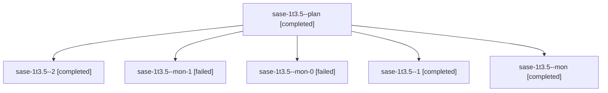

# Session: sase-1t3.5

[Agent Hoods](../README.md) / [bbugyi200](../users/bbugyi200/README.md) / [athena](../users/bbugyi200/machines/athena/README.md) / [sase-1t3](../users/bbugyi200/machines/athena/hoods/sase-1t3/README.md) / sase-1t3.5

Owner: `bbugyi200.athena` · Hood: `sase-1t3` · Members: 6 · Bead: [sase-1t3.5](https://github.com/sase-org/sase--beads/blob/main/pages/sase-1t3/sase-1t3.5.md)

## Lineage

The diagram is an optional enhancement; the ordered table below contains the same lineage in accessible text.

| Role | Agent | State | Model / provider | Timing | Commits | Prompt | Chat |
|---|---|---|---|---|---:|---|---|
| plan | sase-1t3.5--plan | completed | gpt-6-luna / codex | 2026-11-16T13:01:36.824823+00:00 → 2026-11-16T13:27:45.131815+00:00 | 0 | [Prompt](../agents/bbugyi200.athena.sase-1t3.5--plan/prompt.md) | [Chat](../agents/bbugyi200.athena.sase-1t3.5--plan/chat.md) |
| 2 | sase-1t3.5--2 | completed | gpt-6-luna / codex | 2026-11-16T19:40:14.095011+00:00 → 2026-11-16T19:53:38.165538+00:00 | 0 | [Prompt](../agents/bbugyi200.athena.sase-1t3.5--2/prompt.md) | [Chat](../agents/bbugyi200.athena.sase-1t3.5--2/chat.md) |
| mon-1 | sase-1t3.5--mon-1 | failed | gpt-6-luna / codex | 2026-11-16T19:51:49.018243+00:00 → 2026-11-16T20:36:36.798789+00:00 | [1](../agents/bbugyi200.athena.sase-1t3.5--mon-1/README.md#commits) | — | [Chat](../agents/bbugyi200.athena.sase-1t3.5--mon-1/chat.md) |
| mon-0 | sase-1t3.5--mon-0 | failed | gpt-6-luna / codex | 2026-11-16T18:14:35.584528+00:00 → 2026-11-16T19:38:48.166893+00:00 | 0 | — | [Chat](../agents/bbugyi200.athena.sase-1t3.5--mon-0/chat.md) |
| 1 | sase-1t3.5--1 | completed | gpt-6-luna / codex | 2026-11-16T13:34:21.210730+00:00 → 2026-11-16T18:16:34.990575+00:00 | 0 | [Prompt](../agents/bbugyi200.athena.sase-1t3.5--1/prompt.md) | [Chat](../agents/bbugyi200.athena.sase-1t3.5--1/chat.md) |
| mon | sase-1t3.5--mon | completed | gpt-6-luna / codex | 2026-11-16T13:26:17.030346+00:00 → 2026-11-16T13:30:14.011801+00:00 | 0 | — | [Chat](../agents/bbugyi200.athena.sase-1t3.5--mon/chat.md) |

## Commits

| Role | Repo | Commit | Subject | Committed |
|---|---|---|---|---|
| mon-1 | sase | [`fadbfdc`](https://github.com/sase-org/sase/commit/fadbfdc497dc98b2a17a0250b64c43a83da93a85) | feat(ace): memoize per-load agent loader work | 2026-11-16 15:35:18 EST |

## Neighbors

| Agent | Relation | State |
|---|---|---|
| [sase-1t3.1](bbugyi200.athena.sase-1t3.1.md) (session · 2) | sase-1t3 hood | completed 2 |
| [sase-1t3.1](../agents/bbugyi200.athena.sase-1t3.1/README.md) | sase-1t3 hood | completed |
| [sase-1t3.10](bbugyi200.athena.sase-1t3.10.md) (session · 3) | sase-1t3 hood | active 1, completed 2 |
| [sase-1t3.10.1.1](../agents/bbugyi200.athena.sase-1t3.10.1.1/README.md) | sase-1t3 hood | completed |
| [sase-1t3.10.1.2](../agents/bbugyi200.athena.sase-1t3.10.1.2/README.md) | sase-1t3 hood | active |
| [sase-1t3.10.1.3](../agents/bbugyi200.athena.sase-1t3.10.1.3/README.md) | sase-1t3 hood | waiting |
| [sase-1t3.10.1.4](../agents/bbugyi200.athena.sase-1t3.10.1.4/README.md) | sase-1t3 hood | waiting |
| [sase-1t3.10.1.land](../agents/bbugyi200.athena.sase-1t3.10.1.land/README.md) | sase-1t3 hood | waiting |
| [sase-1t3.11](bbugyi200.athena.sase-1t3.11.md) (session · 3) | sase-1t3 hood | active 1, completed 2 |
| [sase-1t3.11.1.1](../agents/bbugyi200.athena.sase-1t3.11.1.1/README.md) | sase-1t3 hood | completed |
| [sase-1t3.11.1.2](bbugyi200.athena.sase-1t3.11.1.2.md) (session · 2) | sase-1t3 hood | active 1, completed 1 |
| [sase-1t3.11.1.3](../agents/bbugyi200.athena.sase-1t3.11.1.3/README.md) | sase-1t3 hood | waiting |
| [sase-1t3.11.1.4](../agents/bbugyi200.athena.sase-1t3.11.1.4/README.md) | sase-1t3 hood | waiting |
| [sase-1t3.11.1.5](../agents/bbugyi200.athena.sase-1t3.11.1.5/README.md) | sase-1t3 hood | waiting |
| [sase-1t3.11.1.6](../agents/bbugyi200.athena.sase-1t3.11.1.6/README.md) | sase-1t3 hood | waiting |
| [sase-1t3.11.1.land](../agents/bbugyi200.athena.sase-1t3.11.1.land/README.md) | sase-1t3 hood | waiting |
| [sase-1t3.12](bbugyi200.athena.sase-1t3.12.md) (session · 11) | sase-1t3 hood | completed 8, failed 3 |
| [sase-1t3.13](../agents/bbugyi200.athena.sase-1t3.13/README.md) | sase-1t3 hood | waiting |
| [sase-1t3.14](../agents/bbugyi200.athena.sase-1t3.14/README.md) | sase-1t3 hood | waiting |
| [sase-1t3.2](bbugyi200.athena.sase-1t3.2.md) (session · 5) | sase-1t3 hood | completed 5 |
| [sase-1t3.3](../agents/bbugyi200.athena.sase-1t3.3/README.md) | sase-1t3 hood | completed |
| [sase-1t3.4](bbugyi200.athena.sase-1t3.4.md) (session · 4) | sase-1t3 hood | completed 3, failed 1 |
| [sase-1t3.6](bbugyi200.athena.sase-1t3.6.md) (session · 3) | sase-1t3 hood | active 1, completed 2 |
| [sase-1t3.6.1.1](../agents/bbugyi200.athena.sase-1t3.6.1.1/README.md) | sase-1t3 hood | completed |
| [sase-1t3.6.1.2](../agents/bbugyi200.athena.sase-1t3.6.1.2/README.md) | sase-1t3 hood | completed |
| [sase-1t3.6.1.3](bbugyi200.athena.sase-1t3.6.1.3.md) (session · 15) | sase-1t3 hood | completed 11, failed 4 |
| [sase-1t3.6.1.land](bbugyi200.athena.sase-1t3.6.1.land.md) (session · 5) | sase-1t3 hood | completed 4, failed 1 |
| [sase-1t3.6.1.land](../agents/bbugyi200.athena.sase-1t3.6.1.land/README.md) | sase-1t3 hood | completed |
| [sase-1t3.7](bbugyi200.athena.sase-1t3.7.md) (session · 3) | sase-1t3 hood | active 1, completed 2 |
| [sase-1t3.7.1.1](bbugyi200.athena.sase-1t3.7.1.1.md) (session · 15) | sase-1t3 hood | completed 8, failed 7 |
| [sase-1t3.7.1.2](bbugyi200.athena.sase-1t3.7.1.2.md) (session · 3) | sase-1t3 hood | completed 2, failed 1 |
| [sase-1t3.7.1.land](bbugyi200.athena.sase-1t3.7.1.land.md) (session · 3) | sase-1t3 hood | completed 3 |
| [sase-1t3.8](bbugyi200.athena.sase-1t3.8.md) (session · 9) | sase-1t3 hood | completed 7, failed 2 |
| [sase-1t3.8](../agents/bbugyi200.athena.sase-1t3.8/README.md) | sase-1t3 hood | waiting |
| [sase-1t3.9](bbugyi200.athena.sase-1t3.9.md) (session · 5) | sase-1t3 hood | completed 5 |
| [sase-1t3.land](../agents/bbugyi200.athena.sase-1t3.land/README.md) | sase-1t3 hood | waiting |
