# Session: sase-1t3.6.1.3

[Agent Hoods](../README.md) / [bbugyi200](../users/bbugyi200/README.md) / [athena](../users/bbugyi200/machines/athena/README.md) / [sase-1t3](../users/bbugyi200/machines/athena/hoods/sase-1t3/README.md) / sase-1t3.6.1.3

Owner: `bbugyi200.athena` · Hood: `sase-1t3` · Members: 15 · Bead: [sase-1t3.6.1.3](https://github.com/sase-org/sase--beads/blob/main/pages/sase-1t3/sase-1t3.6.1.3.md)

## Lineage

```mermaid
flowchart TD
  n0["sase-1t3.6.1.3--4 [completed]"]
  n1["sase-1t3.6.1.3--plan [completed]"]
  n0 --> n1
  n2["sase-1t3.6.1.3--mon-1 [failed]"]
  n0 --> n2
  n3["sase-1t3.6.1.3--mon-2 [completed]"]
  n0 --> n3
  n4["sase-1t3.6.1.3--1 [completed]"]
  n0 --> n4
  n5["sase-1t3.6.1.3--5 [completed]"]
  n0 --> n5
  n6["sase-1t3.6.1.3--mon-5 [completed]"]
  n0 --> n6
  n7["sase-1t3.6.1.3--mon-3 [completed]"]
  n0 --> n7
  n8["sase-1t3.6.1.3--7 [failed]"]
  n0 --> n8
  n9["sase-1t3.6.1.3--mon-4 [completed]"]
  n0 --> n9
  n10["sase-1t3.6.1.3--mon [failed]"]
  n0 --> n10
  n11["sase-1t3.6.1.3--mon-0 [failed]"]
  n0 --> n11
  n12["sase-1t3.6.1.3--3 [completed]"]
  n0 --> n12
  n13["sase-1t3.6.1.3--2 [completed]"]
  n0 --> n13
  n14["sase-1t3.6.1.3--6 [completed]"]
  n0 --> n14
```



The diagram is an optional enhancement; the ordered table below contains the same lineage in accessible text.

| Role | Agent | State | Model / provider | Timing | Commits | Prompt | Chat |
|---|---|---|---|---|---:|---|---|
| <a id="member-4"></a>4 | sase-1t3.6.1.3--4 | completed | gpt-6-luna / codex | 2026-11-16T21:32:43.672790+00:00 → 2026-11-16T22:27:14.230150+00:00 | 0 | [Prompt](../agents/bbugyi200.athena.sase-1t3.6.1.3--4/prompt.md) | [Chat](../agents/bbugyi200.athena.sase-1t3.6.1.3--4/chat.md) |
| <a id="member-plan"></a>plan | sase-1t3.6.1.3--plan | completed | gpt-6-astra / codex | 2026-11-17T02:10:47.882487+00:00 → 2026-11-17T02:28:15.615484+00:00 | 0 | [Prompt](../agents/bbugyi200.athena.sase-1t3.6.1.3--plan/prompt.md) | [Chat](../agents/bbugyi200.athena.sase-1t3.6.1.3--plan/chat.md) |
| <a id="member-mon-1"></a>mon-1 | sase-1t3.6.1.3--mon-1 | failed | gpt-6-astra / codex | 2026-11-17T04:19:18.299289+00:00 → 2026-11-17T04:39:21.352021+00:00 | 0 | — | [Chat](../agents/bbugyi200.athena.sase-1t3.6.1.3--mon-1/chat.md) |
| <a id="member-mon-2"></a>mon-2 | sase-1t3.6.1.3--mon-2 | completed | gpt-6-luna / codex | 2026-11-16T21:08:57.131710+00:00 → 2026-11-16T21:31:39.491003+00:00 | 0 | — | [Chat](../agents/bbugyi200.athena.sase-1t3.6.1.3--mon-2/chat.md) |
| <a id="member-1"></a>1 | sase-1t3.6.1.3--1 | completed | gpt-6-astra / codex | 2026-11-17T03:16:56.702384+00:00 → 2026-11-17T03:41:36.145884+00:00 | 0 | [Prompt](../agents/bbugyi200.athena.sase-1t3.6.1.3--1/prompt.md) | [Chat](../agents/bbugyi200.athena.sase-1t3.6.1.3--1/chat.md) |
| <a id="member-5"></a>5 | sase-1t3.6.1.3--5 | completed | gpt-6-luna / codex | 2026-11-16T22:30:53.523756+00:00 → 2026-11-16T22:39:12.790865+00:00 | 0 | [Prompt](../agents/bbugyi200.athena.sase-1t3.6.1.3--5/prompt.md) | [Chat](../agents/bbugyi200.athena.sase-1t3.6.1.3--5/chat.md) |
| <a id="member-mon-5"></a>mon-5 | sase-1t3.6.1.3--mon-5 | completed | gpt-6-luna / codex | 2026-11-16T23:14:08.905671+00:00 → 2026-11-16T23:57:46.316243+00:00 | 0 | — | [Chat](../agents/bbugyi200.athena.sase-1t3.6.1.3--mon-5/chat.md) |
| <a id="member-mon-3"></a>mon-3 | sase-1t3.6.1.3--mon-3 | completed | gpt-6-luna / codex | 2026-11-16T22:26:18.716336+00:00 → 2026-11-16T22:30:22.418031+00:00 | 0 | — | [Chat](../agents/bbugyi200.athena.sase-1t3.6.1.3--mon-3/chat.md) |
| <a id="member-7"></a>7 | sase-1t3.6.1.3--7 | failed | gpt-6-luna / codex | 2026-11-16T23:58:08.815885+00:00 → 2026-11-17T00:27:28.838234+00:00 | 0 | [Prompt](../agents/bbugyi200.athena.sase-1t3.6.1.3--7/prompt.md) | — |
| <a id="member-mon-4"></a>mon-4 | sase-1t3.6.1.3--mon-4 | completed | gpt-6-luna / codex | 2026-11-16T22:37:14.042202+00:00 → 2026-11-16T23:05:53.605466+00:00 | 0 | — | [Chat](../agents/bbugyi200.athena.sase-1t3.6.1.3--mon-4/chat.md) |
| <a id="member-mon"></a>mon | sase-1t3.6.1.3--mon | failed | gpt-6-astra / codex | 2026-11-17T02:27:34.209004+00:00 → 2026-11-17T03:16:27.123712+00:00 | 0 | — | [Chat](../agents/bbugyi200.athena.sase-1t3.6.1.3--mon/chat.md) |
| <a id="member-mon-0"></a>mon-0 | sase-1t3.6.1.3--mon-0 | failed | gpt-6-astra / codex | 2026-11-17T03:40:39.497032+00:00 → 2026-11-17T04:12:57.438131+00:00 | 0 | — | [Chat](../agents/bbugyi200.athena.sase-1t3.6.1.3--mon-0/chat.md) |
| <a id="member-3"></a>3 | sase-1t3.6.1.3--3 | completed | gpt-6-astra / codex | 2026-11-17T04:40:46.741071+00:00 → 2026-11-17T04:47:05.904160+00:00 | [1](../agents/bbugyi200.athena.sase-1t3.6.1.3--3/README.md#commits) | [Prompt](../agents/bbugyi200.athena.sase-1t3.6.1.3--3/prompt.md) | [Chat](../agents/bbugyi200.athena.sase-1t3.6.1.3--3/chat.md) |
| <a id="member-2"></a>2 | sase-1t3.6.1.3--2 | completed | gpt-6-astra / codex | 2026-11-17T04:13:22.424892+00:00 → 2026-11-17T04:20:13.032039+00:00 | 0 | [Prompt](../agents/bbugyi200.athena.sase-1t3.6.1.3--2/prompt.md) | [Chat](../agents/bbugyi200.athena.sase-1t3.6.1.3--2/chat.md) |
| <a id="member-6"></a>6 | sase-1t3.6.1.3--6 | completed | gpt-6-luna / codex | 2026-11-16T23:06:24.520289+00:00 → 2026-11-16T23:15:27.637404+00:00 | 0 | [Prompt](../agents/bbugyi200.athena.sase-1t3.6.1.3--6/prompt.md) | [Chat](../agents/bbugyi200.athena.sase-1t3.6.1.3--6/chat.md) |

## Commits

| Role | Repo | Commit | Subject | Committed |
|---|---|---|---|---|
| 3 | sase | [`7c514e2`](https://github.com/sase-org/sase/commit/7c514e2f8ee94a289fd5dbd10fbf7bafc4602bc9) | feat(agents): resolve sessions and clans through indexed core queries | 2026-11-16 23:45:57 EST |

## Variables

| Role | Variable | Value |
|---|---|---|
| 1 | `artifacts` | \[{bead: sase-1t3.6.1.3, kind: file, label: Indexed session and clan verification baseline evidence, path: /home/bryan/.sase/artifacts/agents/gh\_sase-org\_\_sase/20261116221526/sase-1t3.6.1.3-baseline-e… |
| 2 | `artifacts` | \[{bead: sase-1t3.6.1.3, kind: file, label: Indexed session clan runtime verification and final primary gate status, path: /home/bryan/.sase/artifacts/agents/gh\_sase-org\_\_sase/20261116231157/sase-1t3.… |

#### artifacts

**Role:** `1`

```yaml
- bead: sase-1t3.6.1.3
  kind: file
  label: Indexed session and clan verification baseline evidence
  path: /home/bryan/.sase/artifacts/agents/gh_sase-org__sase/20261116221526/sase-1t3.6.1.3-baseline-evidence-e29e147e8c4d.json
  ref: file:explicit:30a40133acfe3c8fa7bda0f4
  source_path: /tmp/sase-1t3.6.1.3-baseline-evidence.json
```

#### artifacts

**Role:** `2`

```yaml
- bead: sase-1t3.6.1.3
  kind: file
  label: Indexed session clan runtime verification and final primary gate status
  path: /home/bryan/.sase/artifacts/agents/gh_sase-org__sase/20261116231157/sase-1t3.6.1.3-runtime-verified-3f5ec379aac3.json
  ref: file:explicit:f39aaeb2254856086d4bd6a2
  source_path: /tmp/sase-1t3.6.1.3-runtime-verified.json
```

Values are truncated for display; see each member's agent meta.json for the full values.

## Neighbors

| Agent | Relation | State |
|---|---|---|
| [sase-1t3.6](bbugyi200.athena.sase-1t3.6.md) (session · 3) | ancestor | active 1, completed 2 |
| [sase-1t3.6.1.1](../agents/bbugyi200.athena.sase-1t3.6.1.1/README.md) | sase-1t3.6.1 hood | completed |
| [sase-1t3.6.1.2](../agents/bbugyi200.athena.sase-1t3.6.1.2/README.md) | sase-1t3.6.1 hood | completed |
| [sase-1t3.6.1.land](bbugyi200.athena.sase-1t3.6.1.land.md) (session · 5) | sase-1t3.6.1 hood | completed 4, failed 1 |
| [sase-1t3.6.1.land](../agents/bbugyi200.athena.sase-1t3.6.1.land/README.md) | sase-1t3.6.1 hood | completed |
| [sase-1t3.1](bbugyi200.athena.sase-1t3.1.md) (session · 2) | sase-1t3 hood | completed 2 |
| [sase-1t3.1](../agents/bbugyi200.athena.sase-1t3.1/README.md) | sase-1t3 hood | completed |
| [sase-1t3.10](bbugyi200.athena.sase-1t3.10.md) (session · 3) | sase-1t3 hood | active 1, completed 2 |
| [sase-1t3.10.1.1](../agents/bbugyi200.athena.sase-1t3.10.1.1/README.md) | sase-1t3 hood | completed |
| [sase-1t3.10.1.2](../agents/bbugyi200.athena.sase-1t3.10.1.2/README.md) | sase-1t3 hood | completed |
| [sase-1t3.10.1.3](bbugyi200.athena.sase-1t3.10.1.3.md) (session · 3) | sase-1t3 hood | completed 2, failed 1 |
| [sase-1t3.10.1.3](../agents/bbugyi200.athena.sase-1t3.10.1.3/README.md) | sase-1t3 hood | completed |
| [sase-1t3.10.1.4](bbugyi200.athena.sase-1t3.10.1.4.md) (session · 3) | sase-1t3 hood | completed 3 |
| [sase-1t3.10.1.4](../agents/bbugyi200.athena.sase-1t3.10.1.4/README.md) | sase-1t3 hood | waiting |
| [sase-1t3.10.1.land](bbugyi200.athena.sase-1t3.10.1.land.md) (session · 5) | sase-1t3 hood | completed 5 |
| [sase-1t3.10.1.land](../agents/bbugyi200.athena.sase-1t3.10.1.land/README.md) | sase-1t3 hood | completed |
| [sase-1t3.11](bbugyi200.athena.sase-1t3.11.md) (session · 3) | sase-1t3 hood | active 1, completed 2 |
| [sase-1t3.11.1.1](../agents/bbugyi200.athena.sase-1t3.11.1.1/README.md) | sase-1t3 hood | completed |
| [sase-1t3.11.1.2](bbugyi200.athena.sase-1t3.11.1.2.md) (session · 5) | sase-1t3 hood | completed 3, failed 2 |
| [sase-1t3.11.1.3](../agents/bbugyi200.athena.sase-1t3.11.1.3/README.md) | sase-1t3 hood | completed |
| [sase-1t3.11.1.4](../agents/bbugyi200.athena.sase-1t3.11.1.4/README.md) | sase-1t3 hood | completed |
| [sase-1t3.11.1.5](../agents/bbugyi200.athena.sase-1t3.11.1.5/README.md) | sase-1t3 hood | completed |
| [sase-1t3.11.1.6](bbugyi200.athena.sase-1t3.11.1.6.md) (session · 8) | sase-1t3 hood | completed 7, failed 1 |
| [sase-1t3.11.1.land](bbugyi200.athena.sase-1t3.11.1.land.md) (session · 3) | sase-1t3 hood | completed 3 |
| [sase-1t3.12](bbugyi200.athena.sase-1t3.12.md) (session · 11) | sase-1t3 hood | completed 8, failed 3 |
| [sase-1t3.13](bbugyi200.athena.sase-1t3.13.md) (session · 3) | sase-1t3 hood | active 1, completed 2 |
| [sase-1t3.13.1.1](../agents/bbugyi200.athena.sase-1t3.13.1.1/README.md) | sase-1t3 hood | completed |
| [sase-1t3.13.1.2](../agents/bbugyi200.athena.sase-1t3.13.1.2/README.md) | sase-1t3 hood | completed |
| [sase-1t3.13.1.3](bbugyi200.athena.sase-1t3.13.1.3.md) (session · 3) | sase-1t3 hood | completed 3 |
| [sase-1t3.13.1.4](bbugyi200.athena.sase-1t3.13.1.4.md) (session · 3) | sase-1t3 hood | completed 3 |
| [sase-1t3.13.1.5](bbugyi200.athena.sase-1t3.13.1.5.md) (session · 3) | sase-1t3 hood | completed 3 |
| [sase-1t3.13.1.land](bbugyi200.athena.sase-1t3.13.1.land.md) (session · 3) | sase-1t3 hood | completed 3 |
| [sase-1t3.14](bbugyi200.athena.sase-1t3.14.md) (session · 5) | sase-1t3 hood | completed 4, failed 1 |
| [sase-1t3.2](bbugyi200.athena.sase-1t3.2.md) (session · 5) | sase-1t3 hood | completed 5 |
| [sase-1t3.3](../agents/bbugyi200.athena.sase-1t3.3/README.md) | sase-1t3 hood | completed |
| [sase-1t3.4](bbugyi200.athena.sase-1t3.4.md) (session · 4) | sase-1t3 hood | completed 3, failed 1 |
| [sase-1t3.5](bbugyi200.athena.sase-1t3.5.md) (session · 6) | sase-1t3 hood | completed 4, failed 2 |
| [sase-1t3.7](bbugyi200.athena.sase-1t3.7.md) (session · 3) | sase-1t3 hood | active 1, completed 2 |
| [sase-1t3.7.1.1](bbugyi200.athena.sase-1t3.7.1.1.md) (session · 15) | sase-1t3 hood | completed 8, failed 7 |
| [sase-1t3.7.1.2](bbugyi200.athena.sase-1t3.7.1.2.md) (session · 3) | sase-1t3 hood | completed 2, failed 1 |
| [sase-1t3.7.1.land](bbugyi200.athena.sase-1t3.7.1.land.md) (session · 3) | sase-1t3 hood | completed 3 |
| [sase-1t3.8](bbugyi200.athena.sase-1t3.8.md) (session · 9) | sase-1t3 hood | completed 7, failed 2 |
| [sase-1t3.8](../agents/bbugyi200.athena.sase-1t3.8/README.md) | sase-1t3 hood | waiting |
| [sase-1t3.9](bbugyi200.athena.sase-1t3.9.md) (session · 5) | sase-1t3 hood | completed 5 |
| [sase-1t3.land](../agents/bbugyi200.athena.sase-1t3.land/README.md) | sase-1t3 hood | waiting |
