# Session: sase-1t3.6.1.3

[Agent Hoods](../README.md) / [bbugyi200](../users/bbugyi200/README.md) / [athena](../users/bbugyi200/machines/athena/README.md) / [sase-1t3](../users/bbugyi200/machines/athena/hoods/sase-1t3/README.md) / sase-1t3.6.1.3

Owner: `bbugyi200.athena` · Hood: `sase-1t3` · Members: 15 · Bead: [sase-1t3.6.1.3](https://github.com/sase-org/sase--beads/blob/main/pages/sase-1t3/sase-1t3.6.1.3.md)

## Lineage

```mermaid
flowchart TD
  n0["sase-1t3.6.1.3--4 [completed]"]
  n1["sase-1t3.6.1.3--2 [completed]"]
  n0 --> n1
  n2["sase-1t3.6.1.3--mon-2 [completed]"]
  n0 --> n2
  n3["sase-1t3.6.1.3--1 [completed]"]
  n0 --> n3
  n4["sase-1t3.6.1.3--5 [completed]"]
  n0 --> n4
  n5["sase-1t3.6.1.3--mon-5 [completed]"]
  n0 --> n5
  n6["sase-1t3.6.1.3--mon-3 [completed]"]
  n0 --> n6
  n7["sase-1t3.6.1.3--mon-1 [failed]"]
  n0 --> n7
  n8["sase-1t3.6.1.3--7 [failed]"]
  n0 --> n8
  n9["sase-1t3.6.1.3--mon [completed]"]
  n0 --> n9
  n10["sase-1t3.6.1.3--mon-4 [completed]"]
  n0 --> n10
  n11["sase-1t3.6.1.3--mon-0 [completed]"]
  n0 --> n11
  n12["sase-1t3.6.1.3--plan [completed]"]
  n0 --> n12
  n13["sase-1t3.6.1.3--3 [completed]"]
  n0 --> n13
  n14["sase-1t3.6.1.3--6 [completed]"]
  n0 --> n14
```

The diagram is an optional enhancement; the ordered table below contains the same lineage in accessible text.

| Role | Agent | State | Model / provider | Timing | Commits | Prompt | Chat |
|---|---|---|---|---|---:|---|---|
| 4 | sase-1t3.6.1.3--4 | completed | gpt-6-luna / codex | 2026-11-16T21:32:43.672790+00:00 → 2026-11-16T22:27:14.230150+00:00 | 0 | [Prompt](../agents/bbugyi200.athena.sase-1t3.6.1.3--4/prompt.md) | [Chat](../agents/bbugyi200.athena.sase-1t3.6.1.3--4/chat.md) |
| 2 | sase-1t3.6.1.3--2 | completed | gpt-6-luna / codex | 2026-11-16T20:43:47.665699+00:00 → 2026-11-16T20:52:28.860361+00:00 | 0 | [Prompt](../agents/bbugyi200.athena.sase-1t3.6.1.3--2/prompt.md) | [Chat](../agents/bbugyi200.athena.sase-1t3.6.1.3--2/chat.md) |
| mon-2 | sase-1t3.6.1.3--mon-2 | completed | gpt-6-luna / codex | 2026-11-16T21:08:57.131710+00:00 → 2026-11-16T21:31:39.491003+00:00 | 0 | — | [Chat](../agents/bbugyi200.athena.sase-1t3.6.1.3--mon-2/chat.md) |
| 1 | sase-1t3.6.1.3--1 | completed | gpt-6-luna / codex | 2026-11-16T19:18:04.307975+00:00 → 2026-11-16T20:22:35.685964+00:00 | 0 | [Prompt](../agents/bbugyi200.athena.sase-1t3.6.1.3--1/prompt.md) | [Chat](../agents/bbugyi200.athena.sase-1t3.6.1.3--1/chat.md) |
| 5 | sase-1t3.6.1.3--5 | completed | gpt-6-luna / codex | 2026-11-16T22:30:53.523756+00:00 → 2026-11-16T22:39:12.790865+00:00 | 0 | [Prompt](../agents/bbugyi200.athena.sase-1t3.6.1.3--5/prompt.md) | [Chat](../agents/bbugyi200.athena.sase-1t3.6.1.3--5/chat.md) |
| mon-5 | sase-1t3.6.1.3--mon-5 | completed | gpt-6-luna / codex | 2026-11-16T23:14:08.905671+00:00 → 2026-11-16T23:57:46.316243+00:00 | 0 | — | [Chat](../agents/bbugyi200.athena.sase-1t3.6.1.3--mon-5/chat.md) |
| mon-3 | sase-1t3.6.1.3--mon-3 | completed | gpt-6-luna / codex | 2026-11-16T22:26:18.716336+00:00 → 2026-11-16T22:30:22.418031+00:00 | 0 | — | [Chat](../agents/bbugyi200.athena.sase-1t3.6.1.3--mon-3/chat.md) |
| mon-1 | sase-1t3.6.1.3--mon-1 | failed | gpt-6-luna / codex | 2026-11-16T20:51:15.133441+00:00 → 2026-11-16T20:56:24.988731+00:00 | 0 | — | [Chat](../agents/bbugyi200.athena.sase-1t3.6.1.3--mon-1/chat.md) |
| 7 | sase-1t3.6.1.3--7 | failed | gpt-6-luna / codex | 2026-11-16T23:58:08.815885+00:00 → 2026-11-17T00:27:28.838234+00:00 | 0 | [Prompt](../agents/bbugyi200.athena.sase-1t3.6.1.3--7/prompt.md) | — |
| mon | sase-1t3.6.1.3--mon | completed | gpt-6-luna / codex | 2026-11-16T18:53:37.749645+00:00 → 2026-11-16T19:17:27.754078+00:00 | 0 | — | [Chat](../agents/bbugyi200.athena.sase-1t3.6.1.3--mon/chat.md) |
| mon-4 | sase-1t3.6.1.3--mon-4 | completed | gpt-6-luna / codex | 2026-11-16T22:37:14.042202+00:00 → 2026-11-16T23:05:53.605466+00:00 | 0 | — | [Chat](../agents/bbugyi200.athena.sase-1t3.6.1.3--mon-4/chat.md) |
| mon-0 | sase-1t3.6.1.3--mon-0 | completed | gpt-6-luna / codex | 2026-11-16T20:21:20.893176+00:00 → 2026-11-16T20:43:16.068072+00:00 | 0 | — | [Chat](../agents/bbugyi200.athena.sase-1t3.6.1.3--mon-0/chat.md) |
| plan | sase-1t3.6.1.3--plan | completed | gpt-6-luna / codex | 2026-11-16T18:18:57.710807+00:00 → 2026-11-16T18:55:42.649743+00:00 | 0 | [Prompt](../agents/bbugyi200.athena.sase-1t3.6.1.3--plan/prompt.md) | [Chat](../agents/bbugyi200.athena.sase-1t3.6.1.3--plan/chat.md) |
| 3 | sase-1t3.6.1.3--3 | completed | gpt-6-luna / codex | 2026-11-16T20:58:37.903834+00:00 → 2026-11-16T21:09:41.700499+00:00 | 0 | [Prompt](../agents/bbugyi200.athena.sase-1t3.6.1.3--3/prompt.md) | [Chat](../agents/bbugyi200.athena.sase-1t3.6.1.3--3/chat.md) |
| 6 | sase-1t3.6.1.3--6 | completed | gpt-6-luna / codex | 2026-11-16T23:06:24.520289+00:00 → 2026-11-16T23:15:27.637404+00:00 | 0 | [Prompt](../agents/bbugyi200.athena.sase-1t3.6.1.3--6/prompt.md) | [Chat](../agents/bbugyi200.athena.sase-1t3.6.1.3--6/chat.md) |

## Neighbors

| Agent | Relation | State |
|---|---|---|
| [sase-1t3.6](bbugyi200.athena.sase-1t3.6.md) (session · 3) | ancestor | active 1, completed 2 |
| [sase-1t3.6.1.1](../agents/bbugyi200.athena.sase-1t3.6.1.1/README.md) | sase-1t3.6.1 hood | completed |
| [sase-1t3.6.1.2](../agents/bbugyi200.athena.sase-1t3.6.1.2/README.md) | sase-1t3.6.1 hood | completed |
| [sase-1t3.6.1.land](../agents/bbugyi200.athena.sase-1t3.6.1.land/README.md) | sase-1t3.6.1 hood | waiting |
| [sase-1t3.1](bbugyi200.athena.sase-1t3.1.md) (session · 2) | sase-1t3 hood | completed 2 |
| [sase-1t3.1](../agents/bbugyi200.athena.sase-1t3.1/README.md) | sase-1t3 hood | completed |
| [sase-1t3.10](../agents/bbugyi200.athena.sase-1t3.10/README.md) | sase-1t3 hood | waiting |
| [sase-1t3.11](../agents/bbugyi200.athena.sase-1t3.11/README.md) | sase-1t3 hood | waiting |
| [sase-1t3.12](bbugyi200.athena.sase-1t3.12.md) (session · 11) | sase-1t3 hood | completed 8, failed 3 |
| [sase-1t3.13](../agents/bbugyi200.athena.sase-1t3.13/README.md) | sase-1t3 hood | waiting |
| [sase-1t3.14](../agents/bbugyi200.athena.sase-1t3.14/README.md) | sase-1t3 hood | waiting |
| [sase-1t3.2](bbugyi200.athena.sase-1t3.2.md) (session · 5) | sase-1t3 hood | completed 5 |
| [sase-1t3.3](../agents/bbugyi200.athena.sase-1t3.3/README.md) | sase-1t3 hood | completed |
| [sase-1t3.4](bbugyi200.athena.sase-1t3.4.md) (session · 4) | sase-1t3 hood | completed 3, failed 1 |
| [sase-1t3.5](bbugyi200.athena.sase-1t3.5.md) (session · 6) | sase-1t3 hood | completed 4, failed 2 |
| [sase-1t3.7](bbugyi200.athena.sase-1t3.7.md) (session · 3) | sase-1t3 hood | active 1, completed 2 |
| [sase-1t3.7.1.1](bbugyi200.athena.sase-1t3.7.1.1.md) (session · 15) | sase-1t3 hood | completed 8, failed 7 |
| [sase-1t3.7.1.2](bbugyi200.athena.sase-1t3.7.1.2.md) (session · 3) | sase-1t3 hood | completed 2, failed 1 |
| [sase-1t3.7.1.land](bbugyi200.athena.sase-1t3.7.1.land.md) (session · 3) | sase-1t3 hood | completed 3 |
| [sase-1t3.8](../agents/bbugyi200.athena.sase-1t3.8/README.md) | sase-1t3 hood | waiting |
| [sase-1t3.9](../agents/bbugyi200.athena.sase-1t3.9/README.md) | sase-1t3 hood | waiting |
| [sase-1t3.land](../agents/bbugyi200.athena.sase-1t3.land/README.md) | sase-1t3 hood | waiting |
