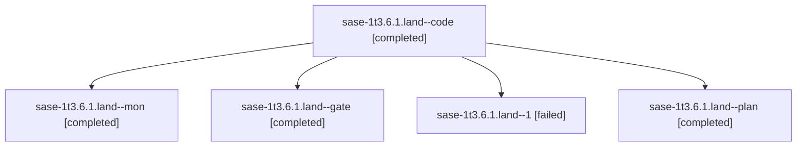

# Session: sase-1t3.6.1.land

[Agent Hoods](../README.md) / [bbugyi200](../users/bbugyi200/README.md) / [athena](../users/bbugyi200/machines/athena/README.md) / [sase-1t3](../users/bbugyi200/machines/athena/hoods/sase-1t3/README.md) / sase-1t3.6.1.land

Owner: `bbugyi200.athena` · Hood: `sase-1t3` · Members: 5 · Bead: [sase-1t3.6.1](https://github.com/sase-org/sase--beads/blob/main/pages/sase-1t3/sase-1t3.6.1.md)

## Lineage



The diagram is an optional enhancement; the ordered table below contains the same lineage in accessible text.

| Role | Agent | State | Model / provider | Timing | Commits | Prompt | Chat |
|---|---|---|---|---|---:|---|---|
| <a id="member-code"></a>code | sase-1t3.6.1.land--code | completed | gpt-6-luna / codex | 2026-11-17T05:04:00.833431+00:00 → 2026-11-17T05:49:01.369141+00:00 | 0 | — | [Chat](../agents/bbugyi200.athena.sase-1t3.6.1.land--code/chat.md) |
| <a id="member-mon"></a>mon | sase-1t3.6.1.land--mon | completed | gpt-6-luna / codex | 2026-11-17T05:47:47.735034+00:00 → 2026-11-17T06:09:17.591939+00:00 | 0 | — | [Chat](../agents/bbugyi200.athena.sase-1t3.6.1.land--mon/chat.md) |
| <a id="member-gate"></a>gate | sase-1t3.6.1.land--gate | completed | gpt-6-astra / codex | 2026-11-17T05:03:11.379726+00:00 → 2026-11-17T05:03:22.178951+00:00 | 0 | — | [Chat](../agents/bbugyi200.athena.sase-1t3.6.1.land--gate/chat.md) |
| <a id="member-1"></a>1 | sase-1t3.6.1.land--1 | failed | gpt-6-luna / codex | 2026-11-17T06:10:17.364138+00:00 → 2026-11-17T08:38:53.100516+00:00 | [1](../agents/bbugyi200.athena.sase-1t3.6.1.land--1/README.md#commits) | [Prompt](../agents/bbugyi200.athena.sase-1t3.6.1.land--1/prompt.md) | — |
| <a id="member-plan"></a>plan | sase-1t3.6.1.land--plan | completed | gpt-6-astra / codex | 2026-11-17T04:48:10.153322+00:00 → 2026-11-17T05:49:01.369141+00:00 | 0 | [Prompt](../agents/bbugyi200.athena.sase-1t3.6.1.land--plan/prompt.md) | [Chat](../agents/bbugyi200.athena.sase-1t3.6.1.land--plan/chat.md) |

## Commits

| Role | Repo | Commit | Subject | Committed |
|---|---|---|---|---|
| 1 | sase | [`824fc24`](https://github.com/sase-org/sase/commit/824fc2445e33499872674f4a26fb4ad9bc672a34) | feat(agent-lookup): land indexed lookup resolution | 2026-11-17 03:35:12 EST |

## Variables

| Role | Variable | Value |
|---|---|---|
| 1 | `artifacts` | \[{bead: sase-1t3.6, kind: markdown, label: Indexed lookup landing audit, path: /home/bryan/.sase/artifacts/agents/gh\_sase-org\_\_sase/20261117010817/indexed\_lookup\_landing\_audit-647098be5859.md, ref: f… |
| plan | `artifacts` | \[{bead: sase-1t3.6.1, kind: file, label: Indexed lookup landing audit and reproduced remaining gaps, path: /home/bryan/.sase/artifacts/agents/gh\_sase-org\_\_sase/20261116081655/sase-1t3-landing-audit-c… |

#### artifacts

**Role:** `1`

```yaml
- bead: sase-1t3.6
  kind: markdown
  label: Indexed lookup landing audit
  path: /home/bryan/.sase/artifacts/agents/gh_sase-org__sase/20261117010817/indexed_lookup_landing_audit-647098be5859.md
  ref: file:explicit:68f0e0cdaf4f6ceee3b9927d
  source_path: /home/bryan/.local/state/sase/workspaces/sase-org/sase/sase_11/.pytest_cache/indexed_lookup_landing_audit.md
```

#### artifacts

**Role:** `plan`

```yaml
- bead: sase-1t3.6.1
  kind: file
  label: Indexed lookup landing audit and reproduced remaining gaps
  path: /home/bryan/.sase/artifacts/agents/gh_sase-org__sase/20261116081655/sase-1t3-landing-audit-cf86eea67d92.txt
  ref: file:explicit:342e54884b78a18ce53099ce
  source_path: /tmp/sase-1t3-landing-audit.txt
```

Values are truncated for display; see each member's agent meta.json for the full values.

## Neighbors

| Agent | Relation | State |
|---|---|---|
| [sase-1t3.6](bbugyi200.athena.sase-1t3.6.md) (session · 3) | ancestor | active 1, completed 2 |
| [sase-1t3.6.1.1](../agents/bbugyi200.athena.sase-1t3.6.1.1/README.md) | sase-1t3.6.1 hood | completed |
| [sase-1t3.6.1.2](../agents/bbugyi200.athena.sase-1t3.6.1.2/README.md) | sase-1t3.6.1 hood | completed |
| [sase-1t3.6.1.3](bbugyi200.athena.sase-1t3.6.1.3.md) (session · 15) | sase-1t3.6.1 hood | completed 11, failed 4 |
| [sase-1t3.1](bbugyi200.athena.sase-1t3.1.md) (session · 2) | sase-1t3 hood | completed 2 |
| [sase-1t3.1](../agents/bbugyi200.athena.sase-1t3.1/README.md) | sase-1t3 hood | completed |
| [sase-1t3.10](bbugyi200.athena.sase-1t3.10.md) (session · 3) | sase-1t3 hood | active 1, completed 2 |
| [sase-1t3.10.1.1](../agents/bbugyi200.athena.sase-1t3.10.1.1/README.md) | sase-1t3 hood | completed |
| [sase-1t3.10.1.2](../agents/bbugyi200.athena.sase-1t3.10.1.2/README.md) | sase-1t3 hood | completed |
| [sase-1t3.10.1.3](bbugyi200.athena.sase-1t3.10.1.3.md) (session · 3) | sase-1t3 hood | completed 2, failed 1 |
| [sase-1t3.10.1.3](../agents/bbugyi200.athena.sase-1t3.10.1.3/README.md) | sase-1t3 hood | completed |
| [sase-1t3.10.1.4](bbugyi200.athena.sase-1t3.10.1.4.md) (session · 3) | sase-1t3 hood | completed 3 |
| [sase-1t3.10.1.4](../agents/bbugyi200.athena.sase-1t3.10.1.4/README.md) | sase-1t3 hood | waiting |
| [sase-1t3.10.1.land](bbugyi200.athena.sase-1t3.10.1.land.md) (session · 3) | sase-1t3 hood | active 2, completed 1 |
| [sase-1t3.11](bbugyi200.athena.sase-1t3.11.md) (session · 3) | sase-1t3 hood | active 1, completed 2 |
| [sase-1t3.11.1.1](../agents/bbugyi200.athena.sase-1t3.11.1.1/README.md) | sase-1t3 hood | completed |
| [sase-1t3.11.1.2](bbugyi200.athena.sase-1t3.11.1.2.md) (session · 5) | sase-1t3 hood | completed 3, failed 2 |
| [sase-1t3.11.1.3](../agents/bbugyi200.athena.sase-1t3.11.1.3/README.md) | sase-1t3 hood | completed |
| [sase-1t3.11.1.4](../agents/bbugyi200.athena.sase-1t3.11.1.4/README.md) | sase-1t3 hood | completed |
| [sase-1t3.11.1.5](../agents/bbugyi200.athena.sase-1t3.11.1.5/README.md) | sase-1t3 hood | completed |
| [sase-1t3.11.1.6](bbugyi200.athena.sase-1t3.11.1.6.md) (session · 8) | sase-1t3 hood | completed 7, failed 1 |
| [sase-1t3.11.1.land](bbugyi200.athena.sase-1t3.11.1.land.md) (session · 3) | sase-1t3 hood | completed 3 |
| [sase-1t3.12](bbugyi200.athena.sase-1t3.12.md) (session · 11) | sase-1t3 hood | completed 8, failed 3 |
| [sase-1t3.13](../agents/bbugyi200.athena.sase-1t3.13/README.md) | sase-1t3 hood | waiting |
| [sase-1t3.14](../agents/bbugyi200.athena.sase-1t3.14/README.md) | sase-1t3 hood | waiting |
| [sase-1t3.2](bbugyi200.athena.sase-1t3.2.md) (session · 5) | sase-1t3 hood | completed 5 |
| [sase-1t3.3](../agents/bbugyi200.athena.sase-1t3.3/README.md) | sase-1t3 hood | completed |
| [sase-1t3.4](bbugyi200.athena.sase-1t3.4.md) (session · 4) | sase-1t3 hood | completed 3, failed 1 |
| [sase-1t3.5](bbugyi200.athena.sase-1t3.5.md) (session · 6) | sase-1t3 hood | completed 4, failed 2 |
| [sase-1t3.7](bbugyi200.athena.sase-1t3.7.md) (session · 3) | sase-1t3 hood | active 1, completed 2 |
| [sase-1t3.7.1.1](bbugyi200.athena.sase-1t3.7.1.1.md) (session · 15) | sase-1t3 hood | completed 8, failed 7 |
| [sase-1t3.7.1.2](bbugyi200.athena.sase-1t3.7.1.2.md) (session · 3) | sase-1t3 hood | completed 2, failed 1 |
| [sase-1t3.7.1.land](bbugyi200.athena.sase-1t3.7.1.land.md) (session · 3) | sase-1t3 hood | completed 3 |
| [sase-1t3.8](bbugyi200.athena.sase-1t3.8.md) (session · 9) | sase-1t3 hood | completed 7, failed 2 |
| [sase-1t3.8](../agents/bbugyi200.athena.sase-1t3.8/README.md) | sase-1t3 hood | waiting |
| [sase-1t3.9](bbugyi200.athena.sase-1t3.9.md) (session · 5) | sase-1t3 hood | completed 5 |
| [sase-1t3.land](../agents/bbugyi200.athena.sase-1t3.land/README.md) | sase-1t3 hood | waiting |
