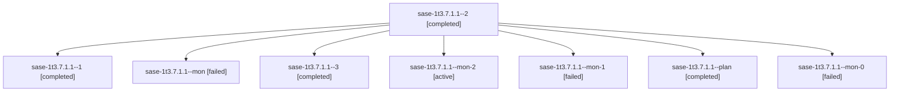

# Session: sase-1t3.7.1.1

[Agent Hoods](../README.md) / [bbugyi200](../users/bbugyi200/README.md) / [athena](../users/bbugyi200/machines/athena/README.md) / [sase-1t3](../users/bbugyi200/machines/athena/hoods/sase-1t3/README.md) / sase-1t3.7.1.1

Owner: `bbugyi200.athena` · Hood: `sase-1t3` · Members: 8 · Bead: [sase-1t3.7.1.1](https://github.com/sase-org/sase--beads/blob/main/pages/sase-1t3/sase-1t3.7.1.1.md)

## Lineage

The diagram is an optional enhancement; the ordered table below contains the same lineage in accessible text.

| Role | Agent | State | Model / provider | Timing | Commits | Prompt | Chat |
|---|---|---|---|---|---:|---|---|
| 2 | sase-1t3.7.1.1--2 | completed | grok-4.6 / grok | 2026-11-16T17:12:43.055473+00:00 → 2026-11-16T17:18:46.948000+00:00 | 0 | [Prompt](../agents/bbugyi200.athena.sase-1t3.7.1.1--2/prompt.md) | [Chat](../agents/bbugyi200.athena.sase-1t3.7.1.1--2/chat.md) |
| 1 | sase-1t3.7.1.1--1 | completed | grok-4.6 / grok | 2026-11-16T17:01:35.470120+00:00 → 2026-11-16T17:05:51.865782+00:00 | 0 | [Prompt](../agents/bbugyi200.athena.sase-1t3.7.1.1--1/prompt.md) | [Chat](../agents/bbugyi200.athena.sase-1t3.7.1.1--1/chat.md) |
| mon | sase-1t3.7.1.1--mon | failed | grok-4.6 / grok | 2026-11-16T16:36:15.544739+00:00 → 2026-11-16T17:01:21.502965+00:00 | 0 | — | [Chat](../agents/bbugyi200.athena.sase-1t3.7.1.1--mon/chat.md) |
| 3 | sase-1t3.7.1.1--3 | completed | grok-4.6 / grok | 2026-11-16T17:40:37.148267+00:00 → 2026-11-16T17:47:48.472630+00:00 | 0 | [Prompt](../agents/bbugyi200.athena.sase-1t3.7.1.1--3/prompt.md) | [Chat](../agents/bbugyi200.athena.sase-1t3.7.1.1--3/chat.md) |
| mon-2 | sase-1t3.7.1.1--mon-2 | active | grok-4.6 / grok | 2026-11-16T17:46:46.984706+00:00 | 0 | — | — |
| mon-1 | sase-1t3.7.1.1--mon-1 | failed | grok-4.6 / grok | 2026-11-16T17:17:10.661775+00:00 → 2026-11-16T17:40:15.960458+00:00 | 0 | — | [Chat](../agents/bbugyi200.athena.sase-1t3.7.1.1--mon-1/chat.md) |
| plan | sase-1t3.7.1.1--plan | completed | grok-4.6 / grok | 2026-11-16T16:14:00.722477+00:00 → 2026-11-16T16:39:27.663342+00:00 | 0 | [Prompt](../agents/bbugyi200.athena.sase-1t3.7.1.1--plan/prompt.md) | [Chat](../agents/bbugyi200.athena.sase-1t3.7.1.1--plan/chat.md) |
| mon-0 | sase-1t3.7.1.1--mon-0 | failed | grok-4.6 / grok | 2026-11-16T17:04:45.640028+00:00 → 2026-11-16T17:11:27.398628+00:00 | 0 | — | [Chat](../agents/bbugyi200.athena.sase-1t3.7.1.1--mon-0/chat.md) |

## Neighbors

| Agent | Relation | State |
|---|---|---|
| [sase-1t3.7](bbugyi200.athena.sase-1t3.7.md) (session · 3) | ancestor | active 1, completed 2 |
| [sase-1t3.7.1.2](../agents/bbugyi200.athena.sase-1t3.7.1.2/README.md) | sase-1t3.7.1 hood | waiting |
| [sase-1t3.7.1.land](../agents/bbugyi200.athena.sase-1t3.7.1.land/README.md) | sase-1t3.7.1 hood | waiting |
| [sase-1t3.1](bbugyi200.athena.sase-1t3.1.md) (session · 2) | sase-1t3 hood | completed 2 |
| [sase-1t3.1](../agents/bbugyi200.athena.sase-1t3.1/README.md) | sase-1t3 hood | completed |
| [sase-1t3.10](../agents/bbugyi200.athena.sase-1t3.10/README.md) | sase-1t3 hood | waiting |
| [sase-1t3.11](../agents/bbugyi200.athena.sase-1t3.11/README.md) | sase-1t3 hood | waiting |
| [sase-1t3.12](bbugyi200.athena.sase-1t3.12.md) (session · 11) | sase-1t3 hood | completed 8, failed 3 |
| [sase-1t3.13](../agents/bbugyi200.athena.sase-1t3.13/README.md) | sase-1t3 hood | waiting |
| [sase-1t3.14](../agents/bbugyi200.athena.sase-1t3.14/README.md) | sase-1t3 hood | waiting |
| [sase-1t3.2](bbugyi200.athena.sase-1t3.2.md) (session · 5) | sase-1t3 hood | completed 5 |
| [sase-1t3.3](../agents/bbugyi200.athena.sase-1t3.3/README.md) | sase-1t3 hood | completed |
| [sase-1t3.4](bbugyi200.athena.sase-1t3.4.md) (session · 4) | sase-1t3 hood | completed 3, failed 1 |
| [sase-1t3.5](bbugyi200.athena.sase-1t3.5.md) (session · 4) | sase-1t3 hood | active 1, completed 3 |
| [sase-1t3.6](bbugyi200.athena.sase-1t3.6.md) (session · 3) | sase-1t3 hood | active 1, completed 2 |
| [sase-1t3.6.1.1](../agents/bbugyi200.athena.sase-1t3.6.1.1/README.md) | sase-1t3 hood | completed |
| [sase-1t3.6.1.2](../agents/bbugyi200.athena.sase-1t3.6.1.2/README.md) | sase-1t3 hood | completed |
| [sase-1t3.6.1.3](../agents/bbugyi200.athena.sase-1t3.6.1.3/README.md) | sase-1t3 hood | waiting |
| [sase-1t3.6.1.land](../agents/bbugyi200.athena.sase-1t3.6.1.land/README.md) | sase-1t3 hood | waiting |
| [sase-1t3.8](../agents/bbugyi200.athena.sase-1t3.8/README.md) | sase-1t3 hood | waiting |
| [sase-1t3.9](../agents/bbugyi200.athena.sase-1t3.9/README.md) | sase-1t3 hood | waiting |
| [sase-1t3.land](../agents/bbugyi200.athena.sase-1t3.land/README.md) | sase-1t3 hood | waiting |
