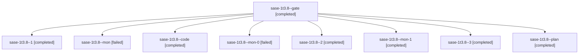

# Session: sase-1t3.8

[Agent Hoods](../README.md) / [bbugyi200](../users/bbugyi200/README.md) / [athena](../users/bbugyi200/machines/athena/README.md) / [sase-1t3](../users/bbugyi200/machines/athena/hoods/sase-1t3/README.md) / sase-1t3.8

Owner: `bbugyi200.athena` · Hood: `sase-1t3` · Members: 9 · Bead: [sase-1t3.8](https://github.com/sase-org/sase--beads/blob/main/pages/sase-1t3/sase-1t3.8.md)

## Lineage

The diagram is an optional enhancement; the ordered table below contains the same lineage in accessible text.

| Role | Agent | State | Model / provider | Timing | Commits | Prompt | Chat |
|---|---|---|---|---|---:|---|---|
| gate | sase-1t3.8--gate | completed | gpt-6-astra / codex | 2026-11-17T11:10:14.256352+00:00 → 2026-11-17T11:10:23.266285+00:00 | 0 | — | [Chat](../agents/bbugyi200.athena.sase-1t3.8--gate/chat.md) |
| 1 | sase-1t3.8--1 | completed | grok-4.6 / grok | 2026-11-17T11:39:20.666795+00:00 → 2026-11-17T11:44:26.098706+00:00 | 0 | [Prompt](../agents/bbugyi200.athena.sase-1t3.8--1/prompt.md) | [Chat](../agents/bbugyi200.athena.sase-1t3.8--1/chat.md) |
| mon | sase-1t3.8--mon | failed | grok-4.6 / grok | 2026-11-17T11:35:36.434832+00:00 → 2026-11-17T11:39:20.995049+00:00 | 0 | — | [Chat](../agents/bbugyi200.athena.sase-1t3.8--mon/chat.md) |
| code | sase-1t3.8--code | completed | grok-4.6 / grok | 2026-11-17T11:11:02.590424+00:00 → 2026-11-17T11:36:41.700074+00:00 | 0 | — | [Chat](../agents/bbugyi200.athena.sase-1t3.8--code/chat.md) |
| mon-0 | sase-1t3.8--mon-0 | failed | grok-4.6 / grok | 2026-11-17T11:43:20.534877+00:00 → 2026-11-17T11:49:16.539244+00:00 | 0 | — | [Chat](../agents/bbugyi200.athena.sase-1t3.8--mon-0/chat.md) |
| 2 | sase-1t3.8--2 | completed | grok-4.6 / grok | 2026-11-17T11:49:16.508116+00:00 → 2026-11-17T11:57:06.041540+00:00 | 0 | [Prompt](../agents/bbugyi200.athena.sase-1t3.8--2/prompt.md) | [Chat](../agents/bbugyi200.athena.sase-1t3.8--2/chat.md) |
| mon-1 | sase-1t3.8--mon-1 | completed | grok-4.6 / grok | 2026-11-17T11:56:03.826960+00:00 → 2026-11-17T12:20:15.416030+00:00 | 0 | — | [Chat](../agents/bbugyi200.athena.sase-1t3.8--mon-1/chat.md) |
| 3 | sase-1t3.8--3 | completed | grok-4.6 / grok | 2026-11-17T12:20:15.266350+00:00 → 2026-11-17T12:27:15.820699+00:00 | [1](../agents/bbugyi200.athena.sase-1t3.8--3/README.md#commits) | [Prompt](../agents/bbugyi200.athena.sase-1t3.8--3/prompt.md) | [Chat](../agents/bbugyi200.athena.sase-1t3.8--3/chat.md) |
| plan | sase-1t3.8--plan | completed | gpt-6-astra / codex | 2026-11-17T11:03:19.717638+00:00 → 2026-11-17T11:36:41.700074+00:00 | 0 | [Prompt](../agents/bbugyi200.athena.sase-1t3.8--plan/prompt.md) | [Chat](../agents/bbugyi200.athena.sase-1t3.8--plan/chat.md) |

## Commits

| Role | Repo | Commit | Subject | Committed |
|---|---|---|---|---|
| 3 | sase | [`10c55db`](https://github.com/sase-org/sase/commit/10c55dbe3022514fd2bf0ec8af90948e3560431b) | perf(ace): keep startup off the agents-action and AXE snapshot path | 2026-11-17 07:25:58 EST |

## Neighbors

| Agent | Relation | State |
|---|---|---|
| [sase-1t3.1](bbugyi200.athena.sase-1t3.1.md) (session · 2) | sase-1t3 hood | completed 2 |
| [sase-1t3.1](../agents/bbugyi200.athena.sase-1t3.1/README.md) | sase-1t3 hood | completed |
| [sase-1t3.10](bbugyi200.athena.sase-1t3.10.md) (session · 3) | sase-1t3 hood | active 1, completed 2 |
| [sase-1t3.10.1.1](../agents/bbugyi200.athena.sase-1t3.10.1.1/README.md) | sase-1t3 hood | completed |
| [sase-1t3.10.1.2](../agents/bbugyi200.athena.sase-1t3.10.1.2/README.md) | sase-1t3 hood | completed |
| [sase-1t3.10.1.3](bbugyi200.athena.sase-1t3.10.1.3.md) (session · 3) | sase-1t3 hood | completed 2, failed 1 |
| [sase-1t3.10.1.3](../agents/bbugyi200.athena.sase-1t3.10.1.3/README.md) | sase-1t3 hood | completed |
| [sase-1t3.10.1.4](bbugyi200.athena.sase-1t3.10.1.4.md) (session · 3) | sase-1t3 hood | completed 3 |
| [sase-1t3.10.1.4](../agents/bbugyi200.athena.sase-1t3.10.1.4/README.md) | sase-1t3 hood | waiting |
| [sase-1t3.10.1.land](bbugyi200.athena.sase-1t3.10.1.land.md) (session · 5) | sase-1t3 hood | completed 5 |
| [sase-1t3.10.1.land](../agents/bbugyi200.athena.sase-1t3.10.1.land/README.md) | sase-1t3 hood | completed |
| [sase-1t3.11](bbugyi200.athena.sase-1t3.11.md) (session · 3) | sase-1t3 hood | active 1, completed 2 |
| [sase-1t3.11.1.1](../agents/bbugyi200.athena.sase-1t3.11.1.1/README.md) | sase-1t3 hood | completed |
| [sase-1t3.11.1.2](bbugyi200.athena.sase-1t3.11.1.2.md) (session · 5) | sase-1t3 hood | completed 3, failed 2 |
| [sase-1t3.11.1.3](../agents/bbugyi200.athena.sase-1t3.11.1.3/README.md) | sase-1t3 hood | completed |
| [sase-1t3.11.1.4](../agents/bbugyi200.athena.sase-1t3.11.1.4/README.md) | sase-1t3 hood | completed |
| [sase-1t3.11.1.5](../agents/bbugyi200.athena.sase-1t3.11.1.5/README.md) | sase-1t3 hood | completed |
| [sase-1t3.11.1.6](bbugyi200.athena.sase-1t3.11.1.6.md) (session · 8) | sase-1t3 hood | completed 7, failed 1 |
| [sase-1t3.11.1.land](bbugyi200.athena.sase-1t3.11.1.land.md) (session · 3) | sase-1t3 hood | completed 3 |
| [sase-1t3.12](bbugyi200.athena.sase-1t3.12.md) (session · 11) | sase-1t3 hood | completed 8, failed 3 |
| [sase-1t3.13](bbugyi200.athena.sase-1t3.13.md) (session · 3) | sase-1t3 hood | active 1, completed 2 |
| [sase-1t3.13.1.1](../agents/bbugyi200.athena.sase-1t3.13.1.1/README.md) | sase-1t3 hood | completed |
| [sase-1t3.13.1.2](../agents/bbugyi200.athena.sase-1t3.13.1.2/README.md) | sase-1t3 hood | completed |
| [sase-1t3.13.1.3](bbugyi200.athena.sase-1t3.13.1.3.md) (session · 3) | sase-1t3 hood | completed 3 |
| [sase-1t3.13.1.4](bbugyi200.athena.sase-1t3.13.1.4.md) (session · 3) | sase-1t3 hood | completed 3 |
| [sase-1t3.13.1.5](bbugyi200.athena.sase-1t3.13.1.5.md) (session · 3) | sase-1t3 hood | completed 3 |
| [sase-1t3.13.1.land](bbugyi200.athena.sase-1t3.13.1.land.md) (session · 3) | sase-1t3 hood | completed 3 |
| [sase-1t3.14](bbugyi200.athena.sase-1t3.14.md) (session · 5) | sase-1t3 hood | completed 4, failed 1 |
| [sase-1t3.2](bbugyi200.athena.sase-1t3.2.md) (session · 5) | sase-1t3 hood | completed 5 |
| [sase-1t3.3](../agents/bbugyi200.athena.sase-1t3.3/README.md) | sase-1t3 hood | completed |
| [sase-1t3.4](bbugyi200.athena.sase-1t3.4.md) (session · 4) | sase-1t3 hood | completed 3, failed 1 |
| [sase-1t3.5](bbugyi200.athena.sase-1t3.5.md) (session · 6) | sase-1t3 hood | completed 4, failed 2 |
| [sase-1t3.6](bbugyi200.athena.sase-1t3.6.md) (session · 3) | sase-1t3 hood | active 1, completed 2 |
| [sase-1t3.6.1.1](../agents/bbugyi200.athena.sase-1t3.6.1.1/README.md) | sase-1t3 hood | completed |
| [sase-1t3.6.1.2](../agents/bbugyi200.athena.sase-1t3.6.1.2/README.md) | sase-1t3 hood | completed |
| [sase-1t3.6.1.3](bbugyi200.athena.sase-1t3.6.1.3.md) (session · 15) | sase-1t3 hood | completed 11, failed 4 |
| [sase-1t3.6.1.land](bbugyi200.athena.sase-1t3.6.1.land.md) (session · 5) | sase-1t3 hood | completed 4, failed 1 |
| [sase-1t3.6.1.land](../agents/bbugyi200.athena.sase-1t3.6.1.land/README.md) | sase-1t3 hood | completed |
| [sase-1t3.7](bbugyi200.athena.sase-1t3.7.md) (session · 3) | sase-1t3 hood | active 1, completed 2 |
| [sase-1t3.7.1.1](bbugyi200.athena.sase-1t3.7.1.1.md) (session · 15) | sase-1t3 hood | completed 8, failed 7 |
| [sase-1t3.7.1.2](bbugyi200.athena.sase-1t3.7.1.2.md) (session · 3) | sase-1t3 hood | completed 2, failed 1 |
| [sase-1t3.7.1.land](bbugyi200.athena.sase-1t3.7.1.land.md) (session · 3) | sase-1t3 hood | completed 3 |
| [sase-1t3.9](bbugyi200.athena.sase-1t3.9.md) (session · 5) | sase-1t3 hood | completed 5 |
| [sase-1t3.land](../agents/bbugyi200.athena.sase-1t3.land/README.md) | sase-1t3 hood | waiting |
