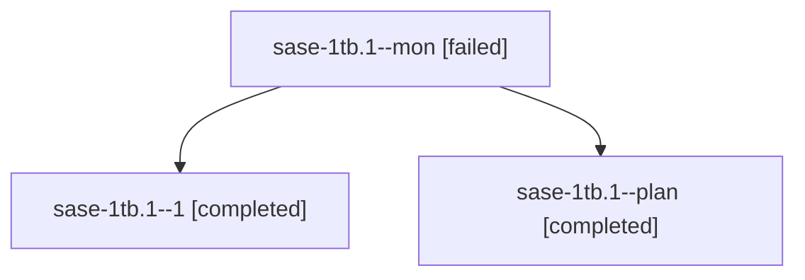

# Session: sase-1tb.1

[Agent Hoods](../README.md) / [bbugyi200](../users/bbugyi200/README.md) / [athena](../users/bbugyi200/machines/athena/README.md) / [sase-1tb](../users/bbugyi200/machines/athena/hoods/sase-1tb/README.md) / sase-1tb.1

Owner: `bbugyi200.athena` · Hood: `sase-1tb` · Members: 3 · Bead: [sase-1tb.1](https://github.com/sase-org/sase--beads/blob/main/pages/sase-1tb/sase-1tb.1.md)

## Lineage

The diagram is an optional enhancement; the ordered table below contains the same lineage in accessible text.

| Role | Agent | State | Model / provider | Timing | Commits | Prompt | Chat |
|---|---|---|---|---|---:|---|---|
| mon | sase-1tb.1--mon | failed | muse-spark-1.3-contributor / muse | 2026-11-17T17:11:17.388701+00:00 → 2026-11-17T17:23:03.317953+00:00 | 0 | — | [Chat](../agents/bbugyi200.athena.sase-1tb.1--mon/chat.md) |
| 1 | sase-1tb.1--1 | completed | muse-spark-1.3-contributor / muse | 2026-11-17T17:23:02.849478+00:00 → 2026-11-17T17:35:47.863662+00:00 | [1](../agents/bbugyi200.athena.sase-1tb.1--1/README.md#commits) | [Prompt](../agents/bbugyi200.athena.sase-1tb.1--1/prompt.md) | [Chat](../agents/bbugyi200.athena.sase-1tb.1--1/chat.md) |
| plan | sase-1tb.1--plan | completed | muse-spark-1.3-contributor / muse | 2026-11-17T16:18:25.290012+00:00 → 2026-11-17T17:13:57.174910+00:00 | 0 | [Prompt](../agents/bbugyi200.athena.sase-1tb.1--plan/prompt.md) | [Chat](../agents/bbugyi200.athena.sase-1tb.1--plan/chat.md) |

## Commits

| Role | Repo | Commit | Subject | Committed |
|---|---|---|---|---|
| 1 | sase | [`bfa6032`](https://github.com/sase-org/sase/commit/bfa60324a69641e8019e7dd9e60b1f120eed30fc) | feat(viewer): show video still frame with metadata in tmux | 2026-11-17 12:33:43 EST |
| — | sase | [`898eb8f`](https://github.com/sase-org/sase/commit/898eb8ffa5b90e04a19ead37e3cbcfc13867854f) | perf(viewer): defer video still module off TUI startup | 2026-11-17 13:26:34 EST |

## Neighbors

| Agent | Relation | State |
|---|---|---|
| [sase-1tb.2](../agents/bbugyi200.athena.sase-1tb.2/README.md) | sase-1tb hood | completed |
| [sase-1tb.3](../agents/bbugyi200.athena.sase-1tb.3/README.md) | sase-1tb hood | completed |
| [sase-1tb.4](bbugyi200.athena.sase-1tb.4.md) (session · 3) | sase-1tb hood | completed 3 |
| [sase-1tb.5](bbugyi200.athena.sase-1tb.5.md) (session · 3) | sase-1tb hood | completed 3 |
| [sase-1tb.6](bbugyi200.athena.sase-1tb.6.md) (session · 3) | sase-1tb hood | completed 2, failed 1 |
| [sase-1tb.7](../agents/bbugyi200.athena.sase-1tb.7/README.md) | sase-1tb hood | waiting |
| [sase-1tb.land](../agents/bbugyi200.athena.sase-1tb.land/README.md) | sase-1tb hood | waiting |
