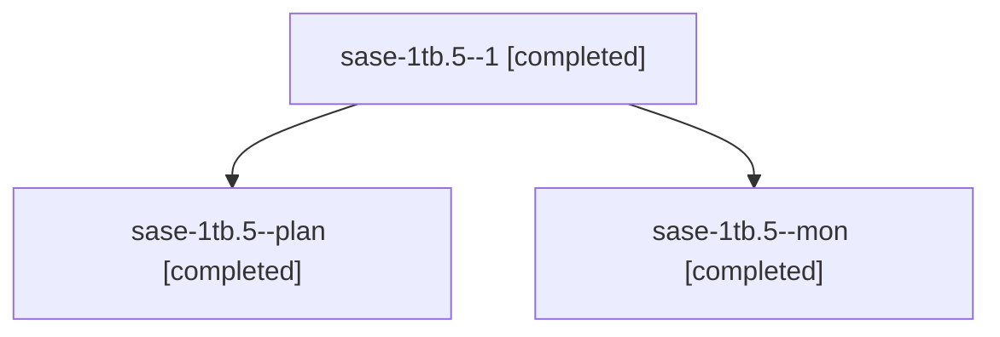

# Session: sase-1tb.5

[Agent Hoods](../README.md) / [bbugyi200](../users/bbugyi200/README.md) / [athena](../users/bbugyi200/machines/athena/README.md) / [sase-1tb](../users/bbugyi200/machines/athena/hoods/sase-1tb/README.md) / sase-1tb.5

Owner: `bbugyi200.athena` · Hood: `sase-1tb` · Members: 3 · Bead: [sase-1tb.5](https://github.com/sase-org/sase--beads/blob/main/pages/sase-1tb/sase-1tb.5.md)

## Lineage

The diagram is an optional enhancement; the ordered table below contains the same lineage in accessible text.

| Role | Agent | State | Model / provider | Timing | Commits | Prompt | Chat |
|---|---|---|---|---|---:|---|---|
| 1 | sase-1tb.5--1 | completed | grok-4.6 / grok | 2026-11-17T22:16:42.097508+00:00 → 2026-11-17T22:21:38.293599+00:00 | [1](../agents/bbugyi200.athena.sase-1tb.5--1/README.md#commits) | [Prompt](../agents/bbugyi200.athena.sase-1tb.5--1/prompt.md) | [Chat](../agents/bbugyi200.athena.sase-1tb.5--1/chat.md) |
| plan | sase-1tb.5--plan | completed | grok-4.6 / grok | 2026-11-17T19:48:05.836056+00:00 → 2026-11-17T21:49:39.437127+00:00 | 0 | [Prompt](../agents/bbugyi200.athena.sase-1tb.5--plan/prompt.md) | [Chat](../agents/bbugyi200.athena.sase-1tb.5--plan/chat.md) |
| mon | sase-1tb.5--mon | completed | grok-4.6 / grok | 2026-11-17T21:48:22.705407+00:00 → 2026-11-17T22:16:42.373785+00:00 | 0 | — | [Chat](../agents/bbugyi200.athena.sase-1tb.5--mon/chat.md) |

## Commits

| Role | Repo | Commit | Subject | Committed |
|---|---|---|---|---|
| 1 | sase | [`ded40c1`](https://github.com/sase-org/sase/commit/ded40c1e6393eeaad92a86e6dfad722bf19b961c) | feat(artifact-viewer): inspect-first video scrubber | 2026-11-17 17:20:38 EST |

## Neighbors

| Agent | Relation | State |
|---|---|---|
| [sase-1tb.1](bbugyi200.athena.sase-1tb.1.md) (session · 3) | sase-1tb hood | completed 2, failed 1 |
| [sase-1tb.1](../agents/bbugyi200.athena.sase-1tb.1/README.md) | sase-1tb hood | completed |
| [sase-1tb.2](../agents/bbugyi200.athena.sase-1tb.2/README.md) | sase-1tb hood | completed |
| [sase-1tb.3](../agents/bbugyi200.athena.sase-1tb.3/README.md) | sase-1tb hood | completed |
| [sase-1tb.4](bbugyi200.athena.sase-1tb.4.md) (session · 3) | sase-1tb hood | completed 3 |
| [sase-1tb.6](bbugyi200.athena.sase-1tb.6.md) (session · 3) | sase-1tb hood | completed 2, failed 1 |
| [sase-1tb.7](bbugyi200.athena.sase-1tb.7.md) (session · 3) | sase-1tb hood | completed 3 |
| [sase-1tb.land](../agents/bbugyi200.athena.sase-1tb.land/README.md) | sase-1tb hood | waiting |
