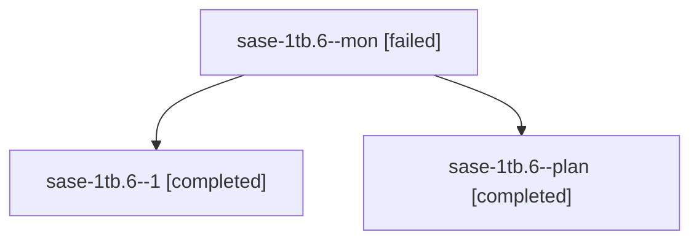

# Session: sase-1tb.6

[Agent Hoods](../README.md) / [bbugyi200](../users/bbugyi200/README.md) / [athena](../users/bbugyi200/machines/athena/README.md) / [sase-1tb](../users/bbugyi200/machines/athena/hoods/sase-1tb/README.md) / sase-1tb.6

Owner: `bbugyi200.athena` · Hood: `sase-1tb` · Members: 3 · Bead: [sase-1tb.6](https://github.com/sase-org/sase--beads/blob/main/pages/sase-1tb/sase-1tb.6.md)

## Lineage

The diagram is an optional enhancement; the ordered table below contains the same lineage in accessible text.

| Role | Agent | State | Model / provider | Timing | Commits | Prompt | Chat |
|---|---|---|---|---|---:|---|---|
| mon | sase-1tb.6--mon | failed | muse-spark-1.3-contributor / muse | 2026-11-17T22:38:42.441661+00:00 → 2026-11-17T22:49:16.111195+00:00 | 0 | — | [Chat](../agents/bbugyi200.athena.sase-1tb.6--mon/chat.md) |
| 1 | sase-1tb.6--1 | completed | muse-spark-1.3-contributor / muse | 2026-11-17T22:50:16.222622+00:00 → 2026-11-17T23:40:24.407978+00:00 | [1](../agents/bbugyi200.athena.sase-1tb.6--1/README.md#commits) | [Prompt](../agents/bbugyi200.athena.sase-1tb.6--1/prompt.md) | [Chat](../agents/bbugyi200.athena.sase-1tb.6--1/chat.md) |
| plan | sase-1tb.6--plan | completed | muse-spark-1.3-contributor / muse | 2026-11-17T22:22:19.306343+00:00 → 2026-11-17T22:42:08.594965+00:00 | 0 | [Prompt](../agents/bbugyi200.athena.sase-1tb.6--plan/prompt.md) | [Chat](../agents/bbugyi200.athena.sase-1tb.6--plan/chat.md) |

## Commits

| Role | Repo | Commit | Subject | Committed |
|---|---|---|---|---|
| 1 | sase | [`4a6d3c5`](https://github.com/sase-org/sase/commit/4a6d3c51b352c61f9054b01546663f4a0a48c536) | feat(viewer): motion backends, native handoff, and muted in-pane audio | 2026-11-17 18:39:30 EST |

## Neighbors

| Agent | Relation | State |
|---|---|---|
| [sase-1tb.1](bbugyi200.athena.sase-1tb.1.md) (session · 3) | sase-1tb hood | completed 2, failed 1 |
| [sase-1tb.1](../agents/bbugyi200.athena.sase-1tb.1/README.md) | sase-1tb hood | completed |
| [sase-1tb.2](../agents/bbugyi200.athena.sase-1tb.2/README.md) | sase-1tb hood | completed |
| [sase-1tb.3](../agents/bbugyi200.athena.sase-1tb.3/README.md) | sase-1tb hood | completed |
| [sase-1tb.4](bbugyi200.athena.sase-1tb.4.md) (session · 3) | sase-1tb hood | completed 3 |
| [sase-1tb.5](bbugyi200.athena.sase-1tb.5.md) (session · 3) | sase-1tb hood | completed 3 |
| [sase-1tb.7](bbugyi200.athena.sase-1tb.7.md) (session · 3) | sase-1tb hood | completed 3 |
| [sase-1tb.land](bbugyi200.athena.sase-1tb.land.md) (session · 8) | sase-1tb hood | completed 5, failed 3 |
