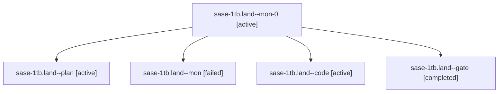

# Session: sase-1tb.land

[Agent Hoods](../README.md) / [bbugyi200](../users/bbugyi200/README.md) / [athena](../users/bbugyi200/machines/athena/README.md) / [sase-1tb](../users/bbugyi200/machines/athena/hoods/sase-1tb/README.md) / sase-1tb.land

Owner: `bbugyi200.athena` · Hood: `sase-1tb` · Members: 5 · Bead: [sase-1tb](https://github.com/sase-org/sase--beads/blob/main/pages/sase-1tb/README.md)

## Lineage

The diagram is an optional enhancement; the ordered table below contains the same lineage in accessible text.

| Role | Agent | State | Model / provider | Timing | Commits | Prompt | Chat |
|---|---|---|---|---|---:|---|---|
| mon-0 | sase-1tb.land--mon-0 | active | muse-spark-1.3-contributor / muse | 2026-11-18T02:22:59.647362+00:00 | 0 | — | — |
| plan | sase-1tb.land--plan | active | opus / claude | 2026-11-18T00:27:08.620995+00:00 | 0 | [Prompt](../agents/bbugyi200.athena.sase-1tb.land--plan/prompt.md) | [Chat](../agents/bbugyi200.athena.sase-1tb.land--plan/chat.md) |
| mon | sase-1tb.land--mon | failed | muse-spark-1.3-contributor / muse | 2026-11-18T01:56:49.178164+00:00 → 2026-11-18T01:56:52.287852+00:00 | 0 | — | — |
| code | sase-1tb.land--code | active | muse-spark-1.3-contributor / muse | 2026-11-18T01:00:12.114860+00:00 | [1](../agents/bbugyi200.athena.sase-1tb.land--code/README.md#commits) | — | — |
| gate | sase-1tb.land--gate | completed | opus / claude | 2026-11-18T00:59:22.313430+00:00 → 2026-11-18T00:59:37.094810+00:00 | 0 | — | [Chat](../agents/bbugyi200.athena.sase-1tb.land--gate/chat.md) |

## Commits

| Role | Repo | Commit | Subject | Committed |
|---|---|---|---|---|
| code | sase | [`5e3931c`](https://github.com/sase-org/sase/commit/5e3931c592a59fae099d386147d94094aabe8369) | feat(artifact-reads): query audit events by agent | 2026-11-17 22:16:19 EST |

## Neighbors

| Agent | Relation | State |
|---|---|---|
| [sase-1tb.1](bbugyi200.athena.sase-1tb.1.md) (session · 3) | sase-1tb hood | completed 2, failed 1 |
| [sase-1tb.1](../agents/bbugyi200.athena.sase-1tb.1/README.md) | sase-1tb hood | completed |
| [sase-1tb.2](../agents/bbugyi200.athena.sase-1tb.2/README.md) | sase-1tb hood | completed |
| [sase-1tb.3](../agents/bbugyi200.athena.sase-1tb.3/README.md) | sase-1tb hood | completed |
| [sase-1tb.4](bbugyi200.athena.sase-1tb.4.md) (session · 3) | sase-1tb hood | completed 3 |
| [sase-1tb.5](bbugyi200.athena.sase-1tb.5.md) (session · 3) | sase-1tb hood | completed 3 |
| [sase-1tb.6](bbugyi200.athena.sase-1tb.6.md) (session · 3) | sase-1tb hood | completed 2, failed 1 |
| [sase-1tb.7](bbugyi200.athena.sase-1tb.7.md) (session · 3) | sase-1tb hood | completed 3 |
