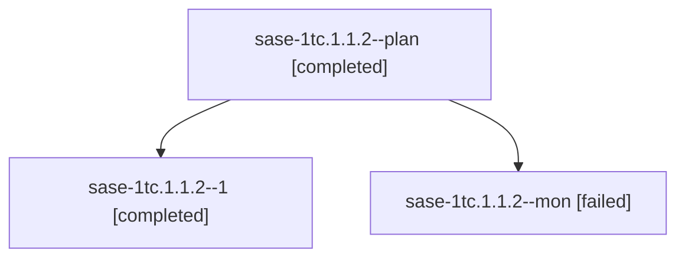

# Session: sase-1tc.1.1.2

[Agent Hoods](../README.md) / [bbugyi200](../users/bbugyi200/README.md) / [athena](../users/bbugyi200/machines/athena/README.md) / [sase-1tc](../users/bbugyi200/machines/athena/hoods/sase-1tc/README.md) / sase-1tc.1.1.2

Owner: `bbugyi200.athena` · Hood: `sase-1tc` · Members: 3 · Bead: [sase-1tc.1.1.2](https://github.com/sase-org/sase--beads/blob/main/pages/sase-1tc/sase-1tc.1.1.2.md)

## Lineage

The diagram is an optional enhancement; the ordered table below contains the same lineage in accessible text.

| Role | Agent | State | Model / provider | Timing | Commits | Prompt | Chat |
|---|---|---|---|---|---:|---|---|
| plan | sase-1tc.1.1.2--plan | completed | muse-spark-1.3-contributor / muse | 2026-11-17T17:23:24.279180+00:00 → 2026-11-17T20:03:39.317906+00:00 | 0 | [Prompt](../agents/bbugyi200.athena.sase-1tc.1.1.2--plan/prompt.md) | [Chat](../agents/bbugyi200.athena.sase-1tc.1.1.2--plan/chat.md) |
| 1 | sase-1tc.1.1.2--1 | completed | muse-spark-1.3-contributor / muse | 2026-11-17T20:05:02.920306+00:00 → 2026-11-17T20:13:06.528454+00:00 | [1](../agents/bbugyi200.athena.sase-1tc.1.1.2--1/README.md#commits) | [Prompt](../agents/bbugyi200.athena.sase-1tc.1.1.2--1/prompt.md) | [Chat](../agents/bbugyi200.athena.sase-1tc.1.1.2--1/chat.md) |
| mon | sase-1tc.1.1.2--mon | failed | muse-spark-1.3-contributor / muse | 2026-11-17T18:35:33.396034+00:00 → 2026-11-17T20:05:02.998646+00:00 | 0 | — | [Chat](../agents/bbugyi200.athena.sase-1tc.1.1.2--mon/chat.md) |

## Commits

| Role | Repo | Commit | Subject | Committed |
|---|---|---|---|---|
| 1 | sase | [`efc66a4`](https://github.com/sase-org/sase/commit/efc66a420b8c738e52cefa4f04bc28eec0031132) | feat(macro): evaluate authored commands before interpolating data | 2026-11-17 15:12:16 EST |

## Neighbors

| Agent | Relation | State |
|---|---|---|
| [sase-1tc.1](bbugyi200.athena.sase-1tc.1.md) (session · 3) | ancestor | active 1, completed 2 |
| [sase-1tc.1.1.1](../agents/bbugyi200.athena.sase-1tc.1.1.1/README.md) | sase-1tc.1.1 hood | completed |
| [sase-1tc.1.1.3](bbugyi200.athena.sase-1tc.1.1.3.md) (session · 3) | sase-1tc.1.1 hood | completed 2, failed 1 |
| [sase-1tc.1.1.land](bbugyi200.athena.sase-1tc.1.1.land.md) (session · 3) | sase-1tc.1.1 hood | active 2, completed 1 |
| [sase-1tc.2](../agents/bbugyi200.athena.sase-1tc.2/README.md) | sase-1tc hood | completed |
| [sase-1tc.3](../agents/bbugyi200.athena.sase-1tc.3/README.md) | sase-1tc hood | waiting |
| [sase-1tc.4](../agents/bbugyi200.athena.sase-1tc.4/README.md) | sase-1tc hood | waiting |
| [sase-1tc.5](../agents/bbugyi200.athena.sase-1tc.5/README.md) | sase-1tc hood | waiting |
| [sase-1tc.land](../agents/bbugyi200.athena.sase-1tc.land/README.md) | sase-1tc hood | waiting |
