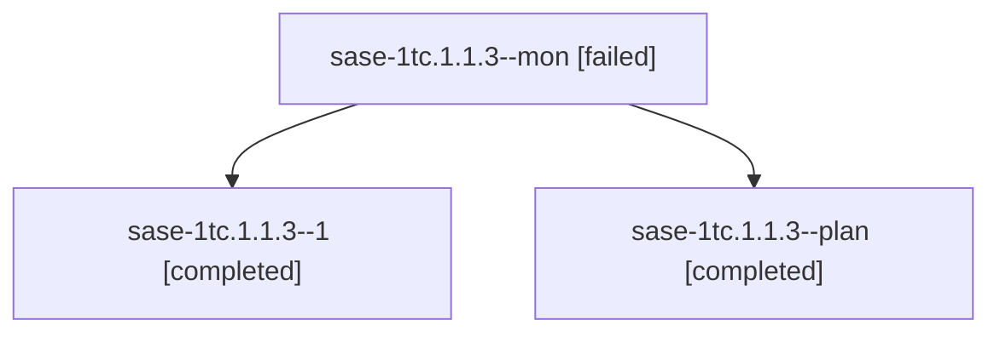

# Session: sase-1tc.1.1.3

[Agent Hoods](../README.md) / [bbugyi200](../users/bbugyi200/README.md) / [athena](../users/bbugyi200/machines/athena/README.md) / [sase-1tc](../users/bbugyi200/machines/athena/hoods/sase-1tc/README.md) / sase-1tc.1.1.3

Owner: `bbugyi200.athena` · Hood: `sase-1tc` · Members: 3 · Bead: [sase-1tc.1.1.3](https://github.com/sase-org/sase--beads/blob/main/pages/sase-1tc/sase-1tc.1.1.3.md)

## Lineage

The diagram is an optional enhancement; the ordered table below contains the same lineage in accessible text.

| Role | Agent | State | Model / provider | Timing | Commits | Prompt | Chat |
|---|---|---|---|---|---:|---|---|
| mon | sase-1tc.1.1.3--mon | failed | muse-spark-1.3-contributor / muse | 2026-11-17T21:33:05.846873+00:00 → 2026-11-17T21:49:55.450624+00:00 | 0 | — | [Chat](../agents/bbugyi200.athena.sase-1tc.1.1.3--mon/chat.md) |
| 1 | sase-1tc.1.1.3--1 | completed | muse-spark-1.3-contributor / muse | 2026-11-17T21:49:55.129849+00:00 → 2026-11-17T21:54:56.759037+00:00 | [1](../agents/bbugyi200.athena.sase-1tc.1.1.3--1/README.md#commits) | [Prompt](../agents/bbugyi200.athena.sase-1tc.1.1.3--1/prompt.md) | [Chat](../agents/bbugyi200.athena.sase-1tc.1.1.3--1/chat.md) |
| plan | sase-1tc.1.1.3--plan | completed | muse-spark-1.3-contributor / muse | 2026-11-17T20:13:30.904667+00:00 → 2026-11-17T21:34:54.049610+00:00 | 0 | [Prompt](../agents/bbugyi200.athena.sase-1tc.1.1.3--plan/prompt.md) | [Chat](../agents/bbugyi200.athena.sase-1tc.1.1.3--plan/chat.md) |

## Commits

| Role | Repo | Commit | Subject | Committed |
|---|---|---|---|---|
| 1 | sase | [`8165695`](https://github.com/sase-org/sase/commit/81656950c684d2c5fb4722439331993b79c6008c) | feat(macro): preserve provenance across workflow rendering routes | 2026-11-17 16:54:05 EST |

## Neighbors

| Agent | Relation | State |
|---|---|---|
| [sase-1tc.1](bbugyi200.athena.sase-1tc.1.md) (session · 3) | ancestor | active 1, completed 2 |
| [sase-1tc.1.1.1](../agents/bbugyi200.athena.sase-1tc.1.1.1/README.md) | sase-1tc.1.1 hood | completed |
| [sase-1tc.1.1.2](bbugyi200.athena.sase-1tc.1.1.2.md) (session · 3) | sase-1tc.1.1 hood | completed 2, failed 1 |
| [sase-1tc.1.1.land](bbugyi200.athena.sase-1tc.1.1.land.md) (session · 3) | sase-1tc.1.1 hood | completed 3 |
| [sase-1tc.2](../agents/bbugyi200.athena.sase-1tc.2/README.md) | sase-1tc hood | completed |
| [sase-1tc.3](bbugyi200.athena.sase-1tc.3.md) (session · 3) | sase-1tc hood | active 1, completed 2 |
| [sase-1tc.3.1.1](../agents/bbugyi200.athena.sase-1tc.3.1.1/README.md) | sase-1tc hood | active |
| [sase-1tc.3.1.2](../agents/bbugyi200.athena.sase-1tc.3.1.2/README.md) | sase-1tc hood | waiting |
| [sase-1tc.3.1.3](../agents/bbugyi200.athena.sase-1tc.3.1.3/README.md) | sase-1tc hood | waiting |
| [sase-1tc.3.1.4](../agents/bbugyi200.athena.sase-1tc.3.1.4/README.md) | sase-1tc hood | waiting |
| [sase-1tc.3.1.5](../agents/bbugyi200.athena.sase-1tc.3.1.5/README.md) | sase-1tc hood | waiting |
| [sase-1tc.3.1.land](../agents/bbugyi200.athena.sase-1tc.3.1.land/README.md) | sase-1tc hood | waiting |
| [sase-1tc.4](../agents/bbugyi200.athena.sase-1tc.4/README.md) | sase-1tc hood | waiting |
| [sase-1tc.5](../agents/bbugyi200.athena.sase-1tc.5/README.md) | sase-1tc hood | waiting |
| [sase-1tc.land](../agents/bbugyi200.athena.sase-1tc.land/README.md) | sase-1tc hood | waiting |
