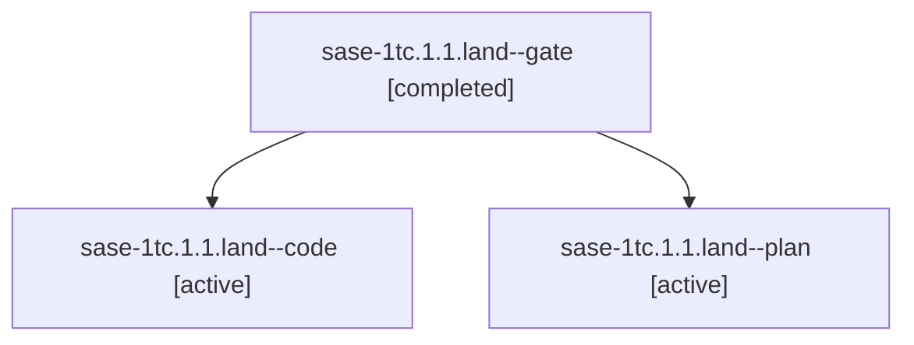

# Session: sase-1tc.1.1.land

[Agent Hoods](../README.md) / [bbugyi200](../users/bbugyi200/README.md) / [athena](../users/bbugyi200/machines/athena/README.md) / [sase-1tc](../users/bbugyi200/machines/athena/hoods/sase-1tc/README.md) / sase-1tc.1.1.land

Owner: `bbugyi200.athena` · Hood: `sase-1tc` · Members: 3 · Bead: [sase-1tc.1.1](https://github.com/sase-org/sase--beads/blob/main/pages/sase-1tc/sase-1tc.1.1.md)

## Lineage

The diagram is an optional enhancement; the ordered table below contains the same lineage in accessible text.

| Role | Agent | State | Model / provider | Timing | Commits | Prompt | Chat |
|---|---|---|---|---|---:|---|---|
| gate | sase-1tc.1.1.land--gate | completed | gpt-6-astra / codex | 2026-11-17T22:08:54.773036+00:00 → 2026-11-17T22:09:10.432186+00:00 | 0 | — | [Chat](../agents/bbugyi200.athena.sase-1tc.1.1.land--gate/chat.md) |
| code | sase-1tc.1.1.land--code | active | muse-spark-1.3-contributor / muse | 2026-11-17T22:11:04.391088+00:00 | 0 | — | — |
| plan | sase-1tc.1.1.land--plan | active | gpt-6-astra / codex | 2026-11-17T21:56:21.189208+00:00 | 0 | [Prompt](../agents/bbugyi200.athena.sase-1tc.1.1.land--plan/prompt.md) | [Chat](../agents/bbugyi200.athena.sase-1tc.1.1.land--plan/chat.md) |

## Neighbors

| Agent | Relation | State |
|---|---|---|
| [sase-1tc.1](bbugyi200.athena.sase-1tc.1.md) (session · 3) | ancestor | active 1, completed 2 |
| [sase-1tc.1.1.1](../agents/bbugyi200.athena.sase-1tc.1.1.1/README.md) | sase-1tc.1.1 hood | completed |
| [sase-1tc.1.1.2](bbugyi200.athena.sase-1tc.1.1.2.md) (session · 3) | sase-1tc.1.1 hood | completed 2, failed 1 |
| [sase-1tc.1.1.3](bbugyi200.athena.sase-1tc.1.1.3.md) (session · 3) | sase-1tc.1.1 hood | completed 2, failed 1 |
| [sase-1tc.2](../agents/bbugyi200.athena.sase-1tc.2/README.md) | sase-1tc hood | waiting |
| [sase-1tc.3](../agents/bbugyi200.athena.sase-1tc.3/README.md) | sase-1tc hood | waiting |
| [sase-1tc.4](../agents/bbugyi200.athena.sase-1tc.4/README.md) | sase-1tc hood | waiting |
| [sase-1tc.5](../agents/bbugyi200.athena.sase-1tc.5/README.md) | sase-1tc hood | waiting |
| [sase-1tc.land](../agents/bbugyi200.athena.sase-1tc.land/README.md) | sase-1tc hood | waiting |
