# Session: sase-1tc.3.1.2

[Agent Hoods](../README.md) / [bbugyi200](../users/bbugyi200/README.md) / [athena](../users/bbugyi200/machines/athena/README.md) / [sase-1tc](../users/bbugyi200/machines/athena/hoods/sase-1tc/README.md) / sase-1tc.3.1.2

Owner: `bbugyi200.athena` · Hood: `sase-1tc` · Members: 18 · Bead: [sase-1tc.3.1.2](https://github.com/sase-org/sase--beads/blob/main/pages/sase-1tc/sase-1tc.3.1.2.md)

## Lineage

```mermaid
flowchart TD
  n0["sase-1tc.3.1.2--mon-2 [failed]"]
  n1["sase-1tc.3.1.2--mon-5 [failed]"]
  n0 --> n1
  n2["sase-1tc.3.1.2--mon-7 [completed]"]
  n0 --> n2
  n3["sase-1tc.3.1.2--mon-0 [failed]"]
  n0 --> n3
  n4["sase-1tc.3.1.2--8 [completed]"]
  n0 --> n4
  n5["sase-1tc.3.1.2--2 [completed]"]
  n0 --> n5
  n6["sase-1tc.3.1.2--mon-3 [failed]"]
  n0 --> n6
  n7["sase-1tc.3.1.2--7 [completed]"]
  n0 --> n7
  n8["sase-1tc.3.1.2--3 [completed]"]
  n0 --> n8
  n9["sase-1tc.3.1.2--mon-6 [failed]"]
  n0 --> n9
  n10["sase-1tc.3.1.2--5 [completed]"]
  n0 --> n10
  n11["sase-1tc.3.1.2--mon-1 [failed]"]
  n0 --> n11
  n12["sase-1tc.3.1.2--mon-4 [failed]"]
  n0 --> n12
  n13["sase-1tc.3.1.2--1 [completed]"]
  n0 --> n13
  n14["sase-1tc.3.1.2--plan [completed]"]
  n0 --> n14
  n15["sase-1tc.3.1.2--6 [completed]"]
  n0 --> n15
  n16["sase-1tc.3.1.2--mon [failed]"]
  n0 --> n16
  n17["sase-1tc.3.1.2--4 [completed]"]
  n0 --> n17
```



The diagram is an optional enhancement; the ordered table below contains the same lineage in accessible text.

| Role | Agent | State | Model / provider | Timing | Commits | Prompt | Chat |
|---|---|---|---|---|---:|---|---|
| <a id="member-mon-2"></a>mon-2 | sase-1tc.3.1.2--mon-2 | failed | gpt-6-luna / codex | 2026-11-18T04:25:58.605718+00:00 → 2026-11-18T05:07:32.661144+00:00 | 0 | — | [Chat](../agents/bbugyi200.athena.sase-1tc.3.1.2--mon-2/chat.md) |
| <a id="member-mon-5"></a>mon-5 | sase-1tc.3.1.2--mon-5 | failed | gpt-6-luna / codex | 2026-11-18T06:40:13.505070+00:00 → 2026-11-18T06:45:22.374066+00:00 | 0 | — | [Chat](../agents/bbugyi200.athena.sase-1tc.3.1.2--mon-5/chat.md) |
| <a id="member-mon-7"></a>mon-7 | sase-1tc.3.1.2--mon-7 | completed | gpt-6-luna / codex | 2026-11-18T07:25:52.651651+00:00 → 2026-11-18T07:49:14.816836+00:00 | [1](../agents/bbugyi200.athena.sase-1tc.3.1.2--mon-7/README.md#commits) | — | [Chat](../agents/bbugyi200.athena.sase-1tc.3.1.2--mon-7/chat.md) |
| <a id="member-mon-0"></a>mon-0 | sase-1tc.3.1.2--mon-0 | failed | gpt-6-luna / codex | 2026-11-18T03:19:47.255260+00:00 → 2026-11-18T03:56:26.507879+00:00 | 0 | — | [Chat](../agents/bbugyi200.athena.sase-1tc.3.1.2--mon-0/chat.md) |
| <a id="member-8"></a>8 | sase-1tc.3.1.2--8 | completed | gpt-6-luna / codex | 2026-11-18T07:12:29.030090+00:00 → 2026-11-18T07:27:16.757664+00:00 | 0 | [Prompt](../agents/bbugyi200.athena.sase-1tc.3.1.2--8/prompt.md) | [Chat](../agents/bbugyi200.athena.sase-1tc.3.1.2--8/chat.md) |
| <a id="member-2"></a>2 | sase-1tc.3.1.2--2 | completed | gpt-6-luna / codex | 2026-11-18T03:56:26.265166+00:00 → 2026-11-18T04:03:53.543183+00:00 | 0 | [Prompt](../agents/bbugyi200.athena.sase-1tc.3.1.2--2/prompt.md) | [Chat](../agents/bbugyi200.athena.sase-1tc.3.1.2--2/chat.md) |
| <a id="member-mon-3"></a>mon-3 | sase-1tc.3.1.2--mon-3 | failed | gpt-6-luna / codex | 2026-11-18T05:46:10.818129+00:00 → 2026-11-18T06:17:14.801079+00:00 | 0 | — | [Chat](../agents/bbugyi200.athena.sase-1tc.3.1.2--mon-3/chat.md) |
| <a id="member-7"></a>7 | sase-1tc.3.1.2--7 | completed | gpt-6-luna / codex | 2026-11-18T06:45:22.196337+00:00 → 2026-11-18T06:50:00.290717+00:00 | 0 | [Prompt](../agents/bbugyi200.athena.sase-1tc.3.1.2--7/prompt.md) | [Chat](../agents/bbugyi200.athena.sase-1tc.3.1.2--7/chat.md) |
| <a id="member-3"></a>3 | sase-1tc.3.1.2--3 | completed | gpt-6-luna / codex | 2026-11-18T04:11:27.684091+00:00 → 2026-11-18T04:28:22.867119+00:00 | 0 | [Prompt](../agents/bbugyi200.athena.sase-1tc.3.1.2--3/prompt.md) | [Chat](../agents/bbugyi200.athena.sase-1tc.3.1.2--3/chat.md) |
| <a id="member-mon-6"></a>mon-6 | sase-1tc.3.1.2--mon-6 | failed | gpt-6-luna / codex | 2026-11-18T06:48:27.296137+00:00 → 2026-11-18T07:12:29.521023+00:00 | 0 | — | [Chat](../agents/bbugyi200.athena.sase-1tc.3.1.2--mon-6/chat.md) |
| <a id="member-5"></a>5 | sase-1tc.3.1.2--5 | completed | gpt-6-luna / codex | 2026-11-18T06:17:42.364553+00:00 → 2026-11-18T06:28:19.979843+00:00 | 0 | [Prompt](../agents/bbugyi200.athena.sase-1tc.3.1.2--5/prompt.md) | [Chat](../agents/bbugyi200.athena.sase-1tc.3.1.2--5/chat.md) |
| <a id="member-mon-1"></a>mon-1 | sase-1tc.3.1.2--mon-1 | failed | gpt-6-luna / codex | 2026-11-18T04:01:11.517341+00:00 → 2026-11-18T04:10:44.645197+00:00 | 0 | — | [Chat](../agents/bbugyi200.athena.sase-1tc.3.1.2--mon-1/chat.md) |
| <a id="member-mon-4"></a>mon-4 | sase-1tc.3.1.2--mon-4 | failed | gpt-6-luna / codex | 2026-11-18T06:26:55.641262+00:00 → 2026-11-18T06:35:02.771749+00:00 | 0 | — | [Chat](../agents/bbugyi200.athena.sase-1tc.3.1.2--mon-4/chat.md) |
| <a id="member-1"></a>1 | sase-1tc.3.1.2--1 | completed | gpt-6-luna / codex | 2026-11-18T03:10:29.726924+00:00 → 2026-11-18T03:21:26.570793+00:00 | 0 | [Prompt](../agents/bbugyi200.athena.sase-1tc.3.1.2--1/prompt.md) | [Chat](../agents/bbugyi200.athena.sase-1tc.3.1.2--1/chat.md) |
| <a id="member-plan"></a>plan | sase-1tc.3.1.2--plan | completed | gpt-6-luna / codex | 2026-11-18T02:21:18.751083+00:00 → 2026-11-18T03:05:31.392051+00:00 | 0 | [Prompt](../agents/bbugyi200.athena.sase-1tc.3.1.2--plan/prompt.md) | [Chat](../agents/bbugyi200.athena.sase-1tc.3.1.2--plan/chat.md) |
| <a id="member-6"></a>6 | sase-1tc.3.1.2--6 | completed | gpt-6-luna / codex | 2026-11-18T06:35:12.635590+00:00 → 2026-11-18T06:41:21.904755+00:00 | 0 | [Prompt](../agents/bbugyi200.athena.sase-1tc.3.1.2--6/prompt.md) | [Chat](../agents/bbugyi200.athena.sase-1tc.3.1.2--6/chat.md) |
| <a id="member-mon"></a>mon | sase-1tc.3.1.2--mon | failed | gpt-6-luna / codex | 2026-11-18T03:04:02.790635+00:00 → 2026-11-18T03:10:30.133901+00:00 | 0 | — | [Chat](../agents/bbugyi200.athena.sase-1tc.3.1.2--mon/chat.md) |
| <a id="member-4"></a>4 | sase-1tc.3.1.2--4 | completed | gpt-6-luna / codex | 2026-11-18T05:07:59.217437+00:00 → 2026-11-18T05:48:20.700001+00:00 | 0 | [Prompt](../agents/bbugyi200.athena.sase-1tc.3.1.2--4/prompt.md) | [Chat](../agents/bbugyi200.athena.sase-1tc.3.1.2--4/chat.md) |

## Commits

| Role | Repo | Commit | Subject | Committed |
|---|---|---|---|---|
| mon-7 | sase | [`558fbd1`](https://github.com/sase-org/sase/commit/558fbd127f0ea0f7b83c771dca98849da132590b) | feat(axe): journal ordinary chop launches at spawn boundaries | 2026-11-18 02:48:14 EST |

## Variables

| Role | Variable | Value |
|---|---|---|
| 8 | `artifacts` | \[{kind: markdown, label: Prompt bar parallel-lane failure evidence, path: /home/bryan/.sase/artifacts/agents/gh\_sase-org\_\_sase/20261118021141/sase-1tc-3-1-2-prompt-bar-flake-f48565f856d6.md, ref: fil… |

#### artifacts

**Role:** `8`

```yaml
- kind: markdown
  label: Prompt bar parallel-lane failure evidence
  path: /home/bryan/.sase/artifacts/agents/gh_sase-org__sase/20261118021141/sase-1tc-3-1-2-prompt-bar-flake-f48565f856d6.md
  ref: file:explicit:b5e36a4c8108159a2d2d821e
  source_path: /tmp/sase-1tc-3-1-2-prompt-bar-flake.md
```

Values are truncated for display; see each member's agent meta.json for the full values.

## Neighbors

| Agent | Relation | State |
|---|---|---|
| [sase-1tc.3](bbugyi200.athena.sase-1tc.3.md) (session · 3) | ancestor | active 1, completed 2 |
| [sase-1tc.3.1.1](../agents/bbugyi200.athena.sase-1tc.3.1.1/README.md) | sase-1tc.3.1 hood | completed |
| [sase-1tc.3.1.3](bbugyi200.athena.sase-1tc.3.1.3.md) (session · 8) | sase-1tc.3.1 hood | completed 5, failed 3 |
| [sase-1tc.3.1.4](bbugyi200.athena.sase-1tc.3.1.4.md) (session · 3) | sase-1tc.3.1 hood | completed 3 |
| [sase-1tc.3.1.5](../agents/bbugyi200.athena.sase-1tc.3.1.5/README.md) | sase-1tc.3.1 hood | completed |
| [sase-1tc.3.1.6.1](../agents/bbugyi200.athena.sase-1tc.3.1.6.1/README.md) | sase-1tc.3.1 hood | completed |
| [sase-1tc.3.1.6.2](../agents/bbugyi200.athena.sase-1tc.3.1.6.2/README.md) | sase-1tc.3.1 hood | completed |
| [sase-1tc.3.1.6.3](../agents/bbugyi200.athena.sase-1tc.3.1.6.3/README.md) | sase-1tc.3.1 hood | completed |
| [sase-1tc.3.1.6.4](../agents/bbugyi200.athena.sase-1tc.3.1.6.4/README.md) | sase-1tc.3.1 hood | waiting |
| [sase-1tc.3.1.6.land](../agents/bbugyi200.athena.sase-1tc.3.1.6.land/README.md) | sase-1tc.3.1 hood | waiting |
| [sase-1tc.3.1.land](bbugyi200.athena.sase-1tc.3.1.land.md) (session · 3) | sase-1tc.3.1 hood | active 1, completed 2 |
| [sase-1tc.1](bbugyi200.athena.sase-1tc.1.md) (session · 3) | sase-1tc hood | active 1, completed 2 |
| [sase-1tc.1.1.1](../agents/bbugyi200.athena.sase-1tc.1.1.1/README.md) | sase-1tc hood | completed |
| [sase-1tc.1.1.2](bbugyi200.athena.sase-1tc.1.1.2.md) (session · 3) | sase-1tc hood | completed 2, failed 1 |
| [sase-1tc.1.1.3](bbugyi200.athena.sase-1tc.1.1.3.md) (session · 3) | sase-1tc hood | completed 2, failed 1 |
| [sase-1tc.1.1.land](bbugyi200.athena.sase-1tc.1.1.land.md) (session · 3) | sase-1tc hood | completed 3 |
| [sase-1tc.2](../agents/bbugyi200.athena.sase-1tc.2/README.md) | sase-1tc hood | completed |
| [sase-1tc.4](../agents/bbugyi200.athena.sase-1tc.4/README.md) | sase-1tc hood | waiting |
| [sase-1tc.5](../agents/bbugyi200.athena.sase-1tc.5/README.md) | sase-1tc hood | waiting |
| [sase-1tc.land](../agents/bbugyi200.athena.sase-1tc.land/README.md) | sase-1tc hood | waiting |
