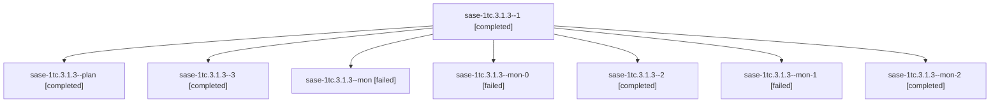

# Session: sase-1tc.3.1.3

[Agent Hoods](../README.md) / [bbugyi200](../users/bbugyi200/README.md) / [athena](../users/bbugyi200/machines/athena/README.md) / [sase-1tc](../users/bbugyi200/machines/athena/hoods/sase-1tc/README.md) / sase-1tc.3.1.3

Owner: `bbugyi200.athena` · Hood: `sase-1tc` · Members: 8 · Bead: [sase-1tc.3.1.3](https://github.com/sase-org/sase--beads/blob/main/pages/sase-1tc/sase-1tc.3.1.3.md)

## Lineage

The diagram is an optional enhancement; the ordered table below contains the same lineage in accessible text.

| Role | Agent | State | Model / provider | Timing | Commits | Prompt | Chat |
|---|---|---|---|---|---:|---|---|
| 1 | sase-1tc.3.1.3--1 | completed | gpt-6-luna / codex | 2026-11-18T08:36:55.160253+00:00 → 2026-11-18T08:40:59.881629+00:00 | 0 | [Prompt](../agents/bbugyi200.athena.sase-1tc.3.1.3--1/prompt.md) | [Chat](../agents/bbugyi200.athena.sase-1tc.3.1.3--1/chat.md) |
| plan | sase-1tc.3.1.3--plan | completed | gpt-6-luna / codex | 2026-11-18T07:50:25.379137+00:00 → 2026-11-18T08:34:11.385166+00:00 | 0 | [Prompt](../agents/bbugyi200.athena.sase-1tc.3.1.3--plan/prompt.md) | [Chat](../agents/bbugyi200.athena.sase-1tc.3.1.3--plan/chat.md) |
| 3 | sase-1tc.3.1.3--3 | completed | gpt-6-luna / codex | 2026-11-18T09:30:36.995122+00:00 → 2026-11-18T09:44:20.044593+00:00 | 0 | [Prompt](../agents/bbugyi200.athena.sase-1tc.3.1.3--3/prompt.md) | [Chat](../agents/bbugyi200.athena.sase-1tc.3.1.3--3/chat.md) |
| mon | sase-1tc.3.1.3--mon | failed | gpt-6-luna / codex | 2026-11-18T08:31:30.956635+00:00 → 2026-11-18T08:36:55.278667+00:00 | 0 | — | [Chat](../agents/bbugyi200.athena.sase-1tc.3.1.3--mon/chat.md) |
| mon-0 | sase-1tc.3.1.3--mon-0 | failed | gpt-6-luna / codex | 2026-11-18T08:39:55.736399+00:00 → 2026-11-18T09:04:46.752706+00:00 | 0 | — | [Chat](../agents/bbugyi200.athena.sase-1tc.3.1.3--mon-0/chat.md) |
| 2 | sase-1tc.3.1.3--2 | completed | gpt-6-luna / codex | 2026-11-18T09:04:46.412376+00:00 → 2026-11-18T09:10:03.684904+00:00 | 0 | [Prompt](../agents/bbugyi200.athena.sase-1tc.3.1.3--2/prompt.md) | [Chat](../agents/bbugyi200.athena.sase-1tc.3.1.3--2/chat.md) |
| mon-1 | sase-1tc.3.1.3--mon-1 | failed | gpt-6-luna / codex | 2026-11-18T09:09:03.259007+00:00 → 2026-11-18T09:30:37.513773+00:00 | 0 | — | [Chat](../agents/bbugyi200.athena.sase-1tc.3.1.3--mon-1/chat.md) |
| mon-2 | sase-1tc.3.1.3--mon-2 | completed | gpt-6-luna / codex | 2026-11-18T09:42:41.058524+00:00 → 2026-11-18T09:57:41.602202+00:00 | [1](../agents/bbugyi200.athena.sase-1tc.3.1.3--mon-2/README.md#commits) | — | [Chat](../agents/bbugyi200.athena.sase-1tc.3.1.3--mon-2/chat.md) |

## Commits

| Role | Repo | Commit | Subject | Committed |
|---|---|---|---|---|
| mon-2 | sase | [`3cf982b`](https://github.com/sase-org/sase/commit/3cf982bdff43f5ab232c668bf0a1770d9a77644a) | feat(axe): attach typed admission to durable chop batches | 2026-11-18 04:56:41 EST |

## Neighbors

| Agent | Relation | State |
|---|---|---|
| [sase-1tc.3](bbugyi200.athena.sase-1tc.3.md) (session · 3) | ancestor | active 1, completed 2 |
| [sase-1tc.3.1.1](../agents/bbugyi200.athena.sase-1tc.3.1.1/README.md) | sase-1tc.3.1 hood | completed |
| [sase-1tc.3.1.2](bbugyi200.athena.sase-1tc.3.1.2.md) (session · 18) | sase-1tc.3.1 hood | completed 10, failed 8 |
| [sase-1tc.3.1.4](../agents/bbugyi200.athena.sase-1tc.3.1.4/README.md) | sase-1tc.3.1 hood | waiting |
| [sase-1tc.3.1.5](../agents/bbugyi200.athena.sase-1tc.3.1.5/README.md) | sase-1tc.3.1 hood | waiting |
| [sase-1tc.3.1.land](../agents/bbugyi200.athena.sase-1tc.3.1.land/README.md) | sase-1tc.3.1 hood | waiting |
| [sase-1tc.1](bbugyi200.athena.sase-1tc.1.md) (session · 3) | sase-1tc hood | active 1, completed 2 |
| [sase-1tc.1.1.1](../agents/bbugyi200.athena.sase-1tc.1.1.1/README.md) | sase-1tc hood | completed |
| [sase-1tc.1.1.2](bbugyi200.athena.sase-1tc.1.1.2.md) (session · 3) | sase-1tc hood | completed 2, failed 1 |
| [sase-1tc.1.1.3](bbugyi200.athena.sase-1tc.1.1.3.md) (session · 3) | sase-1tc hood | completed 2, failed 1 |
| [sase-1tc.1.1.land](bbugyi200.athena.sase-1tc.1.1.land.md) (session · 3) | sase-1tc hood | completed 3 |
| [sase-1tc.2](../agents/bbugyi200.athena.sase-1tc.2/README.md) | sase-1tc hood | completed |
| [sase-1tc.4](../agents/bbugyi200.athena.sase-1tc.4/README.md) | sase-1tc hood | waiting |
| [sase-1tc.5](../agents/bbugyi200.athena.sase-1tc.5/README.md) | sase-1tc hood | waiting |
| [sase-1tc.land](../agents/bbugyi200.athena.sase-1tc.land/README.md) | sase-1tc hood | waiting |
