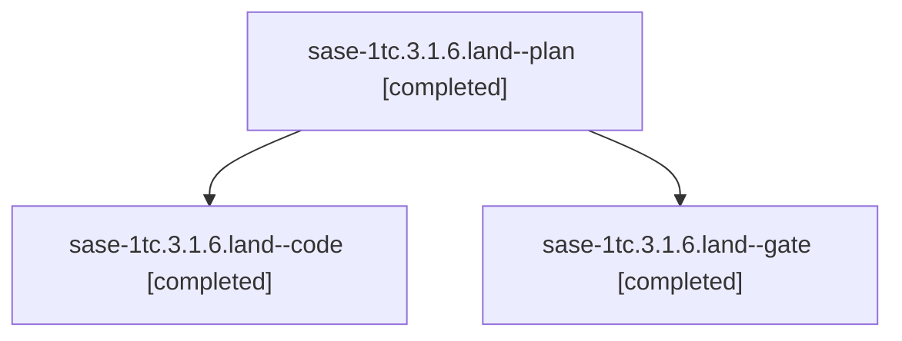

# Session: sase-1tc.3.1.6.land

[Agent Hoods](../README.md) / [bbugyi200](../users/bbugyi200/README.md) / [athena](../users/bbugyi200/machines/athena/README.md) / [sase-1tc](../users/bbugyi200/machines/athena/hoods/sase-1tc/README.md) / sase-1tc.3.1.6.land

Owner: `bbugyi200.athena` · Hood: `sase-1tc` · Members: 3 · Bead: [sase-1tc.3.1.6](https://github.com/sase-org/sase--beads/blob/main/pages/sase-1tc/sase-1tc.3.1.6.md)

## Lineage



The diagram is an optional enhancement; the ordered table below contains the same lineage in accessible text.

| Role | Agent | State | Model / provider | Timing | Commits | Prompt | Chat |
|---|---|---|---|---|---:|---|---|
| <a id="member-plan"></a>plan | sase-1tc.3.1.6.land--plan | completed | gpt-6-astra / codex | 2026-11-18T20:29:35.734544+00:00 → 2026-11-18T22:18:03.749037+00:00 | 0 | [Prompt](../agents/bbugyi200.athena.sase-1tc.3.1.6.land--plan/prompt.md) | [Chat](../agents/bbugyi200.athena.sase-1tc.3.1.6.land--plan/chat.md) |
| <a id="member-code"></a>code | sase-1tc.3.1.6.land--code | completed | muse-spark-1.3-contributor / muse | 2026-11-18T21:12:14.556272+00:00 → 2026-11-18T22:18:03.749037+00:00 | [1](../agents/bbugyi200.athena.sase-1tc.3.1.6.land--code/README.md#commits) | — | [Chat](../agents/bbugyi200.athena.sase-1tc.3.1.6.land--code/chat.md) |
| <a id="member-gate"></a>gate | sase-1tc.3.1.6.land--gate | completed | gpt-6-astra / codex | 2026-11-18T21:11:19.944616+00:00 → 2026-11-18T21:11:31.093316+00:00 | 0 | — | [Chat](../agents/bbugyi200.athena.sase-1tc.3.1.6.land--gate/chat.md) |

## Commits

| Role | Repo | Commit | Subject | Committed |
|---|---|---|---|---|
| code | — | `d3fcb19` | fix(axe): finish chop recovery safety and nested landing closeout | 2026-11-18 17:15:37 EST |

## Variables

| Role | Variable | Value |
|---|---|---|
| plan | `artifacts` | \[{bead: sase-1tc.3.1.6, kind: file, label: sase-1tc.3.1.6 landing defect reproductions, path: /home/bryan/.sase/artifacts/agents/gh\_sase-org\_\_sase/20261118072226/chop\_landing\_repro-29b9a1508a47.py, r… |

#### artifacts

**Role:** `plan`

```yaml
- bead: sase-1tc.3.1.6
  kind: file
  label: sase-1tc.3.1.6 landing defect reproductions
  path: /home/bryan/.sase/artifacts/agents/gh_sase-org__sase/20261118072226/chop_landing_repro-29b9a1508a47.py
  ref: file:explicit:1e5c251a1fc867b27e2230b1
  source_path: /home/bryan/.local/state/sase/workspaces/sase-org/sase/sase_11/.git/chop_landing_repro.py
- bead: sase-1tc.3.1.6
  kind: file
  label: ToolRun 19d8d493 reported nodes for phase .6.3 follow-up triage
  path: /home/bryan/.sase/artifacts/agents/gh_sase-org__sase/20261118072226/chop-land-prior-check-d2b291b9c89f.log
  ref: file:explicit:4aecc722ba3df33887ba80b0
  source_path: /home/bryan/.local/state/sase/workspaces/sase-org/sase/sase_11/.git/chop-land-prior-check.log
- bead: sase-1tc.3.1.6
  kind: file
  label: sase-1tc.3.1.6 four confirmed landing gaps
  path: /home/bryan/.sase/artifacts/agents/gh_sase-org__sase/20261118072226/chop-land-repro-59c36954fe1a.log
  ref: file:explicit:12427ad2e2bd1803cfb142ab
  source_path: /home/bryan/.local/state/sase/workspaces/sase-org/sase/sase_11/.git/chop-land-repro.log
- bead: sase-1tc.3.1.6
  kind: file
  label: Landing serial controls for all 25 proposed flake nodes
  path: /home/bryan/.sase/artifacts/agents/gh_sase-org__sase/20261118072226/chop-land-flake-control-b0805bb64184.log
  ref: file:explicit:daeee05e874919ec98daa999
  source_path: /home/bryan/.local/state/sase/workspaces/sase-org/sase/sase_11/.git/chop-land-flake-control.log
- bead: sase-1tc.3.1.6
  kind: file
  label: sase-1tc.3.1.6 landing focused tests: 69 passed
  path: /home/bryan/.sase/artifacts/agents/gh_sase-org__sase/20261118072226/chop-land-focused-5a9b3aade353.log
  ref: file:explicit:14eeac4f531a122f4b88ecf4
  source_path: /home/bryan/.local/state/sase/workspaces/sase-org/sase/sase_11/.git/chop-land-focused.log
```

Values are truncated for display; see each member's agent meta.json for the full values.

## Neighbors

| Agent | Relation | State |
|---|---|---|
| [sase-1tc.3](bbugyi200.athena.sase-1tc.3.md) (session · 3) | ancestor | active 1, completed 2 |
| [sase-1tc.3.1.6.1](../agents/bbugyi200.athena.sase-1tc.3.1.6.1/README.md) | sase-1tc.3.1.6 hood | completed |
| [sase-1tc.3.1.6.2](../agents/bbugyi200.athena.sase-1tc.3.1.6.2/README.md) | sase-1tc.3.1.6 hood | completed |
| [sase-1tc.3.1.6.3](../agents/bbugyi200.athena.sase-1tc.3.1.6.3/README.md) | sase-1tc.3.1.6 hood | completed |
| [sase-1tc.3.1.6.4](../agents/bbugyi200.athena.sase-1tc.3.1.6.4/README.md) | sase-1tc.3.1.6 hood | completed |
| [sase-1tc.3.1.1](../agents/bbugyi200.athena.sase-1tc.3.1.1/README.md) | sase-1tc.3.1 hood | completed |
| [sase-1tc.3.1.2](bbugyi200.athena.sase-1tc.3.1.2.md) (session · 18) | sase-1tc.3.1 hood | completed 10, failed 8 |
| [sase-1tc.3.1.3](bbugyi200.athena.sase-1tc.3.1.3.md) (session · 8) | sase-1tc.3.1 hood | completed 5, failed 3 |
| [sase-1tc.3.1.4](bbugyi200.athena.sase-1tc.3.1.4.md) (session · 3) | sase-1tc.3.1 hood | completed 3 |
| [sase-1tc.3.1.5](../agents/bbugyi200.athena.sase-1tc.3.1.5/README.md) | sase-1tc.3.1 hood | completed |
| [sase-1tc.3.1.land](bbugyi200.athena.sase-1tc.3.1.land.md) (session · 3) | sase-1tc.3.1 hood | completed 2, dismissed 1 |
| [sase-1tc.1](bbugyi200.athena.sase-1tc.1.md) (session · 3) | sase-1tc hood | active 1, completed 2 |
| [sase-1tc.1.1.1](../agents/bbugyi200.athena.sase-1tc.1.1.1/README.md) | sase-1tc hood | completed |
| [sase-1tc.1.1.2](bbugyi200.athena.sase-1tc.1.1.2.md) (session · 3) | sase-1tc hood | completed 2, failed 1 |
| [sase-1tc.1.1.3](bbugyi200.athena.sase-1tc.1.1.3.md) (session · 3) | sase-1tc hood | completed 2, failed 1 |
| [sase-1tc.1.1.land](bbugyi200.athena.sase-1tc.1.1.land.md) (session · 3) | sase-1tc hood | completed 3 |
| [sase-1tc.2](../agents/bbugyi200.athena.sase-1tc.2/README.md) | sase-1tc hood | completed |
| [sase-1tc.4](bbugyi200.athena.sase-1tc.4.md) (session · 6) | sase-1tc hood | completed 5, failed 1 |
| [sase-1tc.5](bbugyi200.athena.sase-1tc.5.md) (session · 3) | sase-1tc hood | active 1, completed 2 |
| [sase-1tc.5.1.1](bbugyi200.athena.sase-1tc.5.1.1.md) (session · 3) | sase-1tc hood | completed 3 |
| [sase-1tc.5.1.2](../agents/bbugyi200.athena.sase-1tc.5.1.2/README.md) | sase-1tc hood | waiting |
| [sase-1tc.5.1.land](../agents/bbugyi200.athena.sase-1tc.5.1.land/README.md) | sase-1tc hood | waiting |
| [sase-1tc.land](../agents/bbugyi200.athena.sase-1tc.land/README.md) | sase-1tc hood | waiting |
