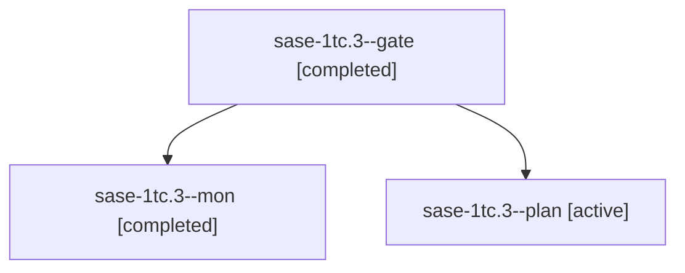

# Session: sase-1tc.3

[Agent Hoods](../README.md) / [bbugyi200](../users/bbugyi200/README.md) / [athena](../users/bbugyi200/machines/athena/README.md) / [sase-1tc](../users/bbugyi200/machines/athena/hoods/sase-1tc/README.md) / sase-1tc.3

Owner: `bbugyi200.athena` · Hood: `sase-1tc` · Members: 3 · Bead: [sase-1tc.3](https://github.com/sase-org/sase--beads/blob/main/pages/sase-1tc/sase-1tc.3.md)

## Lineage

The diagram is an optional enhancement; the ordered table below contains the same lineage in accessible text.

| Role | Agent | State | Model / provider | Timing | Commits | Prompt | Chat |
|---|---|---|---|---|---:|---|---|
| gate | sase-1tc.3--gate | completed | gpt-6-astra / codex | 2026-11-18T00:15:38.746928+00:00 → 2026-11-18T00:16:03.771001+00:00 | 0 | — | [Chat](../agents/bbugyi200.athena.sase-1tc.3--gate/chat.md) |
| mon | sase-1tc.3--mon | completed | gpt-6-astra / codex | 2026-11-18T00:16:02.404158+00:00 → 2026-11-18T00:19:43.328135+00:00 | 0 | — | [Chat](../agents/bbugyi200.athena.sase-1tc.3--mon/chat.md) |
| plan | sase-1tc.3--plan | active | gpt-6-astra / codex | 2026-11-18T00:06:34.893064+00:00 → 2026-11-18T00:16:12.010078+00:00 | 0 | [Prompt](../agents/bbugyi200.athena.sase-1tc.3--plan/prompt.md) | [Chat](../agents/bbugyi200.athena.sase-1tc.3--plan/chat.md) |

## Neighbors

| Agent | Relation | State |
|---|---|---|
| [sase-1tc.3.1.1](../agents/bbugyi200.athena.sase-1tc.3.1.1/README.md) | descendant | completed |
| [sase-1tc.3.1.2](bbugyi200.athena.sase-1tc.3.1.2.md) (session · 18) | descendant | completed 10, failed 8 |
| [sase-1tc.3.1.3](bbugyi200.athena.sase-1tc.3.1.3.md) (session · 8) | descendant | completed 5, failed 3 |
| [sase-1tc.3.1.4](bbugyi200.athena.sase-1tc.3.1.4.md) (session · 3) | descendant | completed 3 |
| [sase-1tc.3.1.5](../agents/bbugyi200.athena.sase-1tc.3.1.5/README.md) | descendant | completed |
| [sase-1tc.3.1.land](../agents/bbugyi200.athena.sase-1tc.3.1.land/README.md) | descendant | waiting |
| [sase-1tc.1](bbugyi200.athena.sase-1tc.1.md) (session · 3) | sase-1tc hood | active 1, completed 2 |
| [sase-1tc.1.1.1](../agents/bbugyi200.athena.sase-1tc.1.1.1/README.md) | sase-1tc hood | completed |
| [sase-1tc.1.1.2](bbugyi200.athena.sase-1tc.1.1.2.md) (session · 3) | sase-1tc hood | completed 2, failed 1 |
| [sase-1tc.1.1.3](bbugyi200.athena.sase-1tc.1.1.3.md) (session · 3) | sase-1tc hood | completed 2, failed 1 |
| [sase-1tc.1.1.land](bbugyi200.athena.sase-1tc.1.1.land.md) (session · 3) | sase-1tc hood | completed 3 |
| [sase-1tc.2](../agents/bbugyi200.athena.sase-1tc.2/README.md) | sase-1tc hood | completed |
| [sase-1tc.4](../agents/bbugyi200.athena.sase-1tc.4/README.md) | sase-1tc hood | waiting |
| [sase-1tc.5](../agents/bbugyi200.athena.sase-1tc.5/README.md) | sase-1tc hood | waiting |
| [sase-1tc.land](../agents/bbugyi200.athena.sase-1tc.land/README.md) | sase-1tc hood | waiting |
