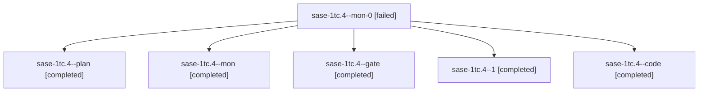

# Session: sase-1tc.4

[Agent Hoods](../README.md) / [bbugyi200](../users/bbugyi200/README.md) / [athena](../users/bbugyi200/machines/athena/README.md) / [sase-1tc](../users/bbugyi200/machines/athena/hoods/sase-1tc/README.md) / sase-1tc.4

Owner: `bbugyi200.athena` · Hood: `sase-1tc` · Members: 6 · Bead: [sase-1tc.4](https://github.com/sase-org/sase--beads/blob/main/pages/sase-1tc/sase-1tc.4.md)

## Lineage

The diagram is an optional enhancement; the ordered table below contains the same lineage in accessible text.

| Role | Agent | State | Model / provider | Timing | Commits | Prompt | Chat |
|---|---|---|---|---|---:|---|---|
| mon-0 | sase-1tc.4--mon-0 | failed | muse-spark-1.3-contributor / muse | 2026-11-19T11:16:24.233395+00:00 → 2026-11-19T11:16:24.913763+00:00 | 0 | — | — |
| plan | sase-1tc.4--plan | completed | gpt-6-astra / codex | 2026-11-19T12:58:07.332184+00:00 → 2026-11-19T13:27:28.731481+00:00 | 0 | [Prompt](../agents/bbugyi200.athena.sase-1tc.4--plan/prompt.md) | [Chat](../agents/bbugyi200.athena.sase-1tc.4--plan/chat.md) |
| mon | sase-1tc.4--mon | completed | muse-spark-1.3-contributor / muse | 2026-11-19T13:25:51.651561+00:00 → 2026-11-19T14:01:54.410519+00:00 | 0 | — | [Chat](../agents/bbugyi200.athena.sase-1tc.4--mon/chat.md) |
| gate | sase-1tc.4--gate | completed | gpt-6-astra / codex | 2026-11-19T13:04:52.202136+00:00 → 2026-11-19T13:05:00.519361+00:00 | 0 | — | [Chat](../agents/bbugyi200.athena.sase-1tc.4--gate/chat.md) |
| 1 | sase-1tc.4--1 | completed | muse-spark-1.3-contributor / muse | 2026-11-19T14:02:07.702940+00:00 → 2026-11-19T14:06:32.791224+00:00 | [1](../agents/bbugyi200.athena.sase-1tc.4--1/README.md#commits) | [Prompt](../agents/bbugyi200.athena.sase-1tc.4--1/prompt.md) | [Chat](../agents/bbugyi200.athena.sase-1tc.4--1/chat.md) |
| code | sase-1tc.4--code | completed | muse-spark-1.3-contributor / muse | 2026-11-19T13:05:41.411962+00:00 → 2026-11-19T13:27:28.731481+00:00 | 0 | — | [Chat](../agents/bbugyi200.athena.sase-1tc.4--code/chat.md) |

## Commits

| Role | Repo | Commit | Subject | Committed |
|---|---|---|---|---|
| — | sase | [`5b79f0f`](https://github.com/sase-org/sase/commit/5b79f0f5e37237e07b48088c4079dc04082453e1) | feat(beads): retire Python beads.db SQLite mirror | 2026-11-19 06:27:33 EST |
| 1 | sase | [`c4cb77b`](https://github.com/sase-org/sase/commit/c4cb77b3b88a86554a9f980f6f0e3e5f38449ccf) | test(beads): single-owner WAL-mirror adoption and exact SQLite owner guard | 2026-11-19 09:05:22 EST |

## Neighbors

| Agent | Relation | State |
|---|---|---|
| [sase-1tc.1](bbugyi200.athena.sase-1tc.1.md) (session · 3) | sase-1tc hood | active 1, completed 2 |
| [sase-1tc.1.1.1](../agents/bbugyi200.athena.sase-1tc.1.1.1/README.md) | sase-1tc hood | completed |
| [sase-1tc.1.1.2](bbugyi200.athena.sase-1tc.1.1.2.md) (session · 3) | sase-1tc hood | completed 2, failed 1 |
| [sase-1tc.1.1.3](bbugyi200.athena.sase-1tc.1.1.3.md) (session · 3) | sase-1tc hood | completed 2, failed 1 |
| [sase-1tc.1.1.land](bbugyi200.athena.sase-1tc.1.1.land.md) (session · 3) | sase-1tc hood | completed 3 |
| [sase-1tc.2](../agents/bbugyi200.athena.sase-1tc.2/README.md) | sase-1tc hood | completed |
| [sase-1tc.3](bbugyi200.athena.sase-1tc.3.md) (session · 3) | sase-1tc hood | active 1, completed 2 |
| [sase-1tc.3.1.1](../agents/bbugyi200.athena.sase-1tc.3.1.1/README.md) | sase-1tc hood | completed |
| [sase-1tc.3.1.2](bbugyi200.athena.sase-1tc.3.1.2.md) (session · 18) | sase-1tc hood | completed 10, failed 8 |
| [sase-1tc.3.1.3](bbugyi200.athena.sase-1tc.3.1.3.md) (session · 8) | sase-1tc hood | completed 5, failed 3 |
| [sase-1tc.3.1.4](bbugyi200.athena.sase-1tc.3.1.4.md) (session · 3) | sase-1tc hood | completed 3 |
| [sase-1tc.3.1.5](../agents/bbugyi200.athena.sase-1tc.3.1.5/README.md) | sase-1tc hood | completed |
| [sase-1tc.3.1.6.1](../agents/bbugyi200.athena.sase-1tc.3.1.6.1/README.md) | sase-1tc hood | completed |
| [sase-1tc.3.1.6.2](../agents/bbugyi200.athena.sase-1tc.3.1.6.2/README.md) | sase-1tc hood | completed |
| [sase-1tc.3.1.6.3](../agents/bbugyi200.athena.sase-1tc.3.1.6.3/README.md) | sase-1tc hood | completed |
| [sase-1tc.3.1.6.4](../agents/bbugyi200.athena.sase-1tc.3.1.6.4/README.md) | sase-1tc hood | completed |
| [sase-1tc.3.1.6.land](bbugyi200.athena.sase-1tc.3.1.6.land.md) (session · 3) | sase-1tc hood | completed 3 |
| [sase-1tc.3.1.land](bbugyi200.athena.sase-1tc.3.1.land.md) (session · 3) | sase-1tc hood | completed 2, dismissed 1 |
| [sase-1tc.5](bbugyi200.athena.sase-1tc.5.md) (session · 3) | sase-1tc hood | active 1, completed 2 |
| [sase-1tc.5.1.1](bbugyi200.athena.sase-1tc.5.1.1.md) (session · 3) | sase-1tc hood | completed 3 |
| [sase-1tc.5.1.2](../agents/bbugyi200.athena.sase-1tc.5.1.2/README.md) | sase-1tc hood | completed |
| [sase-1tc.5.1.land](../agents/bbugyi200.athena.sase-1tc.5.1.land/README.md) | sase-1tc hood | completed |
| [sase-1tc.land](../agents/bbugyi200.athena.sase-1tc.land/README.md) | sase-1tc hood | waiting |
