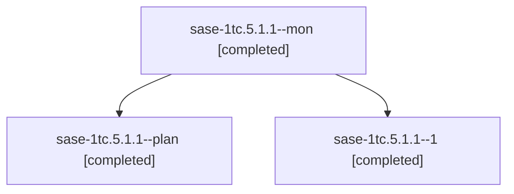

# Session: sase-1tc.5.1.1

[Agent Hoods](../README.md) / [bbugyi200](../users/bbugyi200/README.md) / [athena](../users/bbugyi200/machines/athena/README.md) / [sase-1tc](../users/bbugyi200/machines/athena/hoods/sase-1tc/README.md) / sase-1tc.5.1.1

Owner: `bbugyi200.athena` · Hood: `sase-1tc` · Members: 3 · Bead: [sase-1tc.5.1.1](https://github.com/sase-org/sase--beads/blob/main/pages/sase-1tc/sase-1tc.5.1.1.md)

## Lineage

The diagram is an optional enhancement; the ordered table below contains the same lineage in accessible text.

| Role | Agent | State | Model / provider | Timing | Commits | Prompt | Chat |
|---|---|---|---|---|---:|---|---|
| mon | sase-1tc.5.1.1--mon | completed | muse-spark-1.3-contributor / muse | 2026-11-19T14:41:32.118584+00:00 → 2026-11-19T16:26:33.279094+00:00 | 0 | — | [Chat](../agents/bbugyi200.athena.sase-1tc.5.1.1--mon/chat.md) |
| plan | sase-1tc.5.1.1--plan | completed | muse-spark-1.3-contributor / muse | 2026-11-19T14:17:36.628688+00:00 → 2026-11-19T16:08:35.056256+00:00 | 0 | [Prompt](../agents/bbugyi200.athena.sase-1tc.5.1.1--plan/prompt.md) | [Chat](../agents/bbugyi200.athena.sase-1tc.5.1.1--plan/chat.md) |
| 1 | sase-1tc.5.1.1--1 | completed | muse-spark-1.3-contributor / muse | 2026-11-19T16:26:32.867158+00:00 → 2026-11-19T16:30:51.118074+00:00 | [1](../agents/bbugyi200.athena.sase-1tc.5.1.1--1/README.md#commits) | [Prompt](../agents/bbugyi200.athena.sase-1tc.5.1.1--1/prompt.md) | [Chat](../agents/bbugyi200.athena.sase-1tc.5.1.1--1/chat.md) |

## Commits

| Role | Repo | Commit | Subject | Committed |
|---|---|---|---|---|
| 1 | sase | [`d9cb9cf`](https://github.com/sase-org/sase/commit/d9cb9cf4a3d8c620464e27f32a882d42580b9b14) | test(triage): add settle owner-enrichment binding regression | 2026-11-19 11:29:42 EST |

## Neighbors

| Agent | Relation | State |
|---|---|---|
| [sase-1tc.5](bbugyi200.athena.sase-1tc.5.md) (session · 3) | ancestor | active 1, completed 2 |
| [sase-1tc.5.1.2](../agents/bbugyi200.athena.sase-1tc.5.1.2/README.md) | sase-1tc.5.1 hood | completed |
| [sase-1tc.5.1.land](../agents/bbugyi200.athena.sase-1tc.5.1.land/README.md) | sase-1tc.5.1 hood | waiting |
| [sase-1tc.1](bbugyi200.athena.sase-1tc.1.md) (session · 3) | sase-1tc hood | active 1, completed 2 |
| [sase-1tc.1.1.1](../agents/bbugyi200.athena.sase-1tc.1.1.1/README.md) | sase-1tc hood | completed |
| [sase-1tc.1.1.2](bbugyi200.athena.sase-1tc.1.1.2.md) (session · 3) | sase-1tc hood | completed 2, failed 1 |
| [sase-1tc.1.1.3](bbugyi200.athena.sase-1tc.1.1.3.md) (session · 3) | sase-1tc hood | completed 2, failed 1 |
| [sase-1tc.1.1.land](bbugyi200.athena.sase-1tc.1.1.land.md) (session · 3) | sase-1tc hood | completed 3 |
| [sase-1tc.2](../agents/bbugyi200.athena.sase-1tc.2/README.md) | sase-1tc hood | completed |
| [sase-1tc.3](bbugyi200.athena.sase-1tc.3.md) (session · 3) | sase-1tc hood | active 1, completed 2 |
| [sase-1tc.3.1.1](../agents/bbugyi200.athena.sase-1tc.3.1.1/README.md) | sase-1tc hood | completed |
| [sase-1tc.3.1.2](bbugyi200.athena.sase-1tc.3.1.2.md) (session · 18) | sase-1tc hood | completed 10, failed 8 |
| [sase-1tc.3.1.3](bbugyi200.athena.sase-1tc.3.1.3.md) (session · 8) | sase-1tc hood | completed 5, failed 3 |
| [sase-1tc.3.1.4](bbugyi200.athena.sase-1tc.3.1.4.md) (session · 3) | sase-1tc hood | completed 3 |
| [sase-1tc.3.1.5](../agents/bbugyi200.athena.sase-1tc.3.1.5/README.md) | sase-1tc hood | completed |
| [sase-1tc.3.1.6.1](../agents/bbugyi200.athena.sase-1tc.3.1.6.1/README.md) | sase-1tc hood | completed |
| [sase-1tc.3.1.6.2](../agents/bbugyi200.athena.sase-1tc.3.1.6.2/README.md) | sase-1tc hood | completed |
| [sase-1tc.3.1.6.3](../agents/bbugyi200.athena.sase-1tc.3.1.6.3/README.md) | sase-1tc hood | completed |
| [sase-1tc.3.1.6.4](../agents/bbugyi200.athena.sase-1tc.3.1.6.4/README.md) | sase-1tc hood | completed |
| [sase-1tc.3.1.6.land](bbugyi200.athena.sase-1tc.3.1.6.land.md) (session · 3) | sase-1tc hood | completed 3 |
| [sase-1tc.3.1.land](bbugyi200.athena.sase-1tc.3.1.land.md) (session · 3) | sase-1tc hood | completed 2, dismissed 1 |
| [sase-1tc.4](bbugyi200.athena.sase-1tc.4.md) (session · 6) | sase-1tc hood | completed 5, failed 1 |
| [sase-1tc.land](../agents/bbugyi200.athena.sase-1tc.land/README.md) | sase-1tc hood | waiting |
